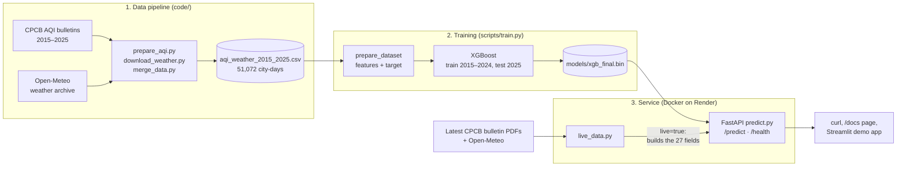

# Next-Day AQI Forecast for 14 Indian Cities

Forecasts **tomorrow's air-quality category** (Good to Severe, as defined by India's Central Pollution Control Board, CPCB) for 14 cities, from today's AQI, its 7-day trend, the prominent pollutants, the weather and the month. Served as a REST API that can also build its own input from the latest CPCB bulletin.

| | |
|---|---|
| **API** | https://aqi-forcasting-2.onrender.com · interactive docs at [`/docs`](https://aqi-forcasting-2.onrender.com/docs) |
| **Demo app** | https://aqi-forcasting-v1.streamlit.app ([source](https://github.com/shohbitgupta/aqi_forcasting_ui)) |
| **Context** | DataTalks.Club ML Zoomcamp midterm project · [problem statement](problem_statement.pdf) |

## Contents

[Overview](#overview) · [Results](#results) · [Quick start](#quick-start) · [Architecture](#architecture) · [Data](#data) · [Approach](#approach) · [Accuracy experiments](#accuracy-experiments) · [Running locally](#running-locally) · [Deployment](#deployment) · [Live forecasts](#how-live-forecasts-work) · [Project structure](#project-structure) · [Limitations](#limitations) · [Next steps](#next-steps) · [Licences](#data-licences)

## Overview

Air-quality dashboards in India report what the air is like *now*; by the time the AQI reads "Severe", people have already been exposed. A next-day forecast lets people plan outdoor activity, schools decide on closures, hospitals prepare and authorities start pollution controls (Delhi's GRAP) **before** the peak.

The task is **multi-class classification**: one of six CPCB categories for the next day.

| AQI | 0–50 | 51–100 | 101–200 | 201–300 | 301–400 | 401–500 |
|---|---|---|---|---|---|---|
| **Category** | Good | Satisfactory | Moderate | Poor | Very Poor | Severe |

For a city, the service returns the **most likely category**, the **probability of every category**, the chance of a **Severe** day and of a **Dangerous** day (Very Poor or Severe), and an **alert** whose threshold each user can set.

**Success criterion:** beat persistence, the forecast "tomorrow = today", on the metrics below. Persistence is right on about 70% of days, because the air usually stays in the same category, so it is a hard baseline to beat.

### Evaluation metrics

The classes are **imbalanced**: Severe is 2.4% of days, and Very Poor or Severe ("Dangerous") about 1 in 8 (11.8%); in the 2025 test year they are 0.9% and 6%. A model that never forecast Severe would still look good on accuracy, so the metrics focus on precision and recall:

| Metric | What it measures | Why |
|---|---|---|
| **Macro F1** (main metric) | F1 (precision and recall combined) for each category, averaged so the six count equally | Rare categories weigh as much as common ones; used to compare and choose the models |
| **Dangerous recall** | Share of Very Poor or Severe days that were forecast as such | A missed dangerous day is the costly error |
| **Dangerous precision** | Share of Very Poor or Severe forecasts that were right | Too many false alarms and people stop trusting the alert |
| **Dangerous PR AUC** (average precision) | How well P(Dangerous) ranks the risky days, at every alert threshold | The alert threshold can be set by each user; guessing scores the share of dangerous days (0.06), not 0.5 |

Accuracy and ROC AUC are reported for comparison only: both are dominated by the many ordinary days. PR AUC was added for the final test; models were chosen on macro F1 over five validation years, with ROC AUC as the ranking check.

## Results

Final model: **XGBoost**, trained on 2015–2024 and scored **once** on the held-out year 2025 (4,877 city-days).

| 2025 test | Persistence | **XGBoost** |
|---|---|---|
| **Macro F1** (main metric) | 0.659 | **0.671** |
| Dangerous days caught (recall) | 76.5% | **82.7%** |
| Dangerous alerts that were right (precision) | 77.9% | 77.6% |
| Dangerous PR AUC (guessing: 0.06) | 0.610 | **0.892** |
| Right on days the category changed | 0% | **28.1%** |
| Accuracy (for comparison) | 73.3% | **75.1%** |
| Macro ROC AUC (for comparison) | 0.797 | **0.952** |

- It beat persistence in **each of the five validation years** (2019–2023, rolling validation).
- **Live check**, 31 days in October 2026 built from the CPCB bulletins exactly as the service does: 71.4% accuracy against 69.1% for persistence.
- **Strength:** it ranks risky days well (Dangerous PR AUC 0.892 against 0.610 for persistence), so a user can lower the alert threshold to catch more dangerous days and the alerts stay mostly right: with `dangerous_threshold=0.3`, 90% of dangerous days are caught and 67% of alerts are right (82.7% and 77.6% at the default). **Weaknesses:** it catches only about 3 in 10 category changes, and Severe on its own is hard (precision 0.54, recall 0.58); see [Limitations](#limitations).
- `python scripts/train.py` prints all of these, plus precision, recall and F1 for each category, the confusion matrix and the log loss, the quantity the model is trained to minimise (0.579 on 2025; 1.357 for guessing each category's share of days).

## Quick start

Try the deployed service (the free server sleeps when idle: the first request can take up to a minute):

```bash
# Today's latest data for a city: the service fetches the CPCB bulletins and weather itself
curl -X POST "https://aqi-forcasting-2.onrender.com/predict?live=true" \
     -H "Content-Type: application/json" -d '{"city": "Delhi"}'

# Your own input: one city-day's 27 fields (see demo.json)
curl -X POST https://aqi-forcasting-2.onrender.com/predict \
     -H "Content-Type: application/json" -d @demo.json
```

```json
{
  "city": "Noida",
  "forecast": "Poor",
  "p_severe": 0.0015,
  "p_dangerous": 0.1081,
  "probabilities": {"Good": 0.0001, "Satisfactory": 0.0072, "Moderate": 0.1741,
                    "Poor": 0.7105, "Very Poor": 0.1065, "Severe": 0.0015},
  "alert": false,
  "alert_rule": "forecast is below Very Poor"
}
```

Or open the [demo app](https://aqi-forcasting-v1.streamlit.app): pick a city, see the forecast, today's check against CPCB and a what-if on the weather.

## Architecture



1. **Data:** `code/` downloads the CPCB bulletins and the weather and merges them into one row per city per day.
2. **Training:** `train.py` applies the EDA decisions (`prepare_dataset` in `utility.py`), trains XGBoost on 2015–2024, scores 2025 once and saves the model with its feature list.
3. **Service:** the FastAPI app loads the model once at start-up. A request either sends the 27 fields, or `live=true` with a city, and then `live_data.py` builds the same 27 fields from the latest CPCB bulletins and weather. The app runs in Docker on Render; the [demo app](https://aqi-forcasting-v1.streamlit.app) is a separate client of the same API.

## Data

One row per city per day, May 2015 to December 2025: **51,072 city-days**, 48,632 after preparation.

| Region | Cities |
|---|---|
| Delhi NCR | Delhi, Noida, Greater Noida, Ghaziabad, Gurugram, Faridabad |
| Indo-Gangetic Plain | Lucknow, Kanpur, Patna |
| Other metros | Mumbai, Kolkata, Chennai, Bengaluru, Hyderabad |

Each row holds the day's AQI and category, the prominent pollutants and the daily weather (temperature, humidity, dew point, rain, pressure, cloud cover, wind speed and direction).

| Data | Source |
|---|---|
| Daily AQI bulletins, 2015–2025 (training) | CPCB, compiled by Urban Emissions: [urbanemissionsinfo/AQI_bulletins](https://github.com/urbanemissionsinfo/AQI_bulletins) |
| Daily weather, from hourly values | [Open-Meteo](https://open-meteo.com/) Historical Weather API |
| Recent daily bulletins (live forecasts only) | [CPCB](https://cpcb.gov.in/) bulletin PDFs, downloaded on demand, not stored in git |

The data is committed, so everything runs after cloning; `code/` rebuilds it from the sources (see [Rebuilding the data](#rebuilding-the-data)).

## Approach

**Exploratory data analysis** ([`notebooks/eda.ipynb`](notebooks/eda.ipynb), decisions in [`docs/EDA_Decision_Document.pdf`](docs/EDA_Decision_Document.pdf)):
- The target is built from the **AQI number**, not the text label (56 labels disagree with their own value).
- Gaps of up to 3 days are filled with the last known value; longer gaps are dropped; the target is never filled.
- Classes are imbalanced (Severe is 2.4% of days), so models are compared on **macro F1** and on **Very Poor and Severe recall and precision**, not accuracy ([Evaluation metrics](#evaluation-metrics)).
- Today's AQI is by far the strongest signal (Spearman ρ 0.88); seasonality is strong (10.4% of November days are Severe).
- Outliers are real pollution episodes and are kept.

**Features** ([`notebooks/aqi_prediction.ipynb`](notebooks/aqi_prediction.ipynb)): today's AQI; its 7-day mean and spread, change since yesterday and deviation from the previous week; one flag per prominent pollutant and one for a filled day; 13 weather values; month; city. 27 inputs in total. Logistic regression also gets four transformed features (pressure relative to the city's normal, log of rain, month as sin/cos); the tree models and the final model use the raw columns ([`docs/feature_transformation_notes.md`](docs/feature_transformation_notes.md)).

**Validation:** always by time, so a model is tested only on days after the ones it learned from. Tuned on 2015–2022 with 2023 for validation, confirmed with rolling validation over 2019–2023, and tested once on 2025.

**Models:**

| Model | Chosen settings | Macro F1, 2019–2023 | Years ahead of persistence | Macro ROC AUC |
|---|---|---|---|---|
| Persistence | – | 0.634 | – | – |
| Logistic regression | `C` = 1 | 0.613 | 1 of 5 | 0.935 |
| Decision tree | depth 10, leaf 100 | 0.631 | 3 of 5 | 0.930 |
| Random forest | 200 trees, `max_features` 0.5, leaf 5, balanced | **0.664** | 5 of 5 | 0.940 |
| **XGBoost** | depth 3, `min_child_weight` 10, 628 rounds | 0.655 | **5 of 5** | **0.942** |

**XGBoost was chosen:** it beats persistence in every year, ranks risky days best, and its file is 27 times smaller than the random forest's (4 MB vs 114 MB). Details: [`docs/model_comparison.md`](docs/model_comparison.md) and [`docs/model_decisions.md`](docs/model_decisions.md).

## Accuracy experiments

Five ideas to raise overall accuracy were tested under the same rules ([`docs/accuracy_experiments.md`](docs/accuracy_experiments.md)):

| Idea | Effect on accuracy |
|---|---|
| Weight recent years more | +0.2 (validation), +0.7 (2025), +0.9 (live) points |
| Forecast the AQI number, then the category | −0.3 points |
| AQI 2–3 days ago | +0.1 points |
| Weather on the bulletin's 4 PM-to-4 PM window instead of the calendar day (5 NCR cities) | −1.5 points: the calendar day's evening hours already act as a short-range forecast |
| Perfect knowledge of tomorrow's weather (upper bound, not deployable) | +1.1 points |

**The limit is the data, not the model:** tomorrow's AQI cannot be forecast to better than about 20 points from these inputs, which caps category accuracy in the low-to-mid 70s. The model is kept as it is, so 2025 stays an untouched test year; recency weighting is planned for the next yearly retrain.

**Why Poor, Very Poor and Severe get confused.** Tested directly: on polluted days tomorrow's AQI moves about 34 points a day (a category is 100 wide), and **days that look identical in every input end in a different category 32% of the time** (a Severe day's look-alike is Severe only 46% of the time). More training data and a much bigger model do not help; fewer monitoring stations mean more errors. So the confusion is a **data issue, missing information**: it needs inputs such as tomorrow's weather forecast, crop-fire activity or festival dates.

**Conclusion.** The model is at the limit of this data: every model type, setting and feature built from it lands within about a point, and the limit is **information**, not the model or the amount of data. The way forward is new sources (an archive of past weather forecasts, crop-fire counts, festival dates), each expected to add about a point at most overall. The current model stays: on 2025 it beats persistence on macro F1 (0.671 against 0.659), catches 82.7% of Very Poor or Severe days (against 76.5%) and is right on 75.1% of days (against 73.3%).

## Running locally

### Verify in 5 minutes

From a fresh clone to the API answering, locally and in Docker. Needs [uv](https://docs.astral.sh/uv/) and Docker; timed at about 2 minutes of commands on a laptop.

```bash
git clone https://github.com/shohbitgupta/aqi_forcasting.git && cd aqi_forcasting
uv sync && source .venv/bin/activate            # Python 3.13 and the pinned packages (~10 s)
python scripts/train.py                         # reproduces the Results table on 2025 (under a minute)

uvicorn predict:app --app-dir scripts --port 8080 &   # the API, in the background
sleep 5 && curl -X POST localhost:8080/predict -H "Content-Type: application/json" -d @demo.json
kill %1                                         # stop it, freeing port 8080

docker build -t aqi-forecast .                  # ~30 s
docker run -d --rm --name aqi -p 8080:8080 aqi-forecast
sleep 5 && curl -X POST localhost:8080/predict -H "Content-Type: application/json" -d @demo.json
docker stop aqi
```

Both requests return Noida, **Poor**, P(Dangerous) 0.1081, as in [Quick start](#quick-start). The sections below explain each step.

### Setup

Requires [uv](https://docs.astral.sh/uv/); Python 3.13 is installed by uv if needed.

```bash
git clone https://github.com/shohbitgupta/aqi_forcasting.git
cd aqi_forcasting
uv sync                          # creates .venv with the exact versions in uv.lock
source .venv/bin/activate        # Windows: .venv\Scripts\activate
```

- The model is a pickle, so library versions are pinned to the ones it was trained with.
- The experiment models in `experiments/models/` are stored with [Git LFS](https://git-lfs.com/): run `git lfs install` before cloning to rerun notebooks 5–8 (without it they are small text placeholders). Training, the service and Docker do not need them.
- `uv sync --no-dev` installs only what the service and the command line need; the notebooks need the default `uv sync`.
- For the notebooks: `python -m ipykernel install --user --name aqi-forecasting`, then open them in VS Code or `uv run --with jupyter jupyter lab`.
- Without uv: `python3.13 -m venv .venv && source .venv/bin/activate && pip install -r requirements.txt` installs the same pinned versions for the service and the command line (not the notebooks). The file is generated from uv.lock; after changing dependencies, regenerate it with `uv export --no-dev --no-hashes --no-emit-project --format requirements-txt > requirements.txt`.
- macOS: if XGBoost fails with `libomp.dylib could not be loaded`, run `brew install libomp`.

### Reproduce the results

```bash
python scripts/train.py          # trains on 2015-2024, scores 2025 once, saves models/xgb_final.bin (under a minute)
```

The notebooks run in this order, since later experiments load the models saved by earlier ones in `experiments/models/`. Executed copies with every output are in [`outputs/`](outputs/).

| # | Notebook | Purpose | Run time |
|---|---|---|---|
| 1 | `notebooks/eda.ipynb` | Exploratory analysis and data decisions | seconds |
| 2 | `notebooks/aqi_prediction.ipynb` | Feature engineering, collinearity check | seconds |
| 3 | `experiments/baseline_forecast.ipynb` | Persistence and simple baselines | seconds |
| 4 | `experiments/lr_train_baseline.ipynb` | Logistic regression | ~20 s |
| 5 | `experiments/dt_train.ipynb` | Decision tree | ~1.5 min |
| 6 | `experiments/rf_train.ipynb` | Random forest | ~5 min |
| 7 | `experiments/xgb_train.ipynb` | XGBoost | ~8–11 min |
| 8 | `experiments/model_comparison.ipynb` | ROC AUC of every model | ~1.5 min |
| 9 | `experiments/accuracy_experiments.ipynb` | Accuracy experiments (independent of 4–8) | ~7 min |
| 10 | `experiments/weather_window.ipynb` | Calendar-day vs bulletin-window weather, 5 NCR cities (data in `data/processed/weather_bulletin_window*.csv`, rebuilt by `code/download_weather_window.py`) | ~2 min |

### Prediction service

```bash
uvicorn predict:app --app-dir scripts --port 8080     # then open http://localhost:8080/docs
```

In a second terminal:

```bash
curl -X POST http://localhost:8080/predict -H "Content-Type: application/json" -d @demo.json
curl -X POST "http://localhost:8080/predict?live=true" -H "Content-Type: application/json" -d '{"city": "Delhi"}'
```

The first returns the same answer as in [Quick start](#quick-start) (Noida, Poor, P(Dangerous) 0.1081).

| Endpoint | Body | Returns |
|---|---|---|
| `GET /health` | – | status and the 14 supported cities |
| `POST /predict` | one city-day's 27 fields ([`demo.json`](demo.json)) | category, probabilities, P(Severe), P(Dangerous), alert |
| `POST /predict?live=true` | `{"city": "Delhi"}` | the same, built from the latest CPCB data, plus `based_on`, `forecast_for`, the `input` it built and a `check` of the latest day |

- **Alert:** raised by default when the forecast is Very Poor or Severe. `?dangerous_threshold=0.25` raises it when P(Very Poor or Severe) ≥ 25%; `severe_threshold` does the same for P(Severe).
- **Errors:** invalid input returns 422 with the reason; in live mode, 502 if CPCB cannot be reached and 503 if its bulletins miss too many days.

### Command line

```bash
python scripts/forecast.py --mode offline --city Delhi --date 2025-11-15   # a day from the dataset, with the outcome
python scripts/forecast.py --mode live --city Delhi                        # the latest CPCB bulletin
python scripts/forecast.py --input demo.json                               # your own input
```

```
Check for 2026-11-02: forecast Poor (from the day before's data), actual AQI 324 (Very Poor): missed
Delhi, based on 2026-11-02: AQI 324 (Very Poor)
Forecast for 2026-11-03: Poor
```

### Docker

```bash
docker build -t aqi-forecast .
docker run -p 8080:8080 aqi-forecast

# in a second terminal
curl http://localhost:8080/health
curl -X POST http://localhost:8080/predict -H "Content-Type: application/json" -d @demo.json
```

The image holds only the service, the model and the pinned libraries. `Dockerfile` also works on AWS Lambda; `Dockerfile.render` is the same image for Render, listening on the port Render assigns.

## Deployment

The API runs on [Render](https://render.com)'s free plan from `Dockerfile.render`. To deploy a copy: **New → Web Service**, connect the repository, choose **Docker** and the **Free** instance, and under **Advanced** set **Dockerfile Path** to `./Dockerfile.render` and **Health Check Path** to `/health`. Every push to `main` redeploys.

The free plan sleeps after 15 minutes without requests; the first request after that takes up to a minute.

Alternative: [`deploy/deploy_lambda.sh`](deploy/deploy_lambda.sh) deploys the same image to AWS Lambda with a public URL in one command (needs the AWS CLI and an account that allows ECR and Lambda).

## How live forecasts work

- **Timing:** CPCB publishes each day's bulletin at about 4 PM IST. After that, the forecast is based on today and is for tomorrow; before it, it is based on yesterday and is for today.
- **Same inputs as training:** the last 8 days of AQI are read from the CPCB bulletin PDFs (the source the training data was compiled from), plus 3 earlier days to fill gaps as in training, and that day's weather from the same Open-Meteo archive. On 2025 days this reproduces the training inputs field for field.
- **Why not a simpler source:** the Open-Meteo air-quality API (modelled, not measured) matched CPCB's category on only 29% of 2025 days, and forecasts from it were right on 33% of days instead of 75%.
- **Check:** each live answer includes the model's forecast for the latest day against that day's actual CPCB AQI.
- **Efficiency:** bulletins are cached (12 kept), so after the first request only the newest is downloaded; downloads are retried and run in parallel.

## Project structure

```
aqi_forcasting/
├── code/                  # data pipeline: cities, AQI bulletins, weather, merge
├── data/
│   ├── raw/               # downloaded sources (live bulletin PDFs not in git)
│   └── processed/         # aqi_weather_2015_2025.csv, the modelling dataset; live_check_2026_10.csv
├── notebooks/             # EDA and feature engineering
├── experiments/           # model experiments; models/ holds the experiment models
├── scripts/
│   ├── train.py           # trains and tests the final model
│   ├── predict.py         # the web service (FastAPI)
│   ├── forecast.py        # command-line forecasts: offline, live, from JSON
│   ├── live_data.py       # builds live inputs from CPCB bulletins and Open-Meteo
│   └── utility.py         # shared data preparation and evaluation helpers
├── models/xgb_final.bin   # the final model
├── outputs/               # executed notebooks as Markdown
├── docs/                  # EDA decisions, model comparison and decisions, experiments
├── deploy/                # AWS Lambda deployment script (optional)
├── Dockerfile, Dockerfile.render
├── pyproject.toml, uv.lock
└── demo.json              # example request
```

### Rebuilding the data

```bash
python code/prepare_aqi.py        # -> data/processed/aqi_daily.csv
python code/download_weather.py   # -> data/processed/weather_daily.csv (Open-Meteo, no key needed, cached per city)
python code/merge_data.py         # -> data/processed/aqi_weather_2015_2025.csv
```

## Limitations

- **Category changes are hard:** about 3 in 10 are caught. On steady days the model is right about 9 times in 10, so its overall edge over persistence is modest (+0.012 macro F1, +1.8 accuracy points on 2025).
- **Severe alone is hard to pin down:** about half of Severe forecasts are right (precision 0.54) and 26 of 45 Severe days are caught; the other 19 are all forecast Very Poor, which still raises the Dangerous alert.
- **Middle-range probabilities overstate the risk:** on 2025, days with P(Dangerous) between 0.4 and 0.6 were dangerous only 28% of the time (78 days). Below 0.05 and above 0.8, where 90% of days fall, the probabilities match what happened. The model learned from dirtier years (Severe 2.6% of days in 2015–2024, 0.9% in 2025), so when choosing `dangerous_threshold`, go by the measured catch rate and precision in [Results](#results), not by the raw probability.
- **Accuracy is bounded by the inputs** (see [Accuracy experiments](#accuracy-experiments)); a large gain would need new information, not a different model.
- **Live forecasts depend on CPCB and Open-Meteo** being reachable; connections from servers outside India to CPCB are sometimes slow.
- **Today's evening weather is an estimate** when the forecast is based on today; training used fully measured days.

## Next steps

1. **Weight recent years more at the next yearly retrain.** It helped every time it was tested (+0.7 points on 2025, +0.9 live) and targets the drift towards cleaner years that makes middle-range probabilities too high. It was left out of this model so 2025 stays an untouched test year.
2. **Add information the model does not have.** Days that look identical in every input end in a different category 32% of the time, so the gains must come from new inputs: an archive of past weather forecasts, crop-fire counts (October–November) and festival dates. Each is expected to add about a point at most overall.
3. **Prepare inputs ahead of requests.** A daily job at about 4:30 PM IST, after CPCB publishes, would fetch the new bulletin and weather for every city, so requests stay fast and do not depend on CPCB being online at that moment.
4. **Track the model in production.** Check every forecast against the next day's bulletin and watch macro F1, Dangerous recall and precision by month, so a drop is seen before the yearly retrain.
5. **Add automated tests.** A few `pytest` checks on the service (`/health`, the `demo.json` answer, a 422 for an unknown city) run on every push.

## Data licences

- AQI bulletins: CPCB data compiled by Urban Emissions, redistributed here under [GPL-3.0](https://www.gnu.org/licenses/gpl-3.0.html).
- Weather data by [Open-Meteo.com](https://open-meteo.com/), [CC BY 4.0](https://creativecommons.org/licenses/by/4.0/).
