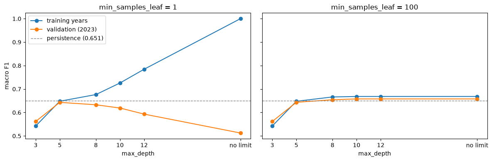
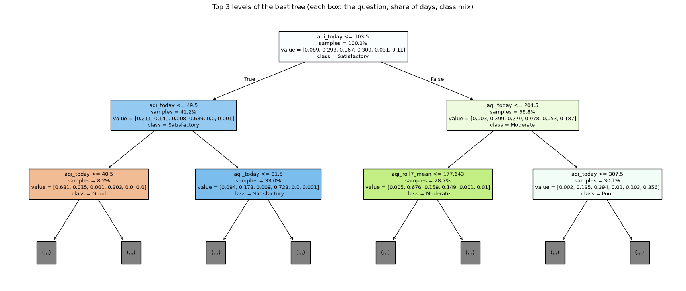
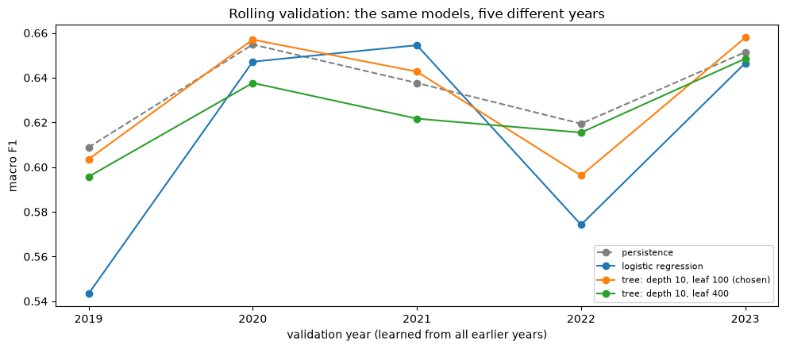

<!-- Exported from experiments/dt_train.ipynb: every cell run top to bottom; generated, do not edit by hand -->

# Decision Tree: Train and Compare

**Motivation:** logistic regression gives every feature one linear weight. The EDA showed patterns a linear model cannot follow:

- **Bends:** `temp_min` drops a lot from Good to Poor, then goes flat.
- **U-shapes:** `humidity_mean` falls, then rises again.
- **Combinations:** Severe days often need two things at once, *high AQI **and** stagnant air*.

A decision tree chains yes/no threshold splits (in the trained tree: `aqi_today` above 204, then the 7-day average above 178), so it can follow bends and combinations.

**Scope:** train a decision tree, tune its size, and compare it with **persistence** (the bar, macro F1 0.651) and the best **logistic regression** (`models/lr_best.bin`) on the same 2023 days, using macro F1, precision, recall, Severe misses and false alarms, and the Dangerous alert.

Decisions so far: [`docs/model_decisions.md`](../docs/model_decisions.md).

## 1. Setup

```python
import pickle
from pathlib import Path

import numpy as np
import pandas as pd
import matplotlib.pyplot as plt

from sklearn.feature_extraction import DictVectorizer
from sklearn.metrics import confusion_matrix, f1_score
from sklearn.pipeline import Pipeline
from sklearn.tree import DecisionTreeClassifier, plot_tree

import sys
sys.path.insert(0, '../scripts')                 # utility.py lives in scripts/
from utility import (AQI_CATEGORIES, prepare_dataset, split_train_val_test, add_lr_features,
                     forecast_scorecard, class_scores_table)

DATA_PATH = '../data/processed/aqi_weather_2015_2025.csv'
MODEL_DIR = Path('models')
TARGET = 'tomorrow_status'
TREND = ['aqi_roll7_mean', 'aqi_roll7_std', 'aqi_diff1', 'aqi_dev7']
pd.set_option('display.max_columns', 30)
```

## 2. The same days as every other model

The same data pipeline, the same 195 rows dropped and the same time split, so every model is scored on exactly the same 2023 days.

```python
df = prepare_dataset(DATA_PATH)
before = len(df)
df = df[df[TREND].notna().all(axis=1)]                   # the same 195 rows every model drops
df_train, df_val, df_test = split_train_val_test(df)

print(f'Dropped {before - len(df)} rows with empty trend features')
print('train:', len(df_train), '| validation:', len(df_val), '| test:', len(df_test))
```

**Output:**

```
Dropped 195 rows with empty trend features
train: 33543 | validation: 5104 | test: 9985
```

## 3. Features: raw columns, no transforms

Trees split on thresholds, so they do **not** need the transforms logistic regression needed:

| Logistic regression needed | Tree uses instead | Why the tree does not care |
|---|---|---|
| `pressure_rel` | `pressure_mean` | A tree can split per city on its own |
| `precip_log` | `precip_sum` | A threshold ("rain above 2 mm") works the same on any scale |
| `month_sin`, `month_cos` | `month` | A tree can ask "month ≥ 11 or ≤ 1" directly |
| Scaling | none | Thresholds do not depend on the scale |
| Dropping overlapping features (VIF) | keeps all of them | Overlapping features do not make a tree unstable |

So the tree gets all raw weather columns and **all four** trend features, including `aqi_roll7_mean`. `DictVectorizer` still turns `city` into yes/no columns, and keeps the dictionary input format of the web service.

```python
TREE_NUMERIC = (['aqi_today'] + TREND +
                ['temp_mean', 'temp_max', 'temp_min', 'temp_range', 'humidity_mean', 'dew_point_mean',
                 'precip_sum', 'pressure_mean', 'cloud_cover_mean', 'wind_speed_mean', 'wind_speed_max',
                 'wind_u_mean', 'wind_v_mean', 'month'])
TREE_BINARY = [c for c in df.columns if c.startswith('has_')] + ['aqi_imputed']
TREE_CATEGORICAL = ['city']
FEATURES = TREE_NUMERIC + TREE_BINARY + TREE_CATEGORICAL

def to_records(part):
    return part[FEATURES].to_dict(orient='records')

X_train, X_val = to_records(df_train), to_records(df_val)
y_train = df_train[TARGET].astype(str).to_numpy()
y_val = df_val[TARGET].astype(str).to_numpy()

assert df_train[FEATURES].notna().all().all() and df_val[FEATURES].notna().all().all(), 'missing values in the features'
print(f'{len(TREE_NUMERIC)} numeric + {len(TREE_BINARY)} yes/no + {len(TREE_CATEGORICAL)} text = {len(FEATURES)} features')
```

**Output:**

```
19 numeric + 7 yes/no + 1 text = 27 features
```

```python
def make_tree(max_depth=None, min_samples_leaf=1, class_weight=None):
    return Pipeline([
        ('dv', DictVectorizer(sparse=False)),             # city -> one-hot; numbers pass through
        ('tree', DecisionTreeClassifier(max_depth=max_depth, min_samples_leaf=min_samples_leaf,
                                        class_weight=class_weight, random_state=1)),
    ])

def macro_f1(y_true, y_pred):
    return f1_score(y_true, y_pred, labels=AQI_CATEGORIES, average='macro')
```

## 4. Unconstrained tree: overfitting

A tree with no size limits.

```python
free_tree = make_tree().fit(X_train, y_train)            # no limits at all

print('Leaves:', free_tree['tree'].get_n_leaves(), '| depth:', free_tree['tree'].get_depth())
print(f'Macro F1 on training years: {macro_f1(y_train, free_tree.predict(X_train)):.3f}')
print(f'Macro F1 on 2023:           {macro_f1(y_val, free_tree.predict(X_val)):.3f}   (persistence 0.651)')
```

**Output:**

```
Leaves: 6700 | depth: 42
```

**Output:**

```
Macro F1 on training years: 1.000
Macro F1 on 2023:           0.513   (persistence 0.651)
```

**This is overfitting.** The tree grew **6,700 leaves**, about one leaf per 5 training days. It memorised the training years (macro F1 **1.000**) but scores only **0.513** on 2023, far below persistence.

Logistic regression shows no gap (training 0.649, 2023 0.647): it is too simple to memorise. A tree must be constrained; two settings do that:

| Setting | Meaning | Effect |
|---|---|---|
| `max_depth` | How many questions in a row the tree may ask | Fewer questions → simpler tree |
| `min_samples_leaf` | How many training days every final group (leaf) must contain | A leaf of 100 days cannot memorise one odd day |

## 5. Tuning tree size

Grid: 6 depths × 5 leaf sizes × 2 class weightings = 60 trees, each scored on the training years and on 2023.

```python
DEPTHS = [3, 5, 8, 10, 12, None]                         # None = no depth limit
LEAVES = [1, 50, 100, 200, 400]                          # minimum days in every leaf
WEIGHTS = {'no class weights': None, 'balanced': 'balanced'}

rows, fitted = [], {}
for weight_name, class_weight in WEIGHTS.items():
    for depth in DEPTHS:
        for leaf in LEAVES:
            m = make_tree(depth, leaf, class_weight).fit(X_train, y_train)
            pred_tr, pred_va = m.predict(X_train), m.predict(X_val)
            rows.append({
                'weights': weight_name, 'max_depth': depth, 'min_samples_leaf': leaf,
                'leaves': m['tree'].get_n_leaves(),
                'train_macro_f1': macro_f1(y_train, pred_tr),
                'val_macro_f1': macro_f1(y_val, pred_va),
                'said_severe': (pred_va == 'Severe').sum(),
            })
            fitted[(weight_name, depth, leaf)] = m

tuning = pd.DataFrame(rows)
tuning['gap'] = tuning['train_macro_f1'] - tuning['val_macro_f1']
print(len(tuning), 'trees trained')
tuning.sort_values('val_macro_f1', ascending=False).head(10).round(3)
```

**Output:**

```
60 trees trained
```

**Output:**

<div>

<table border="1" class="dataframe">
  <thead>
    <tr style="text-align: right;">
      <th></th>
      <th>weights</th>
      <th>max_depth</th>
      <th>min_samples_leaf</th>
      <th>leaves</th>
      <th>train_macro_f1</th>
      <th>val_macro_f1</th>
      <th>said_severe</th>
      <th>gap</th>
    </tr>
  </thead>
  <tbody>
    <tr>
      <th>27</th>
      <td>no class weights</td>
      <td>NaN</td>
      <td>100</td>
      <td>254</td>
      <td>0.668</td>
      <td>0.658</td>
      <td>44</td>
      <td>0.010</td>
    </tr>
    <tr>
      <th>22</th>
      <td>no class weights</td>
      <td>12.0</td>
      <td>100</td>
      <td>248</td>
      <td>0.668</td>
      <td>0.658</td>
      <td>44</td>
      <td>0.010</td>
    </tr>
    <tr>
      <th>17</th>
      <td>no class weights</td>
      <td>10.0</td>
      <td>100</td>
      <td>204</td>
      <td>0.668</td>
      <td>0.658</td>
      <td>44</td>
      <td>0.010</td>
    </tr>
    <tr>
      <th>12</th>
      <td>no class weights</td>
      <td>8.0</td>
      <td>100</td>
      <td>144</td>
      <td>0.666</td>
      <td>0.654</td>
      <td>44</td>
      <td>0.012</td>
    </tr>
    <tr>
      <th>9</th>
      <td>no class weights</td>
      <td>5.0</td>
      <td>400</td>
      <td>29</td>
      <td>0.646</td>
      <td>0.651</td>
      <td>52</td>
      <td>-0.005</td>
    </tr>
    <tr>
      <th>28</th>
      <td>no class weights</td>
      <td>NaN</td>
      <td>200</td>
      <td>128</td>
      <td>0.654</td>
      <td>0.650</td>
      <td>33</td>
      <td>0.004</td>
    </tr>
    <tr>
      <th>18</th>
      <td>no class weights</td>
      <td>10.0</td>
      <td>200</td>
      <td>123</td>
      <td>0.654</td>
      <td>0.650</td>
      <td>33</td>
      <td>0.004</td>
    </tr>
    <tr>
      <th>13</th>
      <td>no class weights</td>
      <td>8.0</td>
      <td>200</td>
      <td>94</td>
      <td>0.654</td>
      <td>0.650</td>
      <td>33</td>
      <td>0.004</td>
    </tr>
    <tr>
      <th>23</th>
      <td>no class weights</td>
      <td>12.0</td>
      <td>200</td>
      <td>128</td>
      <td>0.654</td>
      <td>0.650</td>
      <td>33</td>
      <td>0.004</td>
    </tr>
    <tr>
      <th>14</th>
      <td>no class weights</td>
      <td>8.0</td>
      <td>400</td>
      <td>58</td>
      <td>0.645</td>
      <td>0.648</td>
      <td>52</td>
      <td>-0.004</td>
    </tr>
  </tbody>
</table>
</div>

**Macro F1 on 2023** for every combination (rows: weighting and depth, columns: minimum days per leaf; NaN depth = no limit):

```python
(tuning.pivot_table(index=['weights', 'max_depth'], columns='min_samples_leaf', values='val_macro_f1', dropna=False)
       .reindex(['no class weights', 'balanced'], level=0)
       .round(3))
```

**Output:**

<div>

<table border="1" class="dataframe">
  <thead>
    <tr style="text-align: right;">
      <th></th>
      <th>min_samples_leaf</th>
      <th>1</th>
      <th>50</th>
      <th>100</th>
      <th>200</th>
      <th>400</th>
    </tr>
    <tr>
      <th>weights</th>
      <th>max_depth</th>
      <th></th>
      <th></th>
      <th></th>
      <th></th>
      <th></th>
    </tr>
  </thead>
  <tbody>
    <tr>
      <th rowspan="6" valign="top">no class weights</th>
      <th>3.0</th>
      <td>0.562</td>
      <td>0.562</td>
      <td>0.562</td>
      <td>0.562</td>
      <td>0.562</td>
    </tr>
    <tr>
      <th>5.0</th>
      <td>0.643</td>
      <td>0.643</td>
      <td>0.643</td>
      <td>0.643</td>
      <td>0.651</td>
    </tr>
    <tr>
      <th>8.0</th>
      <td>0.633</td>
      <td>0.638</td>
      <td>0.654</td>
      <td>0.650</td>
      <td>0.648</td>
    </tr>
    <tr>
      <th>10.0</th>
      <td>0.619</td>
      <td>0.639</td>
      <td>0.658</td>
      <td>0.650</td>
      <td>0.648</td>
    </tr>
    <tr>
      <th>12.0</th>
      <td>0.593</td>
      <td>0.638</td>
      <td>0.658</td>
      <td>0.650</td>
      <td>0.648</td>
    </tr>
    <tr>
      <th>NaN</th>
      <td>0.513</td>
      <td>0.624</td>
      <td>0.658</td>
      <td>0.650</td>
      <td>0.648</td>
    </tr>
    <tr>
      <th rowspan="6" valign="top">balanced</th>
      <th>3.0</th>
      <td>0.586</td>
      <td>0.586</td>
      <td>0.586</td>
      <td>0.586</td>
      <td>0.586</td>
    </tr>
    <tr>
      <th>5.0</th>
      <td>0.591</td>
      <td>0.590</td>
      <td>0.590</td>
      <td>0.636</td>
      <td>0.622</td>
    </tr>
    <tr>
      <th>8.0</th>
      <td>0.593</td>
      <td>0.596</td>
      <td>0.605</td>
      <td>0.618</td>
      <td>0.623</td>
    </tr>
    <tr>
      <th>10.0</th>
      <td>0.612</td>
      <td>0.607</td>
      <td>0.605</td>
      <td>0.615</td>
      <td>0.623</td>
    </tr>
    <tr>
      <th>12.0</th>
      <td>0.577</td>
      <td>0.608</td>
      <td>0.600</td>
      <td>0.615</td>
      <td>0.623</td>
    </tr>
    <tr>
      <th>NaN</th>
      <td>0.554</td>
      <td>0.608</td>
      <td>0.600</td>
      <td>0.615</td>
      <td>0.623</td>
    </tr>
  </tbody>
</table>
</div>

```python
fig, axes = plt.subplots(1, 2, figsize=(12, 4), sharey=True)
part = tuning[tuning['weights'] == 'no class weights'].copy()
part['depth'] = part['max_depth'].fillna(20)             # plot "no limit" at the right end
for ax, leaf in zip(axes, [1, 100]):
    p = part[part['min_samples_leaf'] == leaf]
    ax.plot(p['depth'], p['train_macro_f1'], marker='o', label='training years')
    ax.plot(p['depth'], p['val_macro_f1'], marker='o', label='validation (2023)')
    ax.axhline(0.651, color='grey', linestyle='--', linewidth=1, label='persistence (0.651)')
    ax.set_title(f'min_samples_leaf = {leaf}')
    ax.set_xticks([3, 5, 8, 10, 12, 20], ['3', '5', '8', '10', '12', 'no limit'])
    ax.set_xlabel('max_depth')
axes[0].set_ylabel('macro F1')
axes[0].legend()
plt.tight_layout()
plt.show()
```



**Findings:**
- **Overfitting is controlled by the leaf size.** With `min_samples_leaf = 1` (left plot), the training score climbs to 1.0 as the tree deepens, while the 2023 score falls (0.643 → 0.513). With `min_samples_leaf = 100` (right plot), the two lines stay together (gap about 0.01).
- **Once leaves need 100 days, depth stops mattering.** Depth 10, 12 and no limit all give 0.658: the tree cannot split further anyway.
- **Balanced class weights hurt again** (best 0.636), for the same reason as in logistic regression: they lower the bar for the rare categories.
- **The scores jump between neighbouring settings** (0.658 at 100 days per leaf, 0.650 at 200, 0.648 at 400). A single tree is sensitive to small changes, so differences of about 0.01 are partly luck.

## 6. The best tree

Highest 2023 macro F1; if several are within 0.002, the one with the fewest leaves (simplest).

```python
best_score = tuning['val_macro_f1'].max()
best = (tuning[tuning['val_macro_f1'] >= best_score - 0.002]
        .sort_values('leaves')                            # within 0.002 of the best: the simplest tree
        .iloc[0])
best_key = (best['weights'], None if pd.isna(best['max_depth']) else int(best['max_depth']), int(best['min_samples_leaf']))
best_tree = fitted[best_key]
pred_tree = best_tree.predict(X_val)

print(f"Best tree: {best['weights']}, max_depth={best_key[1]}, min_samples_leaf={best_key[2]}, "
      f"{best['leaves']} leaves -> 2023 macro F1 {best['val_macro_f1']:.3f} (training {best['train_macro_f1']:.3f})")
```

**Output:**

```
Best tree: no class weights, max_depth=10, min_samples_leaf=100, 204 leaves -> 2023 macro F1 0.658 (training 0.668)
```

## 7. Compare: persistence vs logistic regression vs decision tree

Logistic regression is loaded from `models/lr_best.bin`. It needs its own features (`pressure_rel`, `precip_log`, month on a circle), which are rebuilt with the city pressure normals saved in its bundle.

```python
with open(MODEL_DIR / 'lr_best.bin', 'rb') as f:
    lr_bundle = pickle.load(f)

df_val_lr = add_lr_features(df_val, pd.Series(lr_bundle['city_pressure']))   # the LR needs its own transforms
lr_features = sum(lr_bundle['features'].values(), [])
pred_lr = lr_bundle['model'].predict(df_val_lr[lr_features].to_dict(orient='records'))

print(f"Logistic regression (class_weight={lr_bundle['class_weight']}, C={lr_bundle['C']}): "
      f"2023 macro F1 {macro_f1(y_val, pred_lr):.3f}")
```

**Output:**

```
Logistic regression (class_weight=None, C=1.0): 2023 macro F1 0.647
```

**The scorecard** (`forecast_scorecard` in `utility.py`, shared by every model notebook):

```python
PREDICTIONS = {
    'persistence': df_val['status_today'].astype(str).to_numpy(),
    'logistic regression': pred_lr,
    'decision tree': pred_tree,
}
scorecard = forecast_scorecard(y_val, PREDICTIONS, y_today=df_val['status_today'])
scorecard
```

**Output:**

<div>

<table border="1" class="dataframe">
  <thead>
    <tr style="text-align: right;">
      <th></th>
      <th>persistence</th>
      <th>logistic regression</th>
      <th>decision tree</th>
    </tr>
  </thead>
  <tbody>
    <tr>
      <th>macro F1</th>
      <td>0.651</td>
      <td>0.647</td>
      <td>0.658</td>
    </tr>
    <tr>
      <th>accuracy</th>
      <td>0.71</td>
      <td>0.729</td>
      <td>0.723</td>
    </tr>
    <tr>
      <th>Severe caught</th>
      <td>27</td>
      <td>20</td>
      <td>25</td>
    </tr>
    <tr>
      <th>Severe missed</th>
      <td>24</td>
      <td>31</td>
      <td>26</td>
    </tr>
    <tr>
      <th>Severe false alarms</th>
      <td>25</td>
      <td>11</td>
      <td>19</td>
    </tr>
    <tr>
      <th>Dangerous recall</th>
      <td>0.749</td>
      <td>0.807</td>
      <td>0.768</td>
    </tr>
    <tr>
      <th>Dangerous precision</th>
      <td>0.753</td>
      <td>0.761</td>
      <td>0.74</td>
    </tr>
    <tr>
      <th>change days right</th>
      <td>0.0</td>
      <td>0.353</td>
      <td>0.278</td>
    </tr>
    <tr>
      <th>unchanged days right</th>
      <td>1.0</td>
      <td>0.883</td>
      <td>0.904</td>
    </tr>
  </tbody>
</table>
</div>

**Precision, recall and F1 for every category** (`class_scores_table` in `utility.py`):

```python
class_scores_table(y_val, PREDICTIONS).round(2)
```

**Output:**

<div>

<table border="1" class="dataframe">
  <thead>
    <tr>
      <th></th>
      <th colspan="3" halign="left">persistence</th>
      <th colspan="3" halign="left">logistic regression</th>
      <th colspan="3" halign="left">decision tree</th>
    </tr>
    <tr>
      <th></th>
      <th>precision</th>
      <th>recall</th>
      <th>F1</th>
      <th>precision</th>
      <th>recall</th>
      <th>F1</th>
      <th>precision</th>
      <th>recall</th>
      <th>F1</th>
    </tr>
  </thead>
  <tbody>
    <tr>
      <th>Good</th>
      <td>0.62</td>
      <td>0.62</td>
      <td>0.62</td>
      <td>0.77</td>
      <td>0.39</td>
      <td>0.52</td>
      <td>0.74</td>
      <td>0.53</td>
      <td>0.62</td>
    </tr>
    <tr>
      <th>Satisfactory</th>
      <td>0.79</td>
      <td>0.79</td>
      <td>0.79</td>
      <td>0.78</td>
      <td>0.82</td>
      <td>0.80</td>
      <td>0.78</td>
      <td>0.82</td>
      <td>0.80</td>
    </tr>
    <tr>
      <th>Moderate</th>
      <td>0.72</td>
      <td>0.72</td>
      <td>0.72</td>
      <td>0.74</td>
      <td>0.75</td>
      <td>0.74</td>
      <td>0.74</td>
      <td>0.72</td>
      <td>0.73</td>
    </tr>
    <tr>
      <th>Poor</th>
      <td>0.58</td>
      <td>0.59</td>
      <td>0.59</td>
      <td>0.62</td>
      <td>0.60</td>
      <td>0.61</td>
      <td>0.59</td>
      <td>0.60</td>
      <td>0.59</td>
    </tr>
    <tr>
      <th>Very Poor</th>
      <td>0.67</td>
      <td>0.67</td>
      <td>0.67</td>
      <td>0.68</td>
      <td>0.76</td>
      <td>0.72</td>
      <td>0.66</td>
      <td>0.70</td>
      <td>0.68</td>
    </tr>
    <tr>
      <th>Severe</th>
      <td>0.52</td>
      <td>0.53</td>
      <td>0.52</td>
      <td>0.65</td>
      <td>0.39</td>
      <td>0.49</td>
      <td>0.57</td>
      <td>0.49</td>
      <td>0.53</td>
    </tr>
  </tbody>
</table>
</div>

**Confusion matrix of the tree** (rows: what really happened, columns: what the tree forecast):

```python
pd.DataFrame(confusion_matrix(y_val, pred_tree, labels=AQI_CATEGORIES),
             index=pd.Index(AQI_CATEGORIES, name='actual'),
             columns=pd.Index(AQI_CATEGORIES, name='predicted'))
```

**Output:**

<div>

<table border="1" class="dataframe">
  <thead>
    <tr style="text-align: right;">
      <th>predicted</th>
      <th>Good</th>
      <th>Satisfactory</th>
      <th>Moderate</th>
      <th>Poor</th>
      <th>Very Poor</th>
      <th>Severe</th>
    </tr>
    <tr>
      <th>actual</th>
      <th></th>
      <th></th>
      <th></th>
      <th></th>
      <th></th>
      <th></th>
    </tr>
  </thead>
  <tbody>
    <tr>
      <th>Good</th>
      <td>156</td>
      <td>135</td>
      <td>2</td>
      <td>0</td>
      <td>0</td>
      <td>0</td>
    </tr>
    <tr>
      <th>Satisfactory</th>
      <td>52</td>
      <td>1462</td>
      <td>263</td>
      <td>8</td>
      <td>0</td>
      <td>0</td>
    </tr>
    <tr>
      <th>Moderate</th>
      <td>4</td>
      <td>268</td>
      <td>1319</td>
      <td>229</td>
      <td>8</td>
      <td>1</td>
    </tr>
    <tr>
      <th>Poor</th>
      <td>0</td>
      <td>5</td>
      <td>201</td>
      <td>468</td>
      <td>101</td>
      <td>3</td>
    </tr>
    <tr>
      <th>Very Poor</th>
      <td>0</td>
      <td>0</td>
      <td>5</td>
      <td>90</td>
      <td>258</td>
      <td>15</td>
    </tr>
    <tr>
      <th>Severe</th>
      <td>0</td>
      <td>1</td>
      <td>0</td>
      <td>1</td>
      <td>24</td>
      <td>25</td>
    </tr>
  </tbody>
</table>
</div>

**Findings:**

| 2023 | Persistence | Logistic regression | Decision tree |
|---|---|---|---|
| Macro F1 | 0.651 | 0.647 | **0.658** |
| Accuracy | 0.710 | **0.729** | 0.723 |
| Severe caught / missed / false alarms | 27 / 24 / 25 | 20 / 31 / **11** | 25 / 26 / 19 |
| Dangerous recall / precision | 0.749 / 0.753 | **0.807 / 0.761** | 0.768 / 0.740 |
| Change days right | 0% | **35.3%** | 27.8% |
| Unchanged days right | **100%** | 88.3% | 90.4% |

- **The tree is the first model to beat persistence on macro F1** (0.658 against 0.651), but the margin (0.007) is smaller than the jumps between neighbouring tree settings (about 0.01): a **narrow, fragile** win. Section 9 checks it on five years.
- **Tree better than logistic regression at the rare ends:** Good F1 0.62 against 0.52 (156 of 293 Good days caught, logistic regression 115), Severe F1 0.53 against 0.49 (25 Severe days caught instead of 20). This is what lifts its macro F1.
- **Logistic regression better on the middle categories and the Dangerous alert:** higher recall (81% against 77%) *and* precision (76% against 74%). It also gets more change days right (35% against 28%).
- **The tree stays closer to persistence:** more unchanged days right (90%), fewer change days. It is the more cautious model.

## 8. What did the tree learn?

**Feature importance:** how much each feature reduced the tree's mistakes, as a share of the total.

```python
importance = pd.Series(best_tree['tree'].feature_importances_, index=best_tree['dv'].feature_names_)
importance.sort_values(ascending=False).head(12).round(3).to_frame('importance')
```

**Output:**

<div>

<table border="1" class="dataframe">
  <thead>
    <tr style="text-align: right;">
      <th></th>
      <th>importance</th>
    </tr>
  </thead>
  <tbody>
    <tr>
      <th>aqi_today</th>
      <td>0.833</td>
    </tr>
    <tr>
      <th>aqi_roll7_mean</th>
      <td>0.046</td>
    </tr>
    <tr>
      <th>precip_sum</th>
      <td>0.025</td>
    </tr>
    <tr>
      <th>wind_speed_max</th>
      <td>0.021</td>
    </tr>
    <tr>
      <th>wind_u_mean</th>
      <td>0.013</td>
    </tr>
    <tr>
      <th>aqi_roll7_std</th>
      <td>0.011</td>
    </tr>
    <tr>
      <th>temp_range</th>
      <td>0.008</td>
    </tr>
    <tr>
      <th>dew_point_mean</th>
      <td>0.005</td>
    </tr>
    <tr>
      <th>temp_min</th>
      <td>0.005</td>
    </tr>
    <tr>
      <th>wind_v_mean</th>
      <td>0.005</td>
    </tr>
    <tr>
      <th>month</th>
      <td>0.004</td>
    </tr>
    <tr>
      <th>wind_speed_mean</th>
      <td>0.004</td>
    </tr>
  </tbody>
</table>
</div>

**The first three levels of the tree.** Each box shows the question, the share of training days that reach it, and the mix of categories in it.

```python
fig, ax = plt.subplots(figsize=(22, 9))
plot_tree(best_tree['tree'], max_depth=2, feature_names=best_tree['dv'].feature_names_,
          class_names=list(best_tree['tree'].classes_), filled=True, impurity=False,
          proportion=True, fontsize=9, ax=ax)
ax.set_title('Top 3 levels of the best tree (each box: the question, share of days, class mix)')
plt.show()
```



**Findings:**
- **`aqi_today` does 83% of the work.** The tree first sorts days by today's AQI, like persistence, then refines with a few other features.
- **The tree recovered the official category limits from the data.** Its first questions are about `aqi_today` at 49.5, 103.5, 204.5 and 307.5, next to the CPCB boundaries at 50 (Good / Satisfactory), 100 (Satisfactory / Moderate), 200 (Moderate / Poor) and 300 (Poor / Very Poor).
- Next most useful: the **weekly average** (`aqi_roll7_mean`), **rain** and **maximum wind speed**, the weather that clears pollution.
- The tree is largely "persistence with corrections", which explains why it scores close to persistence and why the win is narrow.

## 9. Rolling validation: checking the 2023 win

All results above use **one** year (2023), which is noisy: tree scores moved by about 0.01 between neighbouring settings, more than the tree's margin over persistence.

**Rolling validation** repeats the comparison on five years. Each round trains only on the years **before** the year it scores, as in real use:

| Round | Learns from | Scores on |
|---|---|---|
| 1 | 2015–2018 | 2019 |
| 2 | 2015–2019 | 2020 |
| 3 | 2015–2020 | 2021 |
| 4 | 2015–2021 | 2022 |
| 5 | 2015–2022 | 2023 |

`rolling_validation` in `utility.py` refuses to score 2024 or later, so the test years stay locked. Anything learned from data (the logistic regression's city pressure normals) is recomputed in each round from that round's training years only.

The chosen tree is compared with its neighbouring settings and with logistic regression (same settings as `lr_best.bin`).

```python
from sklearn.linear_model import LogisticRegression
from sklearn.preprocessing import StandardScaler
from utility import rolling_validation

df_dev = pd.concat([df_train, df_val])            # 2015-2023 only; the test years stay locked

def tree_xy(train, val):
    return to_records(train), to_records(val)

LR_FEATURES = sum(lr_bundle['features'].values(), [])

def lr_xy(train, val):
    city_pressure = train.groupby('city')['pressure_mean'].mean()     # from this round's training years only
    train_lr, val_lr = add_lr_features(train, city_pressure), add_lr_features(val, city_pressure)
    return train_lr[LR_FEATURES].to_dict(orient='records'), val_lr[LR_FEATURES].to_dict(orient='records')

def make_lr():
    return Pipeline([
        ('dv', DictVectorizer(sparse=False)),
        ('scale', StandardScaler()),
        ('lr', LogisticRegression(class_weight=lr_bundle['class_weight'], C=lr_bundle['C'],
                                  max_iter=5000, random_state=1)),
    ])
```

```python
CANDIDATES = {                                    # name: (make a fresh model, build its features)
    'tree: depth 10, leaf 100 (chosen)': (lambda: make_tree(10, 100), tree_xy),
    'tree: depth 10, leaf 50':           (lambda: make_tree(10, 50), tree_xy),
    'tree: depth 10, leaf 200':          (lambda: make_tree(10, 200), tree_xy),
    'tree: depth 10, leaf 400':          (lambda: make_tree(10, 400), tree_xy),
    'tree: depth 5, leaf 1':             (lambda: make_tree(5, 1), tree_xy),
    'logistic regression':               (make_lr, lr_xy),
}

rolling = pd.concat({name: rolling_validation(df_dev, make, xy) for name, (make, xy) in CANDIDATES.items()},
                    names=['model']).reset_index(level=0)
rolling.round(3)
```

**Output:**

<div>

<table border="1" class="dataframe">
  <thead>
    <tr style="text-align: right;">
      <th></th>
      <th>model</th>
      <th>val_year</th>
      <th>train_rows</th>
      <th>val_rows</th>
      <th>severe_days</th>
      <th>train_macro_f1</th>
      <th>macro_f1</th>
      <th>persistence_macro_f1</th>
      <th>macro_auc</th>
      <th>persistence_macro_auc</th>
      <th>vs_persistence</th>
    </tr>
  </thead>
  <tbody>
    <tr>
      <th>0</th>
      <td>tree: depth 10, leaf 100 (chosen)</td>
      <td>2019</td>
      <td>13284</td>
      <td>4939</td>
      <td>215</td>
      <td>0.643</td>
      <td>0.604</td>
      <td>0.609</td>
      <td>0.916</td>
      <td>0.765</td>
      <td>-0.005</td>
    </tr>
    <tr>
      <th>1</th>
      <td>tree: depth 10, leaf 100 (chosen)</td>
      <td>2020</td>
      <td>18223</td>
      <td>5108</td>
      <td>124</td>
      <td>0.646</td>
      <td>0.657</td>
      <td>0.655</td>
      <td>0.935</td>
      <td>0.794</td>
      <td>0.002</td>
    </tr>
    <tr>
      <th>2</th>
      <td>tree: depth 10, leaf 100 (chosen)</td>
      <td>2021</td>
      <td>23331</td>
      <td>5105</td>
      <td>109</td>
      <td>0.662</td>
      <td>0.643</td>
      <td>0.638</td>
      <td>0.931</td>
      <td>0.785</td>
      <td>0.005</td>
    </tr>
    <tr>
      <th>3</th>
      <td>tree: depth 10, leaf 100 (chosen)</td>
      <td>2022</td>
      <td>28436</td>
      <td>5107</td>
      <td>32</td>
      <td>0.666</td>
      <td>0.596</td>
      <td>0.619</td>
      <td>0.930</td>
      <td>0.776</td>
      <td>-0.023</td>
    </tr>
    <tr>
      <th>4</th>
      <td>tree: depth 10, leaf 100 (chosen)</td>
      <td>2023</td>
      <td>33543</td>
      <td>5104</td>
      <td>51</td>
      <td>0.668</td>
      <td>0.658</td>
      <td>0.651</td>
      <td>0.938</td>
      <td>0.793</td>
      <td>0.006</td>
    </tr>
    <tr>
      <th>0</th>
      <td>tree: depth 10, leaf 50</td>
      <td>2019</td>
      <td>13284</td>
      <td>4939</td>
      <td>215</td>
      <td>0.661</td>
      <td>0.599</td>
      <td>0.609</td>
      <td>0.910</td>
      <td>0.765</td>
      <td>-0.010</td>
    </tr>
    <tr>
      <th>1</th>
      <td>tree: depth 10, leaf 50</td>
      <td>2020</td>
      <td>18223</td>
      <td>5108</td>
      <td>124</td>
      <td>0.672</td>
      <td>0.645</td>
      <td>0.655</td>
      <td>0.931</td>
      <td>0.794</td>
      <td>-0.010</td>
    </tr>
    <tr>
      <th>2</th>
      <td>tree: depth 10, leaf 50</td>
      <td>2021</td>
      <td>23331</td>
      <td>5105</td>
      <td>109</td>
      <td>0.677</td>
      <td>0.627</td>
      <td>0.638</td>
      <td>0.929</td>
      <td>0.785</td>
      <td>-0.011</td>
    </tr>
    <tr>
      <th>3</th>
      <td>tree: depth 10, leaf 50</td>
      <td>2022</td>
      <td>28436</td>
      <td>5107</td>
      <td>32</td>
      <td>0.682</td>
      <td>0.616</td>
      <td>0.619</td>
      <td>0.926</td>
      <td>0.776</td>
      <td>-0.004</td>
    </tr>
    <tr>
      <th>4</th>
      <td>tree: depth 10, leaf 50</td>
      <td>2023</td>
      <td>33543</td>
      <td>5104</td>
      <td>51</td>
      <td>0.683</td>
      <td>0.639</td>
      <td>0.651</td>
      <td>0.932</td>
      <td>0.793</td>
      <td>-0.012</td>
    </tr>
    <tr>
      <th>0</th>
      <td>tree: depth 10, leaf 200</td>
      <td>2019</td>
      <td>13284</td>
      <td>4939</td>
      <td>215</td>
      <td>0.630</td>
      <td>0.602</td>
      <td>0.609</td>
      <td>0.914</td>
      <td>0.765</td>
      <td>-0.006</td>
    </tr>
    <tr>
      <th>1</th>
      <td>tree: depth 10, leaf 200</td>
      <td>2020</td>
      <td>18223</td>
      <td>5108</td>
      <td>124</td>
      <td>0.633</td>
      <td>0.667</td>
      <td>0.655</td>
      <td>0.936</td>
      <td>0.794</td>
      <td>0.012</td>
    </tr>
    <tr>
      <th>2</th>
      <td>tree: depth 10, leaf 200</td>
      <td>2021</td>
      <td>23331</td>
      <td>5105</td>
      <td>109</td>
      <td>0.646</td>
      <td>0.646</td>
      <td>0.638</td>
      <td>0.932</td>
      <td>0.785</td>
      <td>0.008</td>
    </tr>
    <tr>
      <th>3</th>
      <td>tree: depth 10, leaf 200</td>
      <td>2022</td>
      <td>28436</td>
      <td>5107</td>
      <td>32</td>
      <td>0.651</td>
      <td>0.591</td>
      <td>0.619</td>
      <td>0.929</td>
      <td>0.776</td>
      <td>-0.029</td>
    </tr>
    <tr>
      <th>4</th>
      <td>tree: depth 10, leaf 200</td>
      <td>2023</td>
      <td>33543</td>
      <td>5104</td>
      <td>51</td>
      <td>0.654</td>
      <td>0.650</td>
      <td>0.651</td>
      <td>0.938</td>
      <td>0.793</td>
      <td>-0.002</td>
    </tr>
    <tr>
      <th>0</th>
      <td>tree: depth 10, leaf 400</td>
      <td>2019</td>
      <td>13284</td>
      <td>4939</td>
      <td>215</td>
      <td>0.616</td>
      <td>0.596</td>
      <td>0.609</td>
      <td>0.912</td>
      <td>0.765</td>
      <td>-0.013</td>
    </tr>
    <tr>
      <th>1</th>
      <td>tree: depth 10, leaf 400</td>
      <td>2020</td>
      <td>18223</td>
      <td>5108</td>
      <td>124</td>
      <td>0.618</td>
      <td>0.638</td>
      <td>0.655</td>
      <td>0.936</td>
      <td>0.794</td>
      <td>-0.017</td>
    </tr>
    <tr>
      <th>2</th>
      <td>tree: depth 10, leaf 400</td>
      <td>2021</td>
      <td>23331</td>
      <td>5105</td>
      <td>109</td>
      <td>0.628</td>
      <td>0.622</td>
      <td>0.638</td>
      <td>0.930</td>
      <td>0.785</td>
      <td>-0.016</td>
    </tr>
    <tr>
      <th>3</th>
      <td>tree: depth 10, leaf 400</td>
      <td>2022</td>
      <td>28436</td>
      <td>5107</td>
      <td>32</td>
      <td>0.642</td>
      <td>0.615</td>
      <td>0.619</td>
      <td>0.932</td>
      <td>0.776</td>
      <td>-0.004</td>
    </tr>
    <tr>
      <th>4</th>
      <td>tree: depth 10, leaf 400</td>
      <td>2023</td>
      <td>33543</td>
      <td>5104</td>
      <td>51</td>
      <td>0.645</td>
      <td>0.648</td>
      <td>0.651</td>
      <td>0.935</td>
      <td>0.793</td>
      <td>-0.003</td>
    </tr>
    <tr>
      <th>0</th>
      <td>tree: depth 5, leaf 1</td>
      <td>2019</td>
      <td>13284</td>
      <td>4939</td>
      <td>215</td>
      <td>0.635</td>
      <td>0.601</td>
      <td>0.609</td>
      <td>0.909</td>
      <td>0.765</td>
      <td>-0.008</td>
    </tr>
    <tr>
      <th>1</th>
      <td>tree: depth 5, leaf 1</td>
      <td>2020</td>
      <td>18223</td>
      <td>5108</td>
      <td>124</td>
      <td>0.631</td>
      <td>0.639</td>
      <td>0.655</td>
      <td>0.931</td>
      <td>0.794</td>
      <td>-0.016</td>
    </tr>
    <tr>
      <th>2</th>
      <td>tree: depth 5, leaf 1</td>
      <td>2021</td>
      <td>23331</td>
      <td>5105</td>
      <td>109</td>
      <td>0.626</td>
      <td>0.625</td>
      <td>0.638</td>
      <td>0.927</td>
      <td>0.785</td>
      <td>-0.013</td>
    </tr>
    <tr>
      <th>3</th>
      <td>tree: depth 5, leaf 1</td>
      <td>2022</td>
      <td>28436</td>
      <td>5107</td>
      <td>32</td>
      <td>0.633</td>
      <td>0.608</td>
      <td>0.619</td>
      <td>0.926</td>
      <td>0.776</td>
      <td>-0.011</td>
    </tr>
    <tr>
      <th>4</th>
      <td>tree: depth 5, leaf 1</td>
      <td>2023</td>
      <td>33543</td>
      <td>5104</td>
      <td>51</td>
      <td>0.648</td>
      <td>0.643</td>
      <td>0.651</td>
      <td>0.928</td>
      <td>0.793</td>
      <td>-0.008</td>
    </tr>
    <tr>
      <th>0</th>
      <td>logistic regression</td>
      <td>2019</td>
      <td>13284</td>
      <td>4939</td>
      <td>215</td>
      <td>0.621</td>
      <td>0.543</td>
      <td>0.609</td>
      <td>0.924</td>
      <td>0.765</td>
      <td>-0.065</td>
    </tr>
    <tr>
      <th>1</th>
      <td>logistic regression</td>
      <td>2020</td>
      <td>18223</td>
      <td>5108</td>
      <td>124</td>
      <td>0.630</td>
      <td>0.647</td>
      <td>0.655</td>
      <td>0.938</td>
      <td>0.794</td>
      <td>-0.008</td>
    </tr>
    <tr>
      <th>2</th>
      <td>logistic regression</td>
      <td>2021</td>
      <td>23331</td>
      <td>5105</td>
      <td>109</td>
      <td>0.648</td>
      <td>0.655</td>
      <td>0.638</td>
      <td>0.938</td>
      <td>0.785</td>
      <td>0.017</td>
    </tr>
    <tr>
      <th>3</th>
      <td>logistic regression</td>
      <td>2022</td>
      <td>28436</td>
      <td>5107</td>
      <td>32</td>
      <td>0.647</td>
      <td>0.574</td>
      <td>0.619</td>
      <td>0.936</td>
      <td>0.776</td>
      <td>-0.045</td>
    </tr>
    <tr>
      <th>4</th>
      <td>logistic regression</td>
      <td>2023</td>
      <td>33543</td>
      <td>5104</td>
      <td>51</td>
      <td>0.649</td>
      <td>0.647</td>
      <td>0.651</td>
      <td>0.939</td>
      <td>0.793</td>
      <td>-0.005</td>
    </tr>
  </tbody>
</table>
</div>

**Macro F1 per year** (persistence first, for reference):

```python
by_year = rolling.pivot_table(index='model', columns='val_year', values='macro_f1')
persistence_row = rolling.groupby('val_year')['persistence_macro_f1'].first().rename('persistence')
by_year = pd.concat([by_year, persistence_row.to_frame().T]).reindex(['persistence'] + list(CANDIDATES))
by_year.round(3)
```

**Output:**

<div>

<table border="1" class="dataframe">
  <thead>
    <tr style="text-align: right;">
      <th>val_year</th>
      <th>2019</th>
      <th>2020</th>
      <th>2021</th>
      <th>2022</th>
      <th>2023</th>
    </tr>
  </thead>
  <tbody>
    <tr>
      <th>persistence</th>
      <td>0.609</td>
      <td>0.655</td>
      <td>0.638</td>
      <td>0.619</td>
      <td>0.651</td>
    </tr>
    <tr>
      <th>tree: depth 10, leaf 100 (chosen)</th>
      <td>0.604</td>
      <td>0.657</td>
      <td>0.643</td>
      <td>0.596</td>
      <td>0.658</td>
    </tr>
    <tr>
      <th>tree: depth 10, leaf 50</th>
      <td>0.599</td>
      <td>0.645</td>
      <td>0.627</td>
      <td>0.616</td>
      <td>0.639</td>
    </tr>
    <tr>
      <th>tree: depth 10, leaf 200</th>
      <td>0.602</td>
      <td>0.667</td>
      <td>0.646</td>
      <td>0.591</td>
      <td>0.650</td>
    </tr>
    <tr>
      <th>tree: depth 10, leaf 400</th>
      <td>0.596</td>
      <td>0.638</td>
      <td>0.622</td>
      <td>0.615</td>
      <td>0.648</td>
    </tr>
    <tr>
      <th>tree: depth 5, leaf 1</th>
      <td>0.601</td>
      <td>0.639</td>
      <td>0.625</td>
      <td>0.608</td>
      <td>0.643</td>
    </tr>
    <tr>
      <th>logistic regression</th>
      <td>0.543</td>
      <td>0.647</td>
      <td>0.655</td>
      <td>0.574</td>
      <td>0.647</td>
    </tr>
  </tbody>
</table>
</div>

**Summary over the five years** (`spread` = how much the score moves from year to year; `mean_train_gap` = training score minus validation score):

```python
summary = rolling.groupby('model', sort=False).agg(
    mean_macro_f1=('macro_f1', 'mean'),
    spread=('macro_f1', 'std'),                              # how much the score moves from year to year
    mean_vs_persistence=('vs_persistence', 'mean'),
    years_beating_persistence=('vs_persistence', lambda d: f'{(d > 0).sum()} of {len(d)}'),
    mean_train_gap=('train_macro_f1', 'mean'),
)
summary['mean_train_gap'] = summary['mean_train_gap'] - summary['mean_macro_f1']
summary.round(3)
```

**Output:**

<div>

<table border="1" class="dataframe">
  <thead>
    <tr style="text-align: right;">
      <th></th>
      <th>mean_macro_f1</th>
      <th>spread</th>
      <th>mean_vs_persistence</th>
      <th>years_beating_persistence</th>
      <th>mean_train_gap</th>
    </tr>
    <tr>
      <th>model</th>
      <th></th>
      <th></th>
      <th></th>
      <th></th>
      <th></th>
    </tr>
  </thead>
  <tbody>
    <tr>
      <th>tree: depth 10, leaf 100 (chosen)</th>
      <td>0.631</td>
      <td>0.030</td>
      <td>-0.003</td>
      <td>3 of 5</td>
      <td>0.025</td>
    </tr>
    <tr>
      <th>tree: depth 10, leaf 50</th>
      <td>0.625</td>
      <td>0.019</td>
      <td>-0.009</td>
      <td>0 of 5</td>
      <td>0.050</td>
    </tr>
    <tr>
      <th>tree: depth 10, leaf 200</th>
      <td>0.631</td>
      <td>0.033</td>
      <td>-0.003</td>
      <td>2 of 5</td>
      <td>0.012</td>
    </tr>
    <tr>
      <th>tree: depth 10, leaf 400</th>
      <td>0.624</td>
      <td>0.020</td>
      <td>-0.011</td>
      <td>0 of 5</td>
      <td>0.006</td>
    </tr>
    <tr>
      <th>tree: depth 5, leaf 1</th>
      <td>0.623</td>
      <td>0.019</td>
      <td>-0.011</td>
      <td>0 of 5</td>
      <td>0.011</td>
    </tr>
    <tr>
      <th>logistic regression</th>
      <td>0.613</td>
      <td>0.051</td>
      <td>-0.021</td>
      <td>1 of 5</td>
      <td>0.026</td>
    </tr>
  </tbody>
</table>
</div>

```python
fig, ax = plt.subplots(figsize=(10, 4.5))
for name in ['persistence', 'logistic regression', 'tree: depth 10, leaf 100 (chosen)', 'tree: depth 10, leaf 400']:
    style = dict(color='grey', linestyle='--') if name == 'persistence' else {}
    ax.plot(by_year.columns, by_year.loc[name], marker='o', label=name, **style)
ax.set_xticks(list(by_year.columns))
ax.set_xlabel('validation year (learned from all earlier years)')
ax.set_ylabel('macro F1')
ax.set_title('Rolling validation: the same models, five different years')
ax.legend(fontsize=8)
plt.tight_layout()
plt.show()
```



**Findings:**
- **Over five years the tree ties with persistence.** The chosen tree averages **0.631**, persistence 0.634: a mean gap of **−0.003**. It wins in 3 of the 5 years by a hair (+0.002 to +0.006) and loses clearly in 2022 (−0.023). The +0.007 on 2023 was a good year, not a reliable win.
- **Logistic regression is worse over five years than 2023 suggested:** mean 0.613, **−0.021** below persistence, ahead only in 2021. It loses badly in 2019 (−0.065, learned from only four years) and in 2022 (−0.045). Its scores also vary most from year to year (spread 0.051).
- **The chosen tree setting holds up.** At least 100 days per leaf is still among the best (mean 0.631, tied with 200). Smaller leaves (50) overfit (training gap 0.050) and never beat persistence; larger leaves (400) or a shallow tree (depth 5) are too simple and never beat it either.
- **Years differ more than models do.** Persistence itself ranges from 0.609 (2019) to 0.655 (2020), so one validation year can make a model look better or worse than it is.
- **2022 is hard for every learned model.** It had only 32 Severe days, far fewer than the training years (the drift seen earlier), so models trained on more polluted years expect more bad days than 2022 delivered.

**Implication:** no model so far **reliably** beats "tomorrow = today". From now on, a model only counts as better if it beats persistence **on average over the five years and in most of them**, not just in 2023.

## 10. Save the model

```python
MODEL_PATH = MODEL_DIR / 'dt_best.bin'
MODEL_DIR.mkdir(parents=True, exist_ok=True)
bundle = {
    'model': best_tree,                                    # DictVectorizer + decision tree
    'params': {'max_depth': best_key[1], 'min_samples_leaf': best_key[2], 'class_weight': WEIGHTS[best_key[0]]},
    'features': {'numeric': TREE_NUMERIC, 'binary': TREE_BINARY, 'categorical': TREE_CATEGORICAL},
    'categories': AQI_CATEGORIES,
    'cities': sorted(df_train['city'].unique()),           # the service must reject any other city
    'validation': scorecard['decision tree'].to_dict(),
    'tuning': tuning.round(4).to_dict(orient='records'),
}
with open(MODEL_PATH, 'wb') as f:
    pickle.dump(bundle, f)
with open(MODEL_PATH, 'rb') as f:
    assert (pickle.load(f)['model'].predict(X_val) == pred_tree).all()
print(f'Saved and verified: {MODEL_PATH.resolve()}')
```

**Output:**

```
Saved and verified: /Users/sshobhitggupta/Documents/datatalk_ml_zoomchamp/midterm_project/aqi_forcasting/experiments/models/dt_best.bin
```

## Discussion

1. **A tree must be constrained, or it memorises.** Without limits: 1.000 on training, 0.513 on 2023. With at least 100 days per leaf: 0.668 and 0.658. Logistic regression, too simple to memorise, never showed this overfitting.
2. **On 2023 the tree narrowly beats persistence** (0.658 vs 0.651), mostly by doing better than logistic regression at the **rare ends** (Good and Severe). **Over five years it only ties** (mean −0.003, ahead in 3 of 5 years), and logistic regression falls behind (mean −0.021).
3. **No model wins everything yet:**
   - for the six-category score (macro F1): **decision tree**;
   - for days right and the **Dangerous** health alert: **logistic regression**;
   - for Severe false alarms: **logistic regression** (11);
   - for Severe days caught: **persistence** (27), the tree close behind (25).
4. **One validation year is not enough.** A single tree's score moves by about 0.01 between neighbouring settings, and persistence itself varies from 0.609 to 0.655 between years. Rolling validation over 2019–2023 is now the standard check for every model.

**Next: random forest** (many trees on slightly different samples of the data, averaged, which removes much of a single tree's variance), then XGBoost. Both are judged with the same `forecast_scorecard` on 2023 **and** with `rolling_validation`; the target is to beat persistence on average over the five years and in most of them.
