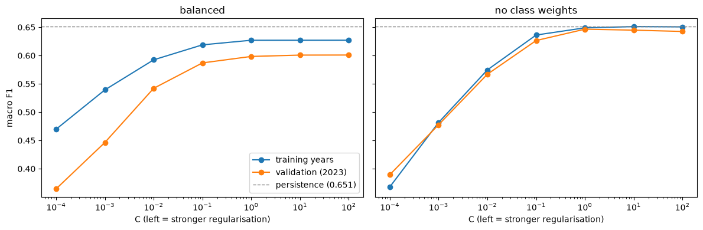

<!-- Exported from experiments/lr_train_baseline.ipynb: every cell run top to bottom; generated, do not edit by hand -->

```python
import numpy as np
import pandas as pd

import sys
sys.path.insert(0, '../scripts')                 # utility.py lives in scripts/
from utility import AQI_CATEGORIES, aqi_to_category, prepare_dataset, split_train_val_test, evaluate

DATA_PATH = '../data/processed/aqi_weather_2015_2025.csv'
TARGET = 'tomorrow_status'
TREND = ['aqi_roll7_mean', 'aqi_roll7_std', 'aqi_diff1', 'aqi_dev7']
```

### Load the data ###

```python
DATA_PATH = '../data/processed/aqi_weather_2015_2025.csv'

df = pd.read_csv(DATA_PATH, parse_dates=['date'])
df = df.rename(columns={'aqi_value': 'aqi_today', 'air_quality_status': 'status_today'})
df = df.drop(columns=['split'])          # the split is rebuilt from `date` (split_train_val_test)
df = df.sort_values(['city', 'date']).reset_index(drop=True)
df.shape
```

**Output:**

```
(51072, 20)
```

### Data Cleaning ###

```python
df = prepare_dataset(DATA_PATH)                 # EDA pipeline: target, pollutant flags, gap filling, trend features
before = len(df)                                # count AFTER prepare_dataset, so only the next line is measured
df = df[df[TREND].notna().all(axis=1)]
print(f'Dropped {before - len(df)} rows with empty trend features')   # expect 195
```

**Output:**

```
Dropped 195 rows with empty trend features
```

### Split the dataset on timeline ###

```python
df_train, df_val, df_test = split_train_val_test(df)

for name, part in [('train', df_train), ('val', df_val), ('test', df_test)]:
    print(f"{name:5s} {len(part):6,} rows   {part['date'].min().date()} → {part['date'].max().date()}")

assert len(df_train) + len(df_val) + len(df_test) == len(df)    # no row lost or duplicated
```

**Output:**

```
train 33,543 rows   2015-05-05 → 2022-12-31
val    5,104 rows   2023-01-01 → 2023-12-31
test   9,985 rows   2024-01-01 → 2025-12-30
```

```python
from utility import add_lr_features

# 1. The city normals: average pressure per city, training years only
city_pressure = df_train.groupby('city')['pressure_mean'].mean()

# 2. Add the three new feature groups to every split, using the SAME normals
df_train = add_lr_features(df_train, city_pressure)
df_val   = add_lr_features(df_val, city_pressure)
df_test  = add_lr_features(df_test, city_pressure)
```

```python
df_train
```

**Output:**

<div>

<table border="1" class="dataframe">
  <thead>
    <tr style="text-align: right;">
      <th></th>
      <th>city</th>
      <th>date</th>
      <th>aqi_today</th>
      <th>status_today</th>
      <th>temp_mean</th>
      <th>temp_max</th>
      <th>temp_min</th>
      <th>humidity_mean</th>
      <th>dew_point_mean</th>
      <th>precip_sum</th>
      <th>...</th>
      <th>aqi_imputed</th>
      <th>aqi_roll7_mean</th>
      <th>aqi_roll7_std</th>
      <th>aqi_diff1</th>
      <th>aqi_dev7</th>
      <th>month</th>
      <th>pressure_rel</th>
      <th>precip_log</th>
      <th>month_sin</th>
      <th>month_cos</th>
    </tr>
  </thead>
  <tbody>
    <tr>
      <th>0</th>
      <td>Bengaluru</td>
      <td>2015-05-06</td>
      <td>90.0</td>
      <td>Satisfactory</td>
      <td>25.22</td>
      <td>30.1</td>
      <td>21.2</td>
      <td>67.29</td>
      <td>18.34</td>
      <td>3.8</td>
      <td>...</td>
      <td>0</td>
      <td>109.200000</td>
      <td>75.595635</td>
      <td>-139.0</td>
      <td>-24.000000</td>
      <td>5</td>
      <td>-0.812750</td>
      <td>1.568616</td>
      <td>5.000000e-01</td>
      <td>-0.866025</td>
    </tr>
    <tr>
      <th>1</th>
      <td>Bengaluru</td>
      <td>2015-05-07</td>
      <td>52.0</td>
      <td>Satisfactory</td>
      <td>25.18</td>
      <td>30.8</td>
      <td>20.0</td>
      <td>71.04</td>
      <td>18.94</td>
      <td>1.1</td>
      <td>...</td>
      <td>0</td>
      <td>99.666667</td>
      <td>71.533675</td>
      <td>-38.0</td>
      <td>-57.200000</td>
      <td>5</td>
      <td>0.157250</td>
      <td>0.741937</td>
      <td>5.000000e-01</td>
      <td>-0.866025</td>
    </tr>
    <tr>
      <th>2</th>
      <td>Bengaluru</td>
      <td>2015-05-08</td>
      <td>83.0</td>
      <td>Satisfactory</td>
      <td>26.18</td>
      <td>32.1</td>
      <td>20.9</td>
      <td>68.25</td>
      <td>18.99</td>
      <td>0.0</td>
      <td>...</td>
      <td>0</td>
      <td>97.285714</td>
      <td>65.604152</td>
      <td>31.0</td>
      <td>-16.666667</td>
      <td>5</td>
      <td>-0.422750</td>
      <td>0.000000</td>
      <td>5.000000e-01</td>
      <td>-0.866025</td>
    </tr>
    <tr>
      <th>3</th>
      <td>Bengaluru</td>
      <td>2015-05-09</td>
      <td>46.0</td>
      <td>Good</td>
      <td>27.10</td>
      <td>33.3</td>
      <td>21.7</td>
      <td>60.79</td>
      <td>17.80</td>
      <td>0.0</td>
      <td>...</td>
      <td>0</td>
      <td>85.000000</td>
      <td>66.070669</td>
      <td>-37.0</td>
      <td>-51.285714</td>
      <td>5</td>
      <td>-1.612750</td>
      <td>0.000000</td>
      <td>5.000000e-01</td>
      <td>-0.866025</td>
    </tr>
    <tr>
      <th>4</th>
      <td>Bengaluru</td>
      <td>2015-05-10</td>
      <td>266.0</td>
      <td>Poor</td>
      <td>27.05</td>
      <td>32.8</td>
      <td>22.1</td>
      <td>60.54</td>
      <td>17.78</td>
      <td>0.5</td>
      <td>...</td>
      <td>0</td>
      <td>116.000000</td>
      <td>92.132151</td>
      <td>220.0</td>
      <td>181.000000</td>
      <td>5</td>
      <td>-1.332750</td>
      <td>0.405465</td>
      <td>5.000000e-01</td>
      <td>-0.866025</td>
    </tr>
    <tr>
      <th>...</th>
      <td>...</td>
      <td>...</td>
      <td>...</td>
      <td>...</td>
      <td>...</td>
      <td>...</td>
      <td>...</td>
      <td>...</td>
      <td>...</td>
      <td>...</td>
      <td>...</td>
      <td>...</td>
      <td>...</td>
      <td>...</td>
      <td>...</td>
      <td>...</td>
      <td>...</td>
      <td>...</td>
      <td>...</td>
      <td>...</td>
      <td>...</td>
    </tr>
    <tr>
      <th>33538</th>
      <td>Patna</td>
      <td>2022-12-27</td>
      <td>343.0</td>
      <td>Very Poor</td>
      <td>16.60</td>
      <td>21.5</td>
      <td>13.6</td>
      <td>71.17</td>
      <td>10.88</td>
      <td>0.0</td>
      <td>...</td>
      <td>0</td>
      <td>359.142857</td>
      <td>24.714561</td>
      <td>-9.0</td>
      <td>-25.428571</td>
      <td>12</td>
      <td>7.465735</td>
      <td>0.000000</td>
      <td>-2.449294e-16</td>
      <td>1.000000</td>
    </tr>
    <tr>
      <th>33539</th>
      <td>Patna</td>
      <td>2022-12-28</td>
      <td>336.0</td>
      <td>Very Poor</td>
      <td>14.68</td>
      <td>19.8</td>
      <td>10.6</td>
      <td>74.00</td>
      <td>9.83</td>
      <td>0.0</td>
      <td>...</td>
      <td>0</td>
      <td>349.714286</td>
      <td>17.036376</td>
      <td>-7.0</td>
      <td>-23.142857</td>
      <td>12</td>
      <td>8.945735</td>
      <td>0.000000</td>
      <td>-2.449294e-16</td>
      <td>1.000000</td>
    </tr>
    <tr>
      <th>33540</th>
      <td>Patna</td>
      <td>2022-12-29</td>
      <td>382.0</td>
      <td>Very Poor</td>
      <td>14.86</td>
      <td>19.9</td>
      <td>9.2</td>
      <td>78.96</td>
      <td>10.96</td>
      <td>0.0</td>
      <td>...</td>
      <td>0</td>
      <td>356.714286</td>
      <td>18.979939</td>
      <td>46.0</td>
      <td>32.285714</td>
      <td>12</td>
      <td>10.515735</td>
      <td>0.000000</td>
      <td>-2.449294e-16</td>
      <td>1.000000</td>
    </tr>
    <tr>
      <th>33541</th>
      <td>Patna</td>
      <td>2022-12-30</td>
      <td>424.0</td>
      <td>Severe</td>
      <td>15.20</td>
      <td>20.5</td>
      <td>11.5</td>
      <td>81.25</td>
      <td>11.80</td>
      <td>0.0</td>
      <td>...</td>
      <td>0</td>
      <td>363.857143</td>
      <td>31.709245</td>
      <td>42.0</td>
      <td>67.285714</td>
      <td>12</td>
      <td>11.075735</td>
      <td>0.000000</td>
      <td>-2.449294e-16</td>
      <td>1.000000</td>
    </tr>
    <tr>
      <th>33542</th>
      <td>Patna</td>
      <td>2022-12-31</td>
      <td>419.0</td>
      <td>Severe</td>
      <td>15.64</td>
      <td>21.1</td>
      <td>10.4</td>
      <td>81.92</td>
      <td>12.37</td>
      <td>0.0</td>
      <td>...</td>
      <td>0</td>
      <td>370.571429</td>
      <td>38.060728</td>
      <td>-5.0</td>
      <td>55.142857</td>
      <td>12</td>
      <td>9.955735</td>
      <td>0.000000</td>
      <td>-2.449294e-16</td>
      <td>1.000000</td>
    </tr>
  </tbody>
</table>
<p>33543 rows × 35 columns</p>
</div>

### Select the features ###

Logistic regression uses 23 columns: 15 numeric, 7 yes/no (6 pollutant flags + `aqi_imputed`) and `city`. `aqi_roll7_mean` is left out because it nearly duplicates `aqi_today` (VIF check in `aqi_prediction.ipynb`).

The checks below stop with a clear message if anything is wrong, instead of training a bad model silently.

```python
import pickle
import warnings
from pathlib import Path

from sklearn.exceptions import ConvergenceWarning
from sklearn.feature_extraction import DictVectorizer
from sklearn.linear_model import LogisticRegression
from sklearn.metrics import confusion_matrix
from sklearn.pipeline import Pipeline
from sklearn.preprocessing import StandardScaler
```

```python
LR_NUMERIC = ['aqi_today', 'aqi_roll7_std', 'aqi_diff1', 'aqi_dev7',
              'temp_min', 'temp_range', 'humidity_mean', 'precip_log', 'pressure_rel',
              'cloud_cover_mean', 'wind_speed_mean', 'wind_u_mean', 'wind_v_mean',
              'month_sin', 'month_cos']
LR_BINARY = [c for c in df_train.columns if c.startswith('has_')] + ['aqi_imputed']
LR_CATEGORICAL = ['city']
FEATURES = LR_NUMERIC + LR_BINARY + LR_CATEGORICAL

print(f'{len(LR_NUMERIC)} numeric + {len(LR_BINARY)} yes/no + {len(LR_CATEGORICAL)} text = {len(FEATURES)} features')
```

**Output:**

```
15 numeric + 7 yes/no + 1 text = 23 features
```

```python
# Stop early, with a clear message, if any split has a problem
for name, part in [('train', df_train), ('val', df_val)]:
    bad = part[FEATURES].columns[part[FEATURES].isna().any()].tolist()
    if bad:
        raise ValueError(f'{name}: missing values in {bad}')
    numeric = part[LR_NUMERIC + LR_BINARY]
    if not np.isfinite(numeric).all().all():
        raise ValueError(f'{name}: infinite values in the numeric features')

missing_classes = set(AQI_CATEGORIES) - set(df_train[TARGET].astype(str))
if missing_classes:
    raise ValueError(f'train has no rows for {missing_classes}: the model could never predict them')
print('Checks passed: no missing or infinite values; all six classes in train.')
```

**Output:**

```
Checks passed: no missing or infinite values; all six classes in train.
```

### Turn each row into a dictionary ###

`DictVectorizer` reads one dictionary per row. The web service will receive the same thing (a JSON request), so training and prediction use exactly the same input format.

```python
def to_records(part):
    """One dictionary per row: the input format of DictVectorizer and of the web service."""
    return part[FEATURES].to_dict(orient='records')

X_train, X_val = to_records(df_train), to_records(df_val)
y_train = df_train[TARGET].astype(str).to_numpy()
y_val = df_val[TARGET].astype(str).to_numpy()

X_train[0]
y_train
```

**Output:**

```
array(['Satisfactory', 'Satisfactory', 'Good', ..., 'Severe', 'Severe',
       'Severe'], shape=(33543,), dtype=object)
```

### Build and train the model ###

One `Pipeline` with three steps, all fitted on the training years only:

| Step | What it does |
|---|---|
| `DictVectorizer` | `city` becomes 14 yes/no columns; numbers pass through unchanged |
| `StandardScaler` | Puts every column on the same scale (AQI runs 0–500, flags 0/1), so the regularisation treats them equally and the solver converges |
| `LogisticRegression` | `class_weight='balanced'` makes rare classes (Severe) count more; `C=1.0` is the default strength of regularisation |

If the solver does not converge, training stops with an error instead of a warning.

```python
def make_model(class_weight, regularisation=1.0, max_itr = 2000):
    return Pipeline([
        ('dv', DictVectorizer(sparse=False)),
        ('scale', StandardScaler()),
        ('lr', LogisticRegression(class_weight=class_weight, C=regularisation, max_iter=max_itr, random_state=1)),
    ])
```

```python

model = make_model('balanced')

with warnings.catch_warnings():
    warnings.simplefilter('error', ConvergenceWarning)       # a model that did not converge is an error
    model.fit(X_train, y_train)

print('Columns after DictVectorizer:', len(model['dv'].feature_names_))
print('Classes, in the model\'s own (alphabetical) order:', list(model.classes_))
```

**Output:**

```
Columns after DictVectorizer: 36
Classes, in the model's own (alphabetical) order: ['Good', 'Moderate', 'Poor', 'Satisfactory', 'Severe', 'Very Poor']
```

### Evaluate on validation (2023) ###

The same `evaluate` function as the baselines, so the comparison is fair. The bar is **persistence: macro F1 0.651**.

```python
pred_val = model.predict(X_val)

results = pd.DataFrame([
    evaluate('persistence (tomorrow = today)', y_val, df_val['status_today']),
    evaluate('logistic regression', y_val, pred_val),
]).set_index('model')
results.round(3)
```

**Output:**

<div>

<table border="1" class="dataframe">
  <thead>
    <tr style="text-align: right;">
      <th></th>
      <th>accuracy</th>
      <th>macro_f1</th>
      <th>recall_very_poor</th>
      <th>recall_severe</th>
      <th>precision_very_poor</th>
      <th>precision_severe</th>
    </tr>
    <tr>
      <th>model</th>
      <th></th>
      <th></th>
      <th></th>
      <th></th>
      <th></th>
      <th></th>
    </tr>
  </thead>
  <tbody>
    <tr>
      <th>persistence (tomorrow = today)</th>
      <td>0.710</td>
      <td>0.651</td>
      <td>0.668</td>
      <td>0.529</td>
      <td>0.674</td>
      <td>0.519</td>
    </tr>
    <tr>
      <th>logistic regression</th>
      <td>0.663</td>
      <td>0.598</td>
      <td>0.641</td>
      <td>0.725</td>
      <td>0.590</td>
      <td>0.303</td>
    </tr>
  </tbody>
</table>
</div>

Where does it win and lose? Persistence is right on every day the category stays the same and wrong on every day it changes:

```python
changed = df_val['status_today'].astype(str).to_numpy() != y_val
print(f'Change days: {changed.sum()} of {len(y_val)} ({changed.mean():.0%})')
print(f'Logistic regression gets {(pred_val[changed] == y_val[changed]).mean():.1%} of them right '
      f'(persistence: 0% by definition)')
print(f'... and keeps {(pred_val[~changed] == y_val[~changed]).mean():.1%} of the unchanged days right '
      f'(persistence: 100%)')
```

**Output:**

```
Change days: 1478 of 5104 (29%)
Logistic regression gets 35.5% of them right (persistence: 0% by definition)
... and keeps 78.8% of the unchanged days right (persistence: 100%)
```

```python
cm = pd.DataFrame(confusion_matrix(y_val, pred_val, labels=AQI_CATEGORIES),
                  index=pd.Index(AQI_CATEGORIES, name='actual'),
                  columns=pd.Index(AQI_CATEGORIES, name='predicted'))
cm
```

**Output:**

<div>

<table border="1" class="dataframe">
  <thead>
    <tr style="text-align: right;">
      <th>predicted</th>
      <th>Good</th>
      <th>Satisfactory</th>
      <th>Moderate</th>
      <th>Poor</th>
      <th>Very Poor</th>
      <th>Severe</th>
    </tr>
    <tr>
      <th>actual</th>
      <th></th>
      <th></th>
      <th></th>
      <th></th>
      <th></th>
      <th></th>
    </tr>
  </thead>
  <tbody>
    <tr>
      <th>Good</th>
      <td>219</td>
      <td>71</td>
      <td>3</td>
      <td>0</td>
      <td>0</td>
      <td>0</td>
    </tr>
    <tr>
      <th>Satisfactory</th>
      <td>299</td>
      <td>1154</td>
      <td>325</td>
      <td>7</td>
      <td>0</td>
      <td>0</td>
    </tr>
    <tr>
      <th>Moderate</th>
      <td>4</td>
      <td>228</td>
      <td>1224</td>
      <td>361</td>
      <td>12</td>
      <td>0</td>
    </tr>
    <tr>
      <th>Poor</th>
      <td>0</td>
      <td>4</td>
      <td>112</td>
      <td>513</td>
      <td>140</td>
      <td>9</td>
    </tr>
    <tr>
      <th>Very Poor</th>
      <td>0</td>
      <td>0</td>
      <td>1</td>
      <td>55</td>
      <td>236</td>
      <td>76</td>
    </tr>
    <tr>
      <th>Severe</th>
      <td>0</td>
      <td>0</td>
      <td>1</td>
      <td>1</td>
      <td>12</td>
      <td>37</td>
    </tr>
  </tbody>
</table>
</div>

**Do the weights make sense?** The weights for *Severe tomorrow*, per standard deviation of each feature. Plus means "more of this → Severe more likely".

```python
# Do the weights make sense? Weights for "Severe tomorrow" (per standard deviation of each feature)
coef = pd.DataFrame(model['lr'].coef_, index=model.classes_, columns=model['dv'].feature_names_)
severe = coef.loc['Severe', LR_NUMERIC].sort_values()
severe.round(2).to_frame('weight for Severe')
```

**Output:**

<div>

<table border="1" class="dataframe">
  <thead>
    <tr style="text-align: right;">
      <th></th>
      <th>weight for Severe</th>
    </tr>
  </thead>
  <tbody>
    <tr>
      <th>wind_speed_mean</th>
      <td>-1.32</td>
    </tr>
    <tr>
      <th>precip_log</th>
      <td>-1.16</td>
    </tr>
    <tr>
      <th>aqi_dev7</th>
      <td>-1.05</td>
    </tr>
    <tr>
      <th>temp_min</th>
      <td>-0.95</td>
    </tr>
    <tr>
      <th>month_sin</th>
      <td>-0.70</td>
    </tr>
    <tr>
      <th>pressure_rel</th>
      <td>-0.43</td>
    </tr>
    <tr>
      <th>humidity_mean</th>
      <td>-0.41</td>
    </tr>
    <tr>
      <th>aqi_diff1</th>
      <td>0.00</td>
    </tr>
    <tr>
      <th>month_cos</th>
      <td>0.03</td>
    </tr>
    <tr>
      <th>cloud_cover_mean</th>
      <td>0.10</td>
    </tr>
    <tr>
      <th>aqi_roll7_std</th>
      <td>0.23</td>
    </tr>
    <tr>
      <th>wind_v_mean</th>
      <td>0.54</td>
    </tr>
    <tr>
      <th>temp_range</th>
      <td>0.63</td>
    </tr>
    <tr>
      <th>wind_u_mean</th>
      <td>0.93</td>
    </tr>
    <tr>
      <th>aqi_today</th>
      <td>6.87</td>
    </tr>
  </tbody>
</table>
</div>

**Probabilities come back in the model's own order**, which is alphabetical (`model.classes_`), not Good → Severe. Always pair them with `model.classes_`; otherwise a probability can be shown under the wrong category.

```python
# Probabilities come back in model.classes_ order (alphabetical), NOT in AQI_CATEGORIES order
proba = model.predict_proba(X_val[:1])[0]
example = pd.Series(proba, index=model.classes_).reindex(AQI_CATEGORIES)
print(df_val[['city', 'date', 'aqi_today', 'status_today', TARGET]].iloc[0].to_dict())
example.round(3).to_frame('probability')
```

**Output:**

```
{'city': 'Bengaluru', 'date': Timestamp('2023-01-01 00:00:00'), 'aqi_today': 93.0, 'status_today': 'Satisfactory', 'tomorrow_status': 'Satisfactory'}
```

**Output:**

<div>

<table border="1" class="dataframe">
  <thead>
    <tr style="text-align: right;">
      <th></th>
      <th>probability</th>
    </tr>
  </thead>
  <tbody>
    <tr>
      <th>Good</th>
      <td>0.079</td>
    </tr>
    <tr>
      <th>Satisfactory</th>
      <td>0.595</td>
    </tr>
    <tr>
      <th>Moderate</th>
      <td>0.320</td>
    </tr>
    <tr>
      <th>Poor</th>
      <td>0.005</td>
    </tr>
    <tr>
      <th>Very Poor</th>
      <td>0.000</td>
    </tr>
    <tr>
      <th>Severe</th>
      <td>0.000</td>
    </tr>
  </tbody>
</table>
</div>

**Findings:**
- **The first logistic regression does not beat persistence.** Macro F1 **0.598** against **0.651**, accuracy 0.663 against 0.710.
- **It wins where persistence cannot:** it gets **35.5% of the change days** right (persistence: 0%) and catches **37 of the 51 Severe days** (recall 0.73, against 0.53).
- **But it breaks too many easy days:** it keeps only **78.8%** of the unchanged days right (persistence: 100%).
- **It says "Severe" far too often:** 122 times for 51 real Severe days (precision 0.30). This is the drift effect: `class_weight='balanced'` learned from a period with 3.1% Severe days, but 2023 has 1.0%.
- **The weights make sense:** `aqi_today` dominates (+6.87). Strong wind, rain and warm nights lower the chance of Severe. A sudden jump above last week (`aqi_dev7`, −1.05) also lowers it, the same "AQI falls back after a spike" effect as in the EDA.

**What came next:** the same model **without class weights** (below). It turns out the over-prediction of Severe comes from the class weights, not from `aqi_today`. The discussion at the end of the notebook compares both versions.

### Save the model ###

Everything the web service will need goes into one file:

| Key | Why it is needed |
|---|---|
| `model` | DictVectorizer + scaler + logistic regression |
| `city_pressure` | City normals from the training years, to compute `pressure_rel` for a new day |
| `features` | Which columns the model expects |
| `cities` | The service must reject any other city (DictVectorizer would silently ignore it) |
| `validation` | The scores above, for the record |

```python
MODEL_DIR = Path('models')
MODEL_DIR.mkdir(parents=True, exist_ok=True)
MODEL_PATH = MODEL_DIR / 'lr_baseline.bin'

bundle = {
    'model': model,                                   # DictVectorizer + scaler + logistic regression
    'city_pressure': city_pressure.to_dict(),         # city normals from the training years (for pressure_rel)
    'features': {'numeric': LR_NUMERIC, 'binary': LR_BINARY, 'categorical': LR_CATEGORICAL},
    'categories': AQI_CATEGORIES,
    'cities': sorted(city_pressure.index),            # the service must reject any other city
    'validation': results.round(4).to_dict(orient='index'),
}
with open(MODEL_PATH, 'wb') as f:
    pickle.dump(bundle, f)
print(f'Saved: {MODEL_PATH.resolve()} ({MODEL_PATH.stat().st_size / 1024:.0f} KB)')
```

**Output:**

```
Saved: /Users/sshobhitggupta/Documents/datatalk_ml_zoomchamp/midterm_project/aqi_forcasting/experiments/models/lr_baseline.bin (5 KB)
```

```python
# Load it back and check it gives the same predictions
with open(MODEL_PATH, 'rb') as f:
    loaded = pickle.load(f)
assert (loaded['model'].predict(X_val) == pred_val).all()
print('Reloaded model gives identical predictions.')
```

**Output:**

```
Reloaded model gives identical predictions.
```

### Training without weights ###

The same pipeline with `class_weight=None`: every day counts the same during training. The question: does the over-prediction of Severe come from the class weights or from the features?

```python
model_no_weights = make_model(None)

with warnings.catch_warnings():
    warnings.simplefilter('error', ConvergenceWarning)       # a model that did not converge is an error
    model_no_weights.fit(X_train, y_train)

print('Columns after DictVectorizer:', len(model_no_weights['dv'].feature_names_))
print('Classes, in the model\'s own (alphabetical) order:', list(model_no_weights.classes_))
```

**Output:**

```
Columns after DictVectorizer: 36
Classes, in the model's own (alphabetical) order: ['Good', 'Moderate', 'Poor', 'Satisfactory', 'Severe', 'Very Poor']
```

```python
pred_val_nw = model_no_weights.predict(X_val)

results_nw = pd.DataFrame([
    evaluate('persistence => (tomorrow = today )', y_val, df_val['status_today']),
    evaluate('logistic regression (balanced)', y_val, pred_val),
    evaluate('logistic regression, no class weights', y_val, pred_val_nw),
]).set_index('model')
results_nw.round(3)
```

**Output:**

<div>

<table border="1" class="dataframe">
  <thead>
    <tr style="text-align: right;">
      <th></th>
      <th>accuracy</th>
      <th>macro_f1</th>
      <th>recall_very_poor</th>
      <th>recall_severe</th>
      <th>precision_very_poor</th>
      <th>precision_severe</th>
    </tr>
    <tr>
      <th>model</th>
      <th></th>
      <th></th>
      <th></th>
      <th></th>
      <th></th>
      <th></th>
    </tr>
  </thead>
  <tbody>
    <tr>
      <th>persistence =&gt; (tomorrow = today )</th>
      <td>0.710</td>
      <td>0.651</td>
      <td>0.668</td>
      <td>0.529</td>
      <td>0.674</td>
      <td>0.519</td>
    </tr>
    <tr>
      <th>logistic regression (balanced)</th>
      <td>0.663</td>
      <td>0.598</td>
      <td>0.641</td>
      <td>0.725</td>
      <td>0.590</td>
      <td>0.303</td>
    </tr>
    <tr>
      <th>logistic regression, no class weights</th>
      <td>0.729</td>
      <td>0.647</td>
      <td>0.764</td>
      <td>0.392</td>
      <td>0.680</td>
      <td>0.645</td>
    </tr>
  </tbody>
</table>
</div>

### Prediction distribution check

How often does the model **predict** each category, compared with how often it really **happens**? This is a bias check on the predictions. It is not *drift*: drift is a change in the **data** over time (e.g. Severe falling from 3.1% of training days to 1.0% in 2023).

Matching shares are necessary but not enough: a forecast could match the shares and still put the categories on the wrong days.

```python
right_nw = pred_val_nw == y_val
# share right on changed days:    right_nw[changed].mean()
# share right on unchanged days:  right_nw[~changed].mean()
list(right_nw)

# comparison = pd.DataFrame({
#     "predicted": pred_val_nw,
#     "actual": y_val
# })
# comparison["correct"] = comparison["predicted"] == comparison["actual"]
# comparison[~comparison["correct"]]   # show only the mistakes

dist = pd.DataFrame({
    "actual_pct": pd.Series(y_val).value_counts(normalize=True) * 100,
    "predicted_pct": pd.Series(pred_val_nw).value_counts(normalize=True) * 100
}).fillna(0)

dist["difference_pct_points"] = dist["predicted_pct"] - dist["actual_pct"]
print(dist.round(1))
```

**Output:**

```
              actual_pct  predicted_pct  difference_pct_points
Good                 5.7            2.9                   -2.8
Moderate            35.8           36.4                    0.6
Poor                15.2           14.9                   -0.3
Satisfactory        35.0           37.0                    2.1
Severe               1.0            0.6                   -0.4
Very Poor            7.2            8.1                    0.9
```

```python
def predicted_share(pred):
    return pd.Series(pred).value_counts(normalize=True).reindex(AQI_CATEGORIES, fill_value=0) * 100

dist = pd.DataFrame({
    'actual_pct': predicted_share(y_val),
    'no_weights_pct': predicted_share(pred_val_nw),
    'balanced_pct': predicted_share(pred_val),
})
dist['no_weights_ratio'] = dist['no_weights_pct'] / dist['actual_pct']
dist['balanced_ratio'] = dist['balanced_pct'] / dist['actual_pct']
dist.round(2)
```

**Output:**

<div>

<table border="1" class="dataframe">
  <thead>
    <tr style="text-align: right;">
      <th></th>
      <th>actual_pct</th>
      <th>no_weights_pct</th>
      <th>balanced_pct</th>
      <th>no_weights_ratio</th>
      <th>balanced_ratio</th>
    </tr>
  </thead>
  <tbody>
    <tr>
      <th>Good</th>
      <td>5.74</td>
      <td>2.92</td>
      <td>10.23</td>
      <td>0.51</td>
      <td>1.78</td>
    </tr>
    <tr>
      <th>Satisfactory</th>
      <td>34.97</td>
      <td>37.03</td>
      <td>28.55</td>
      <td>1.06</td>
      <td>0.82</td>
    </tr>
    <tr>
      <th>Moderate</th>
      <td>35.83</td>
      <td>36.44</td>
      <td>32.64</td>
      <td>1.02</td>
      <td>0.91</td>
    </tr>
    <tr>
      <th>Poor</th>
      <td>15.24</td>
      <td>14.91</td>
      <td>18.36</td>
      <td>0.98</td>
      <td>1.20</td>
    </tr>
    <tr>
      <th>Very Poor</th>
      <td>7.21</td>
      <td>8.09</td>
      <td>7.84</td>
      <td>1.12</td>
      <td>1.09</td>
    </tr>
    <tr>
      <th>Severe</th>
      <td>1.00</td>
      <td>0.61</td>
      <td>2.39</td>
      <td>0.61</td>
      <td>2.39</td>
    </tr>
  </tbody>
</table>
</div>

**Weights for Severe, both models.** Do the weights change direction, or only size? And how does the intercept (the starting value for Severe) differ? A higher intercept means a lower bar for saying "Severe".

```python
(pred_val_nw == 'Severe').sum()          # compare with (pred_val == 'Severe').sum() and 51 real Severe days

def severe_weights(m):
    coef = pd.DataFrame(m['lr'].coef_, index=m.classes_, columns=m['dv'].feature_names_)
    return coef.loc['Severe', LR_NUMERIC]

def severe_intercept(m):
    """The model's starting value for Severe, before any feature is added (one value per class)."""
    return pd.Series(m['lr'].intercept_, index=m.classes_)['Severe']

weights = pd.DataFrame({
    'balanced': severe_weights(model),
    'no class weights': severe_weights(model_no_weights),
})
print('Severe intercept: balanced', round(severe_intercept(model), 2),
      '| no class weights', round(severe_intercept(model_no_weights), 2))
weights.round(2)
```

**Output:**

```
Severe intercept: balanced -5.25 | no class weights -7.01
```

**Output:**

<div>

<table border="1" class="dataframe">
  <thead>
    <tr style="text-align: right;">
      <th></th>
      <th>balanced</th>
      <th>no class weights</th>
    </tr>
  </thead>
  <tbody>
    <tr>
      <th>aqi_today</th>
      <td>6.87</td>
      <td>7.21</td>
    </tr>
    <tr>
      <th>aqi_roll7_std</th>
      <td>0.23</td>
      <td>0.17</td>
    </tr>
    <tr>
      <th>aqi_diff1</th>
      <td>0.00</td>
      <td>0.02</td>
    </tr>
    <tr>
      <th>aqi_dev7</th>
      <td>-1.05</td>
      <td>-0.99</td>
    </tr>
    <tr>
      <th>temp_min</th>
      <td>-0.95</td>
      <td>-1.05</td>
    </tr>
    <tr>
      <th>temp_range</th>
      <td>0.63</td>
      <td>0.69</td>
    </tr>
    <tr>
      <th>humidity_mean</th>
      <td>-0.41</td>
      <td>-0.45</td>
    </tr>
    <tr>
      <th>precip_log</th>
      <td>-1.16</td>
      <td>-1.47</td>
    </tr>
    <tr>
      <th>pressure_rel</th>
      <td>-0.43</td>
      <td>-0.35</td>
    </tr>
    <tr>
      <th>cloud_cover_mean</th>
      <td>0.10</td>
      <td>0.09</td>
    </tr>
    <tr>
      <th>wind_speed_mean</th>
      <td>-1.32</td>
      <td>-1.44</td>
    </tr>
    <tr>
      <th>wind_u_mean</th>
      <td>0.93</td>
      <td>0.86</td>
    </tr>
    <tr>
      <th>wind_v_mean</th>
      <td>0.54</td>
      <td>0.44</td>
    </tr>
    <tr>
      <th>month_sin</th>
      <td>-0.70</td>
      <td>-0.76</td>
    </tr>
    <tr>
      <th>month_cos</th>
      <td>0.03</td>
      <td>-0.05</td>
    </tr>
  </tbody>
</table>
</div>

### Confusion Matrix

```python
cm_nw = pd.DataFrame(confusion_matrix(y_val, pred_val_nw, labels=AQI_CATEGORIES),
                     index=pd.Index(AQI_CATEGORIES, name='actual'),
                     columns=pd.Index(AQI_CATEGORIES, name='predicted'))
cm_nw
```

**Output:**

<div>

<table border="1" class="dataframe">
  <thead>
    <tr style="text-align: right;">
      <th>predicted</th>
      <th>Good</th>
      <th>Satisfactory</th>
      <th>Moderate</th>
      <th>Poor</th>
      <th>Very Poor</th>
      <th>Severe</th>
    </tr>
    <tr>
      <th>actual</th>
      <th></th>
      <th></th>
      <th></th>
      <th></th>
      <th></th>
      <th></th>
    </tr>
  </thead>
  <tbody>
    <tr>
      <th>Good</th>
      <td>115</td>
      <td>176</td>
      <td>2</td>
      <td>0</td>
      <td>0</td>
      <td>0</td>
    </tr>
    <tr>
      <th>Satisfactory</th>
      <td>33</td>
      <td>1467</td>
      <td>282</td>
      <td>3</td>
      <td>0</td>
      <td>0</td>
    </tr>
    <tr>
      <th>Moderate</th>
      <td>1</td>
      <td>243</td>
      <td>1369</td>
      <td>212</td>
      <td>4</td>
      <td>0</td>
    </tr>
    <tr>
      <th>Poor</th>
      <td>0</td>
      <td>4</td>
      <td>202</td>
      <td>470</td>
      <td>100</td>
      <td>2</td>
    </tr>
    <tr>
      <th>Very Poor</th>
      <td>0</td>
      <td>0</td>
      <td>4</td>
      <td>74</td>
      <td>281</td>
      <td>9</td>
    </tr>
    <tr>
      <th>Severe</th>
      <td>0</td>
      <td>0</td>
      <td>1</td>
      <td>2</td>
      <td>28</td>
      <td>20</td>
    </tr>
  </tbody>
</table>
</div>

**TP, FN, FP and TN for one category.** With six categories, each category is treated as "this category vs all the others" (*one-vs-rest*). Example: Severe, from the no-weights matrix above.

| Count | Meaning | Where in the table | Value |
|---|---|---|---|
| **TP** | Really Severe, predicted Severe | The diagonal cell | 20 |
| **FN** | Really Severe, predicted something else | The rest of the Severe **row**: 0+0+1+2+28 | 31 |
| **FP** | Not Severe, but predicted Severe | The rest of the Severe **column**: 0+0+0+2+9 | 11 |
| **TN** | Not Severe, not predicted Severe | Everything else: 5,104 − 20 − 31 − 11 | 5,042 |

- **Recall** = TP ÷ (TP + FN) = 20 ÷ 51 = **0.39**: of the real Severe days, how many did we catch?
- **Precision** = TP ÷ (TP + FP) = 20 ÷ 31 = **0.65**: when we said Severe, how often were we right?

"Diagonal ÷ row total" is TP ÷ (TP + FN), and "diagonal ÷ column total" is TP ÷ (TP + FP). TN is not used by recall, precision or F1, which is why accuracy (which counts all those easy TNs) can mislead on rare categories.

```python
counts = pd.DataFrame({
    'TP': np.diag(cm_nw),
    'FN': cm_nw.sum(axis=1) - np.diag(cm_nw),          # row total minus the diagonal
    'FP': cm_nw.sum(axis=0) - np.diag(cm_nw),          # column total minus the diagonal
}, index=AQI_CATEGORIES)
counts['TN'] = cm_nw.values.sum() - counts['TP'] - counts['FN'] - counts['FP']
counts['recall'] = counts['TP'] / (counts['TP'] + counts['FN'])
counts['precision'] = counts['TP'] / (counts['TP'] + counts['FP'])
counts.round(2)
```

**Output:**

<div>

<table border="1" class="dataframe">
  <thead>
    <tr style="text-align: right;">
      <th></th>
      <th>TP</th>
      <th>FN</th>
      <th>FP</th>
      <th>TN</th>
      <th>recall</th>
      <th>precision</th>
    </tr>
  </thead>
  <tbody>
    <tr>
      <th>Good</th>
      <td>115</td>
      <td>178</td>
      <td>34</td>
      <td>4777</td>
      <td>0.39</td>
      <td>0.77</td>
    </tr>
    <tr>
      <th>Satisfactory</th>
      <td>1467</td>
      <td>318</td>
      <td>423</td>
      <td>2896</td>
      <td>0.82</td>
      <td>0.78</td>
    </tr>
    <tr>
      <th>Moderate</th>
      <td>1369</td>
      <td>460</td>
      <td>491</td>
      <td>2784</td>
      <td>0.75</td>
      <td>0.74</td>
    </tr>
    <tr>
      <th>Poor</th>
      <td>470</td>
      <td>308</td>
      <td>291</td>
      <td>4035</td>
      <td>0.60</td>
      <td>0.62</td>
    </tr>
    <tr>
      <th>Very Poor</th>
      <td>281</td>
      <td>87</td>
      <td>132</td>
      <td>4604</td>
      <td>0.76</td>
      <td>0.68</td>
    </tr>
    <tr>
      <th>Severe</th>
      <td>20</td>
      <td>31</td>
      <td>11</td>
      <td>5042</td>
      <td>0.39</td>
      <td>0.65</td>
    </tr>
  </tbody>
</table>
</div>

```python
from sklearn.metrics import multilabel_confusion_matrix

mcm = multilabel_confusion_matrix(y_val, pred_val_nw, labels=AQI_CATEGORIES)
mcm[AQI_CATEGORIES.index('Severe')]        # [[TN, FP], [FN, TP]] for Severe
```

**Output:**

```
array([[5042,   11],
       [  31,   20]])
```

### Macro F1
F1 = 2 × precision × recall / (precision + recall)


F1 = 2·TP / (2·TP + FP + FN)

```python
counts['f1'] = 2 * counts['TP'] / (2 * counts['TP'] + counts['FP'] + counts['FN'])

macro_f1 = counts['f1'].mean()
print('Macro F1 (by hand):', round(macro_f1, 3))        # expect 0.647

counts[['TP', 'FP', 'FN', 'recall', 'precision', 'f1']].round(3)
```

**Output:**

```
Macro F1 (by hand): 0.647
```

**Output:**

<div>

<table border="1" class="dataframe">
  <thead>
    <tr style="text-align: right;">
      <th></th>
      <th>TP</th>
      <th>FP</th>
      <th>FN</th>
      <th>recall</th>
      <th>precision</th>
      <th>f1</th>
    </tr>
  </thead>
  <tbody>
    <tr>
      <th>Good</th>
      <td>115</td>
      <td>34</td>
      <td>178</td>
      <td>0.392</td>
      <td>0.772</td>
      <td>0.520</td>
    </tr>
    <tr>
      <th>Satisfactory</th>
      <td>1467</td>
      <td>423</td>
      <td>318</td>
      <td>0.822</td>
      <td>0.776</td>
      <td>0.798</td>
    </tr>
    <tr>
      <th>Moderate</th>
      <td>1369</td>
      <td>491</td>
      <td>460</td>
      <td>0.748</td>
      <td>0.736</td>
      <td>0.742</td>
    </tr>
    <tr>
      <th>Poor</th>
      <td>470</td>
      <td>291</td>
      <td>308</td>
      <td>0.604</td>
      <td>0.618</td>
      <td>0.611</td>
    </tr>
    <tr>
      <th>Very Poor</th>
      <td>281</td>
      <td>132</td>
      <td>87</td>
      <td>0.764</td>
      <td>0.680</td>
      <td>0.720</td>
    </tr>
    <tr>
      <th>Severe</th>
      <td>20</td>
      <td>11</td>
      <td>31</td>
      <td>0.392</td>
      <td>0.645</td>
      <td>0.488</td>
    </tr>
  </tbody>
</table>
</div>

```python
from sklearn.metrics import f1_score
f1_score(y_val, pred_val_nw, labels=AQI_CATEGORIES, average=None).round(3)    # one F1 per class
f1_score(y_val, pred_val_nw, labels=AQI_CATEGORIES, average='macro')          # 0.647
```

**Output:**

```
0.6465195449480851
```

```python
from sklearn.metrics import f1_score

# --- The three forecasts, all on the same validation days ---------------------------
pred_persistence = df_val['status_today'].astype(str).to_numpy()     # tomorrow = today

PREDICTIONS = {
    'balanced (first model)': pred_val,
    'no class weights': pred_val_nw,
    'persistence': pred_persistence,
}
MODELS = {                                                          # only the real models have weights
    'balanced (first model)': model,
    'no class weights': model_no_weights,
}
real_severe = (y_val == 'Severe').sum()
changed = pred_persistence != y_val                                 # days whose category changes overnight

# --- 1. Scores that every forecast has ------------------------------------------------
macro_f1, accuracy, said_severe = {}, {}, {}
severe_recall, severe_precision = {}, {}
change_right, unchanged_right = {}, {}

for name, pred in PREDICTIONS.items():
    macro_f1[name] = f1_score(y_val, pred, labels=AQI_CATEGORIES, average='macro')
    accuracy[name] = (pred == y_val).mean()                         # correct days / all days

    said_severe[name] = (pred == 'Severe').sum()
    tp = ((pred == 'Severe') & (y_val == 'Severe')).sum()           # said Severe, and it was Severe
    severe_recall[name] = tp / real_severe                          # caught / all real Severe days
    severe_precision[name] = tp / said_severe[name]                 # right / all "Severe" calls

    change_right[name] = (pred[changed] == y_val[changed]).mean()
    unchanged_right[name] = (pred[~changed] == y_val[~changed]).mean()

# --- 2. Values that only the logistic regression models have --------------------------
aqi_today_weight, severe_intercept = {}, {}

for name, m in MODELS.items():
    severe_row = list(m.classes_).index('Severe')                   # classes are in alphabetical order
    aqi_col = list(m['dv'].feature_names_).index('aqi_today')
    aqi_today_weight[name] = m['lr'].coef_[severe_row, aqi_col]
    severe_intercept[name] = m['lr'].intercept_[severe_row]

# --- 3. Build the table ---------------------------------------------------------------
def fmt(values, pattern):
    """Format one row; '—' for forecasts that do not have this value (persistence has no weights)."""
    return [pattern.format(values[name]) if name in values else '—' for name in PREDICTIONS]

comparison = pd.DataFrame({
    'Macro F1': fmt(macro_f1, '{:.3f}'),
    'Accuracy': fmt(accuracy, '{:.3f}'),
    f'Said "Severe" ({real_severe} real)': fmt(said_severe, '{}'),
    'Severe recall / precision': [f'{severe_recall[n]:.2f} / {severe_precision[n]:.2f}' for n in PREDICTIONS],
    'Change days right': fmt(change_right, '{:.1%}'),
    'Unchanged days right': fmt(unchanged_right, '{:.1%}'),
    'aqi_today weight for Severe': fmt(aqi_today_weight, '{:.2f}'),
    'Severe intercept': fmt(severe_intercept, '{:.2f}'),
}, index=list(PREDICTIONS)).T                                       # .T: metrics as rows, forecasts as columns

comparison
```

**Output:**

<div>

<table border="1" class="dataframe">
  <thead>
    <tr style="text-align: right;">
      <th></th>
      <th>balanced (first model)</th>
      <th>no class weights</th>
      <th>persistence</th>
    </tr>
  </thead>
  <tbody>
    <tr>
      <th>Macro F1</th>
      <td>0.598</td>
      <td>0.647</td>
      <td>0.651</td>
    </tr>
    <tr>
      <th>Accuracy</th>
      <td>0.663</td>
      <td>0.729</td>
      <td>0.710</td>
    </tr>
    <tr>
      <th>Said "Severe" (51 real)</th>
      <td>122</td>
      <td>31</td>
      <td>52</td>
    </tr>
    <tr>
      <th>Severe recall / precision</th>
      <td>0.73 / 0.30</td>
      <td>0.39 / 0.65</td>
      <td>0.53 / 0.52</td>
    </tr>
    <tr>
      <th>Change days right</th>
      <td>35.5%</td>
      <td>35.3%</td>
      <td>0.0%</td>
    </tr>
    <tr>
      <th>Unchanged days right</th>
      <td>78.8%</td>
      <td>88.3%</td>
      <td>100.0%</td>
    </tr>
    <tr>
      <th>aqi_today weight for Severe</th>
      <td>6.87</td>
      <td>7.21</td>
      <td>—</td>
    </tr>
    <tr>
      <th>Severe intercept</th>
      <td>-5.25</td>
      <td>-7.01</td>
      <td>—</td>
    </tr>
  </tbody>
</table>
</div>

### Save the no weights model

```python
MODEL_DIR = Path('models')
MODEL_DIR.mkdir(parents=True, exist_ok=True)
MODEL_PATH = MODEL_DIR / 'lr_no_weights.bin'

bundle = {
    'model': model_no_weights,                                   # DictVectorizer + scaler + logistic regression
    'city_pressure': city_pressure.to_dict(),         # city normals from the training years (for pressure_rel)
    'features': {'numeric': LR_NUMERIC, 'binary': LR_BINARY, 'categorical': LR_CATEGORICAL},
    'categories': AQI_CATEGORIES,
    'cities': sorted(city_pressure.index),            # the service must reject any other city
    'validation': results_nw.round(4).to_dict(orient='index'),
}
with open(MODEL_PATH, 'wb') as f:
    pickle.dump(bundle, f)
print(f'Saved: {MODEL_PATH.resolve()} ({MODEL_PATH.stat().st_size / 1024:.0f} KB)')
```

**Output:**

```
Saved: /Users/sshobhitggupta/Documents/datatalk_ml_zoomchamp/midterm_project/aqi_forcasting/experiments/models/lr_no_weights.bin (5 KB)
```

### "Dangerous" alert (Very Poor or Severe) ###

Both categories harm health, especially for children and older people. The model keeps the six categories (authorities act differently on Very Poor and Severe days), and the **alert is derived from its prediction**: Dangerous = the forecast is Very Poor or Severe. With 419 real Dangerous days, this is also a much more stable measure than Severe alone (51 days).

```python
BAD = ['Very Poor', 'Severe']                         # "Dangerous": Very Poor or worse
actual_bad = np.isin(y_val, BAD)

alert_rows = []
for name, pred in PREDICTIONS.items():
    alert = np.isin(pred, BAD)                        # the forecast raises a Dangerous alert
    hit = (alert & actual_bad).sum()                  # ... and the day really was Dangerous
    alert_rows.append({
        'forecast': name,
        'alerts raised': alert.sum(),
        'Dangerous days warned (recall)': hit / actual_bad.sum(),
        'alerts that were right (precision)': hit / alert.sum(),
    })

print('Real Dangerous days in 2023:', actual_bad.sum())
pd.DataFrame(alert_rows).set_index('forecast').round(3)
```

**Output:**

```
Real Dangerous days in 2023: 419
```

**Output:**

<div>

<table border="1" class="dataframe">
  <thead>
    <tr style="text-align: right;">
      <th></th>
      <th>alerts raised</th>
      <th>Dangerous days warned (recall)</th>
      <th>alerts that were right (precision)</th>
    </tr>
    <tr>
      <th>forecast</th>
      <th></th>
      <th></th>
      <th></th>
    </tr>
  </thead>
  <tbody>
    <tr>
      <th>balanced (first model)</th>
      <td>522</td>
      <td>0.862</td>
      <td>0.692</td>
    </tr>
    <tr>
      <th>no class weights</th>
      <td>444</td>
      <td>0.807</td>
      <td>0.761</td>
    </tr>
    <tr>
      <th>persistence</th>
      <td>417</td>
      <td>0.749</td>
      <td>0.753</td>
    </tr>
  </tbody>
</table>
</div>

## Discussion

Full reasoning, written for management: [`docs/model_decisions.md`](../docs/model_decisions.md).

**1. Class weights are a setting to tune, not a fixed choice.**

| Validation 2023 | Balanced | No class weights | Persistence |
|---|---|---|---|
| Macro F1 | 0.598 | 0.647 | **0.651** |
| Accuracy | 0.663 | **0.729** | 0.710 |
| Said "Severe" (51 real) | 122 | 31 | 52 |
| Change days right | 35.5% | 35.3% | 0% |
| Unchanged days right | 78.8% | 88.3% | 100% |

- The over-prediction of Severe comes from **the class weights, not from `aqi_today`**: without weights, the `aqi_today` weight is even larger (7.21 against 6.87), yet the model says Severe 31 times instead of 122.
- `'balanced'` makes a missed Severe day count about 7 times more, which **lowers the bar** for saying Severe (intercept −5.25 against −7.01). Because Severe days became rarer (3.1% of training days, 1.0% in 2023), the lowered bar produces many false alarms.
- Every weight that matters keeps its direction in both models; only its size changes. (`month_cos` flips sign, but it is close to zero in both: +0.03 and −0.05.)
- Without weights the model **ties with persistence** on macro F1 and beats it on accuracy. Its weak spots are the rare ends: it calls many Good days Satisfactory and many Severe days Very Poor.

**2. Misses vs false alarms.**

| 51 real Severe days | Balanced | No weights | Persistence |
|---|---|---|---|
| Caught | **37** | 20 | 27 |
| Missed | **14** | 31 | 24 |
| False alarms | 85 | **11** | 25 |

- Catching 17 more Severe days costs 74 more false alarms: about **4.4 false alarms per extra Severe day caught**. Which side to favour is a decision for the forecast's users.
- Most mistakes are near-misses: 76 of the balanced model's 85 false alarms were Very Poor days, and 28 of the no-weights model's 31 misses were forecast as Very Poor.
- The tool to set the balance: a **decision threshold on P(Severe)**, which changes only the Severe decision.

**3. "Dangerous" is an alert, not a new target.** Merging Very Poor and Severe into one class raises every score, persistence's too (0.651 → 0.693), so the model does not get better; the task gets easier. It would also hide the difference authorities act on (GRAP Stage II vs Stages III–IV). On the derived alert, the no-weights model already beats persistence on both recall and precision (table above).

**Next:** tune `C` and an intermediate class weight, try the variants without `humidity_mean` and without `city`, then tree models (decision tree, random forest, XGBoost), all scored with the same comparison table plus the misses / false alarms and Dangerous alert rows.

```python
C_VALUES = sorted([0.1, 0.01, 0.001, 0.0001, 1, 10, 100])     # small C = strong L2 regularisation
WEIGHTS = {'balanced': 'balanced', 'no class weights': None}

rows, fitted = [], {}
for weight_name, class_weight in WEIGHTS.items():
    for C in C_VALUES:
        m = make_model(class_weight, C, 3000)
        with warnings.catch_warnings(record=True) as caught:      # record convergence problems instead of stopping
            warnings.simplefilter('always', ConvergenceWarning)
            m.fit(X_train, y_train)
        converged = not any(issubclass(w.category, ConvergenceWarning) for w in caught)

        pred_tr, pred_va = m.predict(X_train), m.predict(X_val)
        tp = ((pred_va == 'Severe') & (y_val == 'Severe')).sum()
        rows.append({
            'weights': weight_name,
            'C': C,
            'train_macro_f1': f1_score(y_train, pred_tr, labels=AQI_CATEGORIES, average='macro'),
            'val_macro_f1': f1_score(y_val, pred_va, labels=AQI_CATEGORIES, average='macro'),
            'val_accuracy': (pred_va == y_val).mean(),
            'said_severe': (pred_va == 'Severe').sum(),
            'severe_caught': tp,
            'severe_false_alarms': (pred_va == 'Severe').sum() - tp,
            'converged': converged,
        })
        fitted[(weight_name, C)] = m                              # keep every model, to save the best one

tuning = pd.DataFrame(rows)
tuning['gap'] = tuning['train_macro_f1'] - tuning['val_macro_f1']   # big gap = overfitting
tuning.round(3).assign(C=tuning['C'])                             # keep C unrounded (0.0001 would show as 0.0)
```

**Output:**

<div>

<table border="1" class="dataframe">
  <thead>
    <tr style="text-align: right;">
      <th></th>
      <th>weights</th>
      <th>C</th>
      <th>train_macro_f1</th>
      <th>val_macro_f1</th>
      <th>val_accuracy</th>
      <th>said_severe</th>
      <th>severe_caught</th>
      <th>severe_false_alarms</th>
      <th>converged</th>
      <th>gap</th>
    </tr>
  </thead>
  <tbody>
    <tr>
      <th>0</th>
      <td>balanced</td>
      <td>0.0001</td>
      <td>0.470</td>
      <td>0.364</td>
      <td>0.427</td>
      <td>440</td>
      <td>46</td>
      <td>394</td>
      <td>True</td>
      <td>0.105</td>
    </tr>
    <tr>
      <th>1</th>
      <td>balanced</td>
      <td>0.0010</td>
      <td>0.539</td>
      <td>0.446</td>
      <td>0.509</td>
      <td>268</td>
      <td>46</td>
      <td>222</td>
      <td>True</td>
      <td>0.093</td>
    </tr>
    <tr>
      <th>2</th>
      <td>balanced</td>
      <td>0.0100</td>
      <td>0.592</td>
      <td>0.542</td>
      <td>0.596</td>
      <td>148</td>
      <td>40</td>
      <td>108</td>
      <td>True</td>
      <td>0.050</td>
    </tr>
    <tr>
      <th>3</th>
      <td>balanced</td>
      <td>0.1000</td>
      <td>0.619</td>
      <td>0.587</td>
      <td>0.649</td>
      <td>128</td>
      <td>38</td>
      <td>90</td>
      <td>True</td>
      <td>0.032</td>
    </tr>
    <tr>
      <th>4</th>
      <td>balanced</td>
      <td>1.0000</td>
      <td>0.627</td>
      <td>0.598</td>
      <td>0.663</td>
      <td>122</td>
      <td>37</td>
      <td>85</td>
      <td>True</td>
      <td>0.029</td>
    </tr>
    <tr>
      <th>5</th>
      <td>balanced</td>
      <td>10.0000</td>
      <td>0.627</td>
      <td>0.601</td>
      <td>0.665</td>
      <td>121</td>
      <td>37</td>
      <td>84</td>
      <td>True</td>
      <td>0.026</td>
    </tr>
    <tr>
      <th>6</th>
      <td>balanced</td>
      <td>100.0000</td>
      <td>0.627</td>
      <td>0.601</td>
      <td>0.665</td>
      <td>121</td>
      <td>37</td>
      <td>84</td>
      <td>True</td>
      <td>0.026</td>
    </tr>
    <tr>
      <th>7</th>
      <td>no class weights</td>
      <td>0.0001</td>
      <td>0.368</td>
      <td>0.389</td>
      <td>0.620</td>
      <td>0</td>
      <td>0</td>
      <td>0</td>
      <td>True</td>
      <td>-0.022</td>
    </tr>
    <tr>
      <th>8</th>
      <td>no class weights</td>
      <td>0.0010</td>
      <td>0.482</td>
      <td>0.478</td>
      <td>0.664</td>
      <td>1</td>
      <td>0</td>
      <td>1</td>
      <td>True</td>
      <td>0.004</td>
    </tr>
    <tr>
      <th>9</th>
      <td>no class weights</td>
      <td>0.0100</td>
      <td>0.575</td>
      <td>0.567</td>
      <td>0.704</td>
      <td>8</td>
      <td>6</td>
      <td>2</td>
      <td>True</td>
      <td>0.008</td>
    </tr>
    <tr>
      <th>10</th>
      <td>no class weights</td>
      <td>0.1000</td>
      <td>0.636</td>
      <td>0.626</td>
      <td>0.722</td>
      <td>25</td>
      <td>17</td>
      <td>8</td>
      <td>True</td>
      <td>0.010</td>
    </tr>
    <tr>
      <th>11</th>
      <td>no class weights</td>
      <td>1.0000</td>
      <td>0.649</td>
      <td>0.647</td>
      <td>0.729</td>
      <td>31</td>
      <td>20</td>
      <td>11</td>
      <td>True</td>
      <td>0.002</td>
    </tr>
    <tr>
      <th>12</th>
      <td>no class weights</td>
      <td>10.0000</td>
      <td>0.651</td>
      <td>0.645</td>
      <td>0.729</td>
      <td>33</td>
      <td>20</td>
      <td>13</td>
      <td>True</td>
      <td>0.006</td>
    </tr>
    <tr>
      <th>13</th>
      <td>no class weights</td>
      <td>100.0000</td>
      <td>0.651</td>
      <td>0.643</td>
      <td>0.729</td>
      <td>32</td>
      <td>19</td>
      <td>13</td>
      <td>True</td>
      <td>0.008</td>
    </tr>
  </tbody>
</table>
</div>

```python
import matplotlib.pyplot as plt

fig, axes = plt.subplots(1, 2, figsize=(12, 4), sharey=True)
for ax, (weight_name, part) in zip(axes, tuning.groupby('weights', sort=False)):
    ax.plot(part['C'], part['train_macro_f1'], marker='o', label='training years')
    ax.plot(part['C'], part['val_macro_f1'], marker='o', label='validation (2023)')
    ax.axhline(0.651, color='grey', linestyle='--', linewidth=1, label='persistence (0.651)')
    ax.set_xscale('log')                                       # C values span 0.0001 to 100
    ax.set_title(weight_name)
    ax.set_xlabel('C (left = stronger regularisation)')
axes[0].set_ylabel('macro F1')
axes[0].legend()
plt.tight_layout()
plt.show()
```



```python
# Best = highest validation macro F1. If two are within 0.002, prefer the smaller C (simpler model).
best_score = tuning['val_macro_f1'].max()
best = (tuning[tuning['val_macro_f1'] >= best_score - 0.002]
        .sort_values('C')
        .iloc[0])
best_model = fitted[(best['weights'], best['C'])]
print(f"Best: {best['weights']}, C = {best['C']} -> validation macro F1 {best['val_macro_f1']:.3f} (persistence 0.651)")

MODEL_PATH = Path('models') / 'lr_best.bin'
MODEL_PATH.parent.mkdir(parents=True, exist_ok=True)

bundle = {
    'model': best_model,
    'class_weight': WEIGHTS[best['weights']],
    'C': float(best['C']),
    'city_pressure': city_pressure.to_dict(),                  # needed for pressure_rel at prediction time
    'features': {'numeric': LR_NUMERIC, 'binary': LR_BINARY, 'categorical': LR_CATEGORICAL},
    'categories': AQI_CATEGORIES,
    'cities': sorted(city_pressure.index),                     # the service must reject any other city
    'validation': best.drop(['weights', 'C']).to_dict(),
    'tuning': tuning.round(4).to_dict(orient='records'),       # the whole table, for the record
}
with open(MODEL_PATH, 'wb') as f:
    pickle.dump(bundle, f)

with open(MODEL_PATH, 'rb') as f:                               # reload and check it predicts the same
    loaded = pickle.load(f)
assert (loaded['model'].predict(X_val) == best_model.predict(X_val)).all()
print(f'Saved and verified: {MODEL_PATH.resolve()}')
```

**Output:**

```
Best: no class weights, C = 1.0 -> validation macro F1 0.647 (persistence 0.651)
Saved and verified: /Users/sshobhitggupta/Documents/datatalk_ml_zoomchamp/midterm_project/aqi_forcasting/experiments/models/lr_best.bin
```
