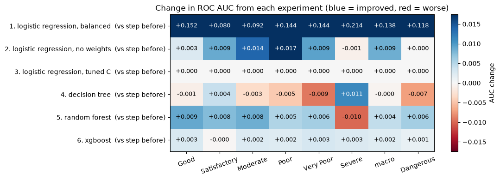
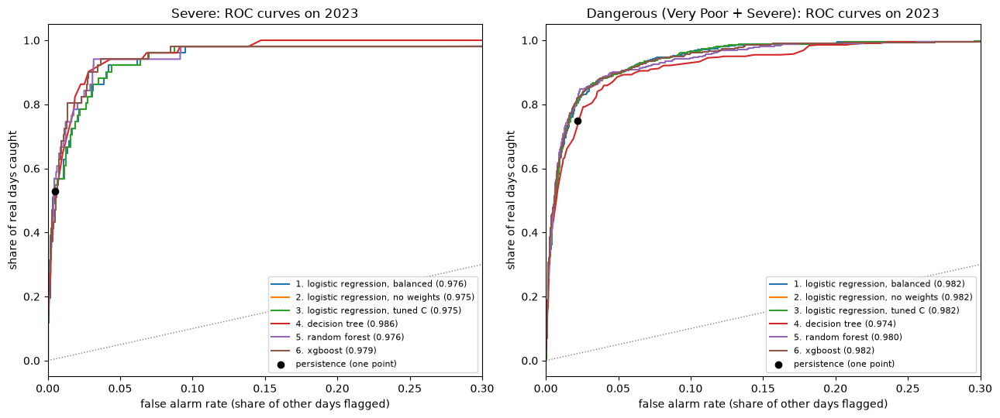
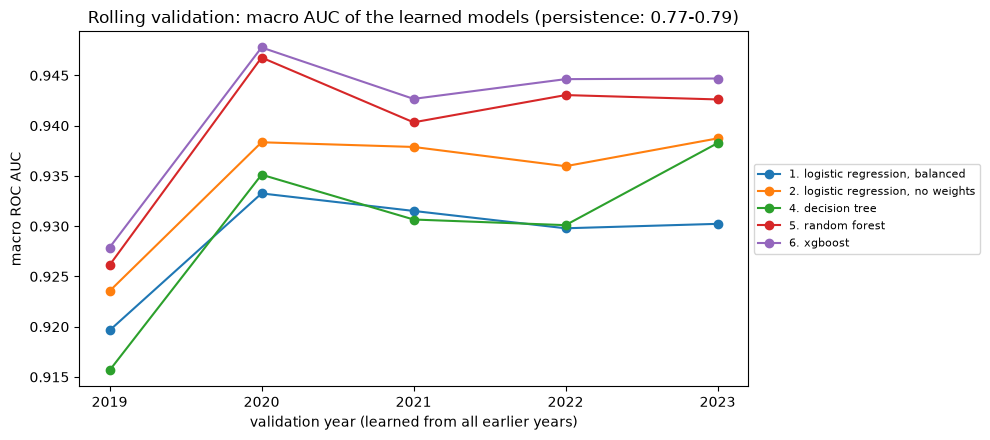

<!-- Exported from experiments/model_comparison.ipynb: every cell run top to bottom; generated, do not edit by hand -->

# Model Comparison: ROC AUC for Every Experiment

Macro F1 scores the **final category** each model picks. **ROC AUC scores the probabilities** behind it: for one category, the share of (real Severe day, other day) pairs in which the real Severe day gets the higher probability.

| AUC | Meaning |
|---|---|
| 0.5 | A coin toss: the probabilities say nothing |
| 0.7–0.8 | Useful |
| 0.8–0.9 | Good |
| above 0.9 | Very good ranking |
| 1.0 | Every Severe day ranked above every other day |

- AUC is **threshold-free**: a high Severe AUC means a good **Severe threshold** exists (the next planned step).
- Computed **one category against the rest** (6 scores), plus their average (**macro AUC**) and the **Dangerous** alert (probability of Very Poor + Severe).

**Persistence has no probabilities** (100% for today's category, 0% for the rest): it is a single ROC point with AUC = (recall + share of other days correctly left out) / 2, shown for reference only. **Only the learned models can be compared fairly with each other.**

This notebook loads every saved experiment in build order and shows **where each step improved** (section 4), on 2023 and on **five years** (section 6).

Run `lr_train_baseline.ipynb`, `dt_train.ipynb`, `rf_train.ipynb` and `xgb_train.ipynb` first: this notebook only loads their saved models.

## 1. Setup

```python
import pickle
from pathlib import Path

import numpy as np
import pandas as pd
import matplotlib.pyplot as plt
from matplotlib.colors import TwoSlopeNorm

from sklearn.base import clone
from sklearn.metrics import f1_score, roc_curve

import sys
sys.path.insert(0, '../scripts')                 # utility.py lives in scripts/
from utility import (AQI_CATEGORIES, DANGEROUS, prepare_dataset, split_train_val_test, add_lr_features,
                     proba_table, persistence_proba, auc_scores, rolling_validation, rolling_summary)

DATA_PATH = '../data/processed/aqi_weather_2015_2025.csv'
MODEL_DIR = Path('models')
TARGET = 'tomorrow_status'
TREND = ['aqi_roll7_mean', 'aqi_roll7_std', 'aqi_diff1', 'aqi_dev7']
pd.set_option('display.max_columns', 30)
```

## 2. The same 2023 days as every model

```python
df = prepare_dataset(DATA_PATH)
df = df[df[TREND].notna().all(axis=1)]                   # the same 195 rows every model drops
df_train, df_val, df_test = split_train_val_test(df)
y_val = df_val[TARGET].astype(str).to_numpy()
print('validation (2023):', len(df_val), 'days |', (y_val == 'Severe').sum(), 'Severe |',
      np.isin(y_val, DANGEROUS).sum(), 'Dangerous')
```

**Output:**

```
validation (2023): 5104 days | 51 Severe | 419 Dangerous
```

## 3. Load every experiment

Each saved bundle holds the model and the list of features it needs. Logistic regression also needs its own transforms (`add_lr_features`, with the city pressure normals saved in its bundle); the tree models use the raw columns.

```python
def lr_records(bundle, part):
    features = sum(bundle['features'].values(), [])
    return add_lr_features(part, pd.Series(bundle['city_pressure']))[features].to_dict(orient='records')

def tree_records(bundle, part):
    features = sum(bundle['features'].values(), [])
    return part[features].to_dict(orient='records')

STEPS = [                                                  # (name, saved file, how to build its features)
    ('1. logistic regression, balanced',   'lr_baseline.bin',   lr_records),
    ('2. logistic regression, no weights', 'lr_no_weights.bin', lr_records),
    ('3. logistic regression, tuned C',    'lr_best.bin',       lr_records),
    ('4. decision tree',                   'dt_best.bin',       tree_records),
    ('5. random forest',                   'rf_best.bin',       tree_records),
    ('6. xgboost',                         'xgb_best.bin',      tree_records),
]
missing = [file for _, file, _ in STEPS if not (MODEL_DIR / file).exists()]
assert not missing, f'run the training notebooks first, missing: {missing}'

BUNDLES, PROBA = {}, {'0. persistence': persistence_proba(df_val['status_today'])}
for name, file, records in STEPS:
    with open(MODEL_DIR / file, 'rb') as f:
        BUNDLES[name] = pickle.load(f)
    PROBA[name] = proba_table(BUNDLES[name]['model'], records(BUNDLES[name], df_val))

# Check: picking the most likely category gives back each model's known 2023 macro F1
pd.Series({name: f1_score(y_val, p.idxmax(axis=1), labels=AQI_CATEGORIES, average='macro')
           for name, p in PROBA.items()}, name='macro F1 (2023)').round(3).to_frame()
```

**Output:**

<div>

<table border="1" class="dataframe">
  <thead>
    <tr style="text-align: right;">
      <th></th>
      <th>macro F1 (2023)</th>
    </tr>
  </thead>
  <tbody>
    <tr>
      <th>0. persistence</th>
      <td>0.651</td>
    </tr>
    <tr>
      <th>1. logistic regression, balanced</th>
      <td>0.598</td>
    </tr>
    <tr>
      <th>2. logistic regression, no weights</th>
      <td>0.647</td>
    </tr>
    <tr>
      <th>3. logistic regression, tuned C</th>
      <td>0.647</td>
    </tr>
    <tr>
      <th>4. decision tree</th>
      <td>0.658</td>
    </tr>
    <tr>
      <th>5. random forest</th>
      <td>0.679</td>
    </tr>
    <tr>
      <th>6. xgboost</th>
      <td>0.668</td>
    </tr>
  </tbody>
</table>
</div>

## 4. ROC AUC on 2023, and where each step improved

**AUC for every category, the average of the six (`macro`) and the Dangerous alert:**

```python
auc = pd.DataFrame({name: auc_scores(y_val, p) for name, p in PROBA.items()}).T
auc.round(3)
```

**Output:**

<div>

<table border="1" class="dataframe">
  <thead>
    <tr style="text-align: right;">
      <th></th>
      <th>Good</th>
      <th>Satisfactory</th>
      <th>Moderate</th>
      <th>Poor</th>
      <th>Very Poor</th>
      <th>Severe</th>
      <th>macro</th>
      <th>Dangerous</th>
    </tr>
  </thead>
  <tbody>
    <tr>
      <th>0. persistence</th>
      <td>0.801</td>
      <td>0.835</td>
      <td>0.779</td>
      <td>0.756</td>
      <td>0.822</td>
      <td>0.762</td>
      <td>0.793</td>
      <td>0.864</td>
    </tr>
    <tr>
      <th>1. logistic regression, balanced</th>
      <td>0.953</td>
      <td>0.915</td>
      <td>0.872</td>
      <td>0.900</td>
      <td>0.966</td>
      <td>0.976</td>
      <td>0.930</td>
      <td>0.982</td>
    </tr>
    <tr>
      <th>2. logistic regression, no weights</th>
      <td>0.956</td>
      <td>0.924</td>
      <td>0.885</td>
      <td>0.917</td>
      <td>0.975</td>
      <td>0.975</td>
      <td>0.939</td>
      <td>0.982</td>
    </tr>
    <tr>
      <th>3. logistic regression, tuned C</th>
      <td>0.956</td>
      <td>0.924</td>
      <td>0.885</td>
      <td>0.917</td>
      <td>0.975</td>
      <td>0.975</td>
      <td>0.939</td>
      <td>0.982</td>
    </tr>
    <tr>
      <th>4. decision tree</th>
      <td>0.955</td>
      <td>0.928</td>
      <td>0.882</td>
      <td>0.913</td>
      <td>0.966</td>
      <td>0.986</td>
      <td>0.938</td>
      <td>0.974</td>
    </tr>
    <tr>
      <th>5. random forest</th>
      <td>0.963</td>
      <td>0.935</td>
      <td>0.891</td>
      <td>0.918</td>
      <td>0.972</td>
      <td>0.976</td>
      <td>0.943</td>
      <td>0.980</td>
    </tr>
    <tr>
      <th>6. xgboost</th>
      <td>0.966</td>
      <td>0.935</td>
      <td>0.893</td>
      <td>0.920</td>
      <td>0.975</td>
      <td>0.979</td>
      <td>0.945</td>
      <td>0.982</td>
    </tr>
  </tbody>
</table>
</div>

**Change per step:** each row is that experiment's AUC **minus the previous step's** (positive = improved). Step 1 is compared with persistence.

```python
change = auc.diff().iloc[1:]
change.round(3)
```

**Output:**

<div>

<table border="1" class="dataframe">
  <thead>
    <tr style="text-align: right;">
      <th></th>
      <th>Good</th>
      <th>Satisfactory</th>
      <th>Moderate</th>
      <th>Poor</th>
      <th>Very Poor</th>
      <th>Severe</th>
      <th>macro</th>
      <th>Dangerous</th>
    </tr>
  </thead>
  <tbody>
    <tr>
      <th>1. logistic regression, balanced</th>
      <td>0.152</td>
      <td>0.080</td>
      <td>0.092</td>
      <td>0.144</td>
      <td>0.144</td>
      <td>0.214</td>
      <td>0.138</td>
      <td>0.118</td>
    </tr>
    <tr>
      <th>2. logistic regression, no weights</th>
      <td>0.003</td>
      <td>0.009</td>
      <td>0.014</td>
      <td>0.017</td>
      <td>0.009</td>
      <td>-0.001</td>
      <td>0.009</td>
      <td>0.000</td>
    </tr>
    <tr>
      <th>3. logistic regression, tuned C</th>
      <td>0.000</td>
      <td>0.000</td>
      <td>0.000</td>
      <td>0.000</td>
      <td>0.000</td>
      <td>0.000</td>
      <td>0.000</td>
      <td>0.000</td>
    </tr>
    <tr>
      <th>4. decision tree</th>
      <td>-0.001</td>
      <td>0.004</td>
      <td>-0.003</td>
      <td>-0.005</td>
      <td>-0.009</td>
      <td>0.011</td>
      <td>-0.000</td>
      <td>-0.007</td>
    </tr>
    <tr>
      <th>5. random forest</th>
      <td>0.009</td>
      <td>0.008</td>
      <td>0.008</td>
      <td>0.005</td>
      <td>0.006</td>
      <td>-0.010</td>
      <td>0.004</td>
      <td>0.006</td>
    </tr>
    <tr>
      <th>6. xgboost</th>
      <td>0.003</td>
      <td>-0.000</td>
      <td>0.002</td>
      <td>0.002</td>
      <td>0.003</td>
      <td>0.003</td>
      <td>0.002</td>
      <td>0.001</td>
    </tr>
  </tbody>
</table>
</div>

```python
fig, ax = plt.subplots(figsize=(11, 4))
limit = np.abs(change.values[1:]).max()                  # scale on the steps between learned models; the jump
image = ax.imshow(change.values, cmap='RdBu',              # from persistence (step 1) is far larger and just saturates
                  norm=TwoSlopeNorm(0, -limit, limit), aspect='auto')
ax.set_xticks(range(change.shape[1]), change.columns, rotation=20)
ax.set_yticks(range(change.shape[0]), [f'{name}  (vs step before)' for name in change.index])
for i in range(change.shape[0]):
    for j in range(change.shape[1]):
        value = change.values[i, j]
        ax.text(j, i, f'{value:+.3f}', ha='center', va='center', fontsize=9,
                color='white' if abs(value) > 0.6 * limit else 'black')
ax.set_title('Change in ROC AUC from each experiment (blue = improved, red = worse)')
fig.colorbar(image, ax=ax, label='AUC change')
plt.tight_layout()
plt.show()
```



**Findings:**
- **The big jump is from persistence to any learned model** (macro AUC 0.793 → 0.930), mostly because persistence only says yes or no. The fair comparison is between the learned models.
- **All learned models rank the days well, and close together:** macro AUC 0.930 to 0.945. Between experiments AUC moves by at most 0.017; macro F1 moved far more (0.598 to 0.679).
- **Step 2, removing class weights: macro AUC +0.009, Severe unchanged (−0.001).** The weights barely changed how the days are **ordered**; they changed **where the bar is set** for saying "Severe" (the "lowered bar" from `lr_train_baseline.ipynb`). Hence macro F1 jumped (0.598 → 0.647) while AUC hardly moved.
- **Step 3, tuning C: no change.** Tuning chose C = 1, the default, so it is the same model as step 2.
- **Step 4, decision tree: best Severe ranking (0.986, +0.011), worse on Very Poor (−0.009) and Dangerous (−0.007).** All days in a leaf (at least 100 days) get the same probabilities, so the ranking is coarse. Overall no gain (macro −0.000).
- **Step 5, random forest: better on 7 of the 8 columns** (macro +0.004). Only Severe falls back (0.976, the same as logistic regression).
- **Step 6, XGBoost: small gains on almost every column** and the **best macro AUC** (0.945).
- **Macro F1 and AUC disagree on the top two.** The forest has the better macro F1 (0.679 against 0.668), XGBoost the better AUC (0.945 against 0.943). XGBoost **ranks** days slightly better; the forest **picks** better final categories, helped by balanced weights that move the bar towards the rare categories.

## 5. ROC curves: Severe and Dangerous

Each curve covers every threshold. x-axis: false-alarm rate (share of other days wrongly flagged); y-axis: share of real days caught. **Higher and further left is better.** Persistence is a single point (it has only one setting).

```python
fig, axes = plt.subplots(1, 2, figsize=(13, 5.5))
for ax, (title, truth, score) in zip(axes, [
        ('Severe', y_val == 'Severe', lambda p: p['Severe']),
        ('Dangerous (Very Poor + Severe)', np.isin(y_val, DANGEROUS), lambda p: p[DANGEROUS].sum(axis=1))]):
    for name, p in PROBA.items():
        if name.startswith('0.'):
            continue
        false_alarm_rate, caught_rate, _ = roc_curve(truth, score(p))
        ax.plot(false_alarm_rate, caught_rate, label=f"{name} ({auc.loc[name, title.split(' ')[0]]:.3f})")
    pred = score(PROBA['0. persistence']) > 0.5
    ax.scatter(pred[~truth].mean(), pred[truth].mean(), color='black', zorder=5, label='persistence (one point)')
    ax.plot([0, 1], [0, 1], color='grey', linestyle=':', linewidth=1)
    ax.set_xlim(0, 0.3)                                    # the useful part: few false alarms
    ax.set_title(f'{title}: ROC curves on 2023')
    ax.set_xlabel('false alarm rate (share of other days flagged)')
    ax.set_ylabel('share of real days caught')
    ax.legend(fontsize=8, loc='lower right')
plt.tight_layout()
plt.show()
```



**Findings:**
- **Severe: at persistence's own false-alarm level, the models do not catch more.** Persistence raised 25 false alarms in 2023 (0.5% of the other days) and caught 53% of the Severe days; at the same false-alarm level the models catch 45% to 57%.
- **The models' advantage on Severe is a choice of operating point:** at about 50 false alarms a year (1% of other days) the forest catches 67% and XGBoost 69%; at about 100 (2%), 78% to 82%. Persistence has no such setting. With only 51 Severe days, each step in these curves is one day.
- **Dangerous: a real gain at no extra cost.** At persistence's false-alarm level (103 false alarms, 2.2% of other days), the forest and XGBoost catch **82%** of the Dangerous days against persistence's **75%** (logistic regression 80%, the tree 73%).
- **The Severe threshold step is therefore a decision about how many false alarms are acceptable per extra Severe day caught,** not a purely technical one.

## 6. Five years: stability of the AUC ranking

As before, one year can mislead. Each experiment is retrained in every round of rolling validation (train on the years before, score 2019 to 2023) with exactly its saved settings (`clone` copies the settings without the learned trees or weights). `rolling_validation` now also records macro AUC whenever a model gives probabilities. About 3 minutes.

```python
df_dev = pd.concat([df_train, df_val])                   # 2015-2023 only; the test years stay locked

def lr_xy_for(bundle):
    features = sum(bundle['features'].values(), [])
    def xy(train, val):
        city_pressure = train.groupby('city')['pressure_mean'].mean()     # from this round's training years only
        return (add_lr_features(train, city_pressure)[features].to_dict(orient='records'),
                add_lr_features(val, city_pressure)[features].to_dict(orient='records'))
    return xy

def tree_xy_for(bundle):
    return lambda train, val: (tree_records(bundle, train), tree_records(bundle, val))

rolling = pd.concat({
    name: rolling_validation(df_dev, lambda b=BUNDLES[name]: clone(b['model']),
                             (lr_xy_for if records is lr_records else tree_xy_for)(BUNDLES[name]))
    for name, _, records in STEPS}, names=['model']).reset_index(level=0)

auc_by_year = rolling.pivot_table(index='model', columns='val_year', values='macro_auc')
persistence_auc = rolling.groupby('val_year')['persistence_macro_auc'].first().rename('0. persistence')
auc_by_year = pd.concat([persistence_auc.to_frame().T, auc_by_year])
print('Macro AUC per year:')
auc_by_year.round(3)
```

**Output:**

```
Macro AUC per year:
```

**Output:**

<div>

<table border="1" class="dataframe">
  <thead>
    <tr style="text-align: right;">
      <th>val_year</th>
      <th>2019</th>
      <th>2020</th>
      <th>2021</th>
      <th>2022</th>
      <th>2023</th>
    </tr>
  </thead>
  <tbody>
    <tr>
      <th>0. persistence</th>
      <td>0.765</td>
      <td>0.794</td>
      <td>0.785</td>
      <td>0.776</td>
      <td>0.793</td>
    </tr>
    <tr>
      <th>1. logistic regression, balanced</th>
      <td>0.920</td>
      <td>0.933</td>
      <td>0.932</td>
      <td>0.930</td>
      <td>0.930</td>
    </tr>
    <tr>
      <th>2. logistic regression, no weights</th>
      <td>0.924</td>
      <td>0.938</td>
      <td>0.938</td>
      <td>0.936</td>
      <td>0.939</td>
    </tr>
    <tr>
      <th>3. logistic regression, tuned C</th>
      <td>0.924</td>
      <td>0.938</td>
      <td>0.938</td>
      <td>0.936</td>
      <td>0.939</td>
    </tr>
    <tr>
      <th>4. decision tree</th>
      <td>0.916</td>
      <td>0.935</td>
      <td>0.931</td>
      <td>0.930</td>
      <td>0.938</td>
    </tr>
    <tr>
      <th>5. random forest</th>
      <td>0.926</td>
      <td>0.947</td>
      <td>0.940</td>
      <td>0.943</td>
      <td>0.943</td>
    </tr>
    <tr>
      <th>6. xgboost</th>
      <td>0.928</td>
      <td>0.948</td>
      <td>0.943</td>
      <td>0.945</td>
      <td>0.945</td>
    </tr>
  </tbody>
</table>
</div>

**Five-year summary:** mean macro AUC next to mean macro F1 and the bar from before (`passes_bar` is still judged on macro F1):

```python
five_years = rolling_summary(rolling)
five_years['auc_change_vs_step_before'] = five_years['mean_macro_auc'].diff()
five_years[['mean_macro_auc', 'auc_change_vs_step_before', 'mean_macro_f1', 'mean_vs_persistence',
            'years_won', 'passes_bar']].round(3)
```

**Output:**

<div>

<table border="1" class="dataframe">
  <thead>
    <tr style="text-align: right;">
      <th></th>
      <th>mean_macro_auc</th>
      <th>auc_change_vs_step_before</th>
      <th>mean_macro_f1</th>
      <th>mean_vs_persistence</th>
      <th>years_won</th>
      <th>passes_bar</th>
    </tr>
    <tr>
      <th>model</th>
      <th></th>
      <th></th>
      <th></th>
      <th></th>
      <th></th>
      <th></th>
    </tr>
  </thead>
  <tbody>
    <tr>
      <th>1. logistic regression, balanced</th>
      <td>0.929</td>
      <td>NaN</td>
      <td>0.614</td>
      <td>-0.020</td>
      <td>2</td>
      <td>False</td>
    </tr>
    <tr>
      <th>2. logistic regression, no weights</th>
      <td>0.935</td>
      <td>0.006</td>
      <td>0.613</td>
      <td>-0.021</td>
      <td>1</td>
      <td>False</td>
    </tr>
    <tr>
      <th>3. logistic regression, tuned C</th>
      <td>0.935</td>
      <td>0.000</td>
      <td>0.613</td>
      <td>-0.021</td>
      <td>1</td>
      <td>False</td>
    </tr>
    <tr>
      <th>4. decision tree</th>
      <td>0.930</td>
      <td>-0.005</td>
      <td>0.631</td>
      <td>-0.003</td>
      <td>3</td>
      <td>False</td>
    </tr>
    <tr>
      <th>5. random forest</th>
      <td>0.940</td>
      <td>0.010</td>
      <td>0.664</td>
      <td>0.030</td>
      <td>5</td>
      <td>True</td>
    </tr>
    <tr>
      <th>6. xgboost</th>
      <td>0.942</td>
      <td>0.002</td>
      <td>0.655</td>
      <td>0.021</td>
      <td>5</td>
      <td>True</td>
    </tr>
  </tbody>
</table>
</div>

```python
fig, ax = plt.subplots(figsize=(10, 4.5))
for name in auc_by_year.index:
    if name.startswith(('0.', '3.')):                    # persistence (0.77-0.79) would squash the plot;
        continue                                           # step 3 is the same model as step 2
    ax.plot(auc_by_year.columns, auc_by_year.loc[name], marker='o', label=name)
ax.set_xticks(list(auc_by_year.columns))
ax.set_xlabel('validation year (learned from all earlier years)')
ax.set_ylabel('macro ROC AUC')
ax.set_title('Rolling validation: macro AUC of the learned models (persistence: 0.77-0.79)')
ax.legend(fontsize=8, loc='center left', bbox_to_anchor=(1, 0.5))
plt.tight_layout()
plt.show()
```



**Findings:**
- **The ranking holds over five years.** XGBoost has the highest macro AUC in **every one** of the five years (mean **0.942**); the random forest is second in every year (mean **0.940**).
- **The forest is the biggest step between learned models** (+0.010 over the tree's five-year average); 2023 alone showed +0.004.
- **The decision tree ranks below unweighted logistic regression** (0.930 against 0.935), the opposite of macro F1 (tree 0.631, logistic regression 0.613), again because its probabilities are coarse. Only balanced logistic regression ranks lower (0.929).
- **Removing class weights improves logistic regression's ranking in every year** (+0.006 on average), as on 2023.
- **AUC is steadier than macro F1.** Every learned model's AUC moves by about 0.02 or less between years, and XGBoost and the forest are the top two in every year. Macro F1 depends more on where the bar happens to fall in each year.

## Discussion

**Where each experiment improved** (five-year averages, each compared with the step before):

| Step | Macro F1 | Macro AUC | Where it helped, where it did not |
|---|---|---|---|
| 0. Persistence | 0.634 | 0.782 | Reference only: no probabilities |
| 1. Logistic regression, balanced | −0.020 | +0.146 | Every category ranked far better than yes/no; but too many rare forecasts |
| 2. Logistic regression, no weights | −0.001 | +0.006 | Middle categories (Moderate, Poor); Severe ranking unchanged: weights only move the bar |
| 3. Logistic regression, tuned C | 0.000 | 0.000 | No change: the tuned C is the default |
| 4. Decision tree | +0.018 | −0.005 | Best Severe ranking on 2023; coarse probabilities elsewhere |
| 5. Random forest | **+0.033** | **+0.010** | The biggest step: better in almost every category; passes the bar |
| 6. XGBoost | −0.009 | +0.002 | Best ranking in every year, but slightly worse final picks than the forest |

1. **Both scores agree on the leaders:** the random forest and XGBoost are the two best models, on 2023 and over five years.
2. **They disagree on the order.** XGBoost ranks days slightly better (AUC); the forest picks the final category better (macro F1). Both gaps are small.
3. **All learned models rank days well (AUC above 0.93); the larger differences come from where the bar is set.** Class weights changed macro F1 a lot and AUC hardly at all, so the next step, **tuning the Severe threshold**, can matter more than another model type. It should be tried on **both** the forest and XGBoost and judged on five years.
4. **Severe: more days caught only with more false alarms.** At persistence's false-alarm level no model catches more Severe days. For the **Dangerous** alert, the forest and XGBoost catch more (82% against 75%) **with the same number of false alarms**.
5. **For management:** the forecast already gives a better health warning than "tomorrow = today" at no extra cost. For Severe, the rarest category, the team has to decide how many false alarms are acceptable per extra Severe day caught.
