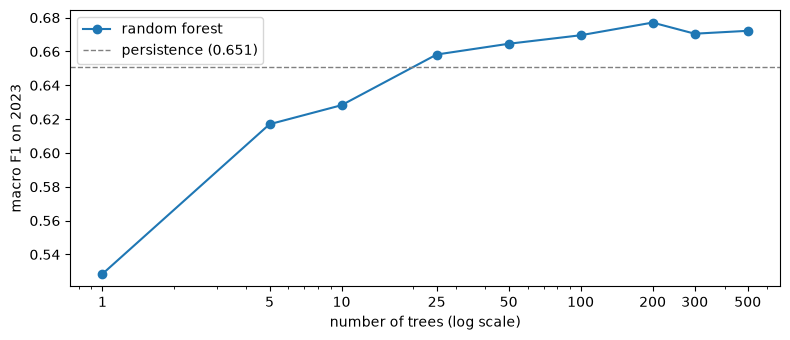
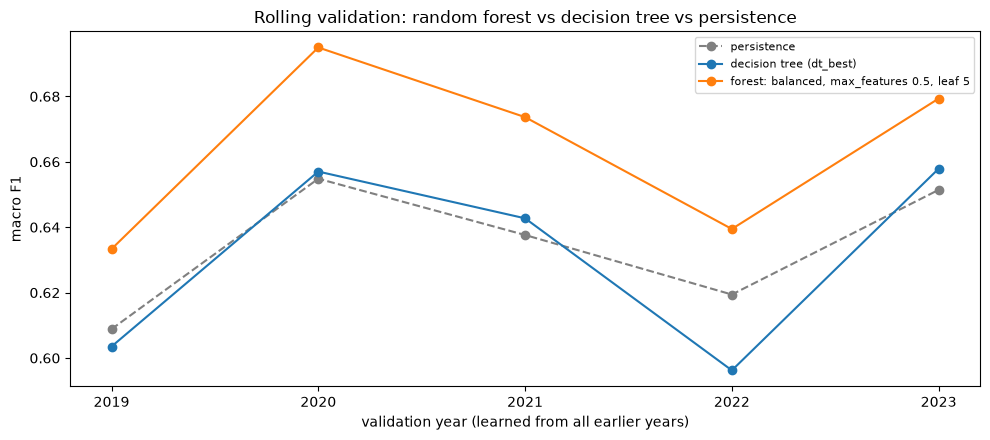

<!-- Exported from experiments/rf_train.ipynb: every cell run top to bottom; generated, do not edit by hand -->

# Random Forest: Train and Compare

**Motivation.** The decision tree was the first model to beat persistence on 2023 (0.658 against 0.651), but it is fragile:

- its 2023 score **jumped by about 0.01** between neighbouring settings, more than its margin over persistence;
- over **five years** it only **tied** with persistence (mean −0.003, ahead in 3 of 5 years).

A random forest reduces that variance by voting over many decorrelated trees. Each tree is trained on a bootstrap sample of the days (**bagging**; about a third of the days are left out of each sample), and each split chooses from a random subset of the features (`max_features`), so the 200 trees do not all split first on `aqi_today` and make the same errors.

**The bar** (set in `dt_train.ipynb`, section 9): a model only counts as better if it beats persistence **on average over the five years 2019–2023 and in most of them**, not just in 2023.

Decisions so far: [`docs/model_decisions.md`](../docs/model_decisions.md). Run `lr_train_baseline.ipynb` and `dt_train.ipynb` first: this notebook loads `models/lr_best.bin` and `models/dt_best.bin` to compare with them.

## 1. Setup

```python
import pickle
from pathlib import Path

import numpy as np
import pandas as pd
import matplotlib.pyplot as plt

from sklearn.ensemble import RandomForestClassifier
from sklearn.feature_extraction import DictVectorizer
from sklearn.metrics import confusion_matrix, f1_score
from sklearn.pipeline import Pipeline
from sklearn.tree import DecisionTreeClassifier

import sys
sys.path.insert(0, '../scripts')                 # utility.py lives in scripts/
from utility import (AQI_CATEGORIES, prepare_dataset, split_train_val_test, add_lr_features,
                     forecast_scorecard, class_scores_table, rolling_validation, rolling_summary)

DATA_PATH = '../data/processed/aqi_weather_2015_2025.csv'
MODEL_DIR = Path('models')
TARGET = 'tomorrow_status'
TREND = ['aqi_roll7_mean', 'aqi_roll7_std', 'aqi_diff1', 'aqi_dev7']
pd.set_option('display.max_columns', 30)
```

## 2. The same days as every other model

The same data pipeline, the same 195 rows dropped and the same time split, so every model is scored on exactly the same 2023 days.

```python
df = prepare_dataset(DATA_PATH)
before = len(df)
df = df[df[TREND].notna().all(axis=1)]                   # the same 195 rows every model drops
df_train, df_val, df_test = split_train_val_test(df)

print(f'Dropped {before - len(df)} rows with empty trend features')
print('train:', len(df_train), '| validation:', len(df_val), '| test:', len(df_test))
```

**Output:**

```
Dropped 195 rows with empty trend features
train: 33543 | validation: 5104 | test: 9985
```

## 3. Features: the same raw columns as the decision tree

No transforms (no scaling, no log, no month on a circle, no pressure relative to the city; reasons in `dt_train.ipynb`, section 3). The features are exactly the decision tree's: all raw weather columns, all four trend features, the pollutant flags and `city`.

```python
TREE_NUMERIC = (['aqi_today'] + TREND +
                ['temp_mean', 'temp_max', 'temp_min', 'temp_range', 'humidity_mean', 'dew_point_mean',
                 'precip_sum', 'pressure_mean', 'cloud_cover_mean', 'wind_speed_mean', 'wind_speed_max',
                 'wind_u_mean', 'wind_v_mean', 'month'])
TREE_BINARY = [c for c in df.columns if c.startswith('has_')] + ['aqi_imputed']
TREE_CATEGORICAL = ['city']
FEATURES = TREE_NUMERIC + TREE_BINARY + TREE_CATEGORICAL

def to_records(part):
    return part[FEATURES].to_dict(orient='records')

X_train, X_val = to_records(df_train), to_records(df_val)
y_train = df_train[TARGET].astype(str).to_numpy()
y_val = df_val[TARGET].astype(str).to_numpy()

assert df_train[FEATURES].notna().all().all() and df_val[FEATURES].notna().all().all(), 'missing values in the features'
print(f'{len(TREE_NUMERIC)} numeric + {len(TREE_BINARY)} yes/no + {len(TREE_CATEGORICAL)} text = {len(FEATURES)} features')
```

**Output:**

```
19 numeric + 7 yes/no + 1 text = 27 features
```

## 4. The settings of a forest

| Setting | Meaning | Effect |
|---|---|---|
| `n_estimators` | Number of trees | More trees → a steadier vote. Does not overfit; only costs time |
| `max_features` | Features available at each split, out of the 40 columns after one-hot encoding the city (`'sqrt'` = √40 ≈ 6, `0.33` = a third, `1.0` = all) | Fewer → more decorrelated trees whose errors cancel better; too few → weak trees |
| `min_samples_leaf` | Minimum training days per leaf | As in the single tree, but a forest tolerates much smaller leaves (section 5) |
| `class_weight` | `None`, or `'balanced_subsample'`: rare categories weighted up, recomputed on each tree's own sample | Balanced lowers the bar for the rare categories (Very Poor, Severe) |

`n_jobs=-1` trains on all processor cores; `random_state=1` fixes the random samples across runs.

```python
def make_forest(min_samples_leaf=1, max_features='sqrt', class_weight=None, n_estimators=200):
    return Pipeline([
        ('dv', DictVectorizer(sparse=False)),             # city -> one-hot; numbers pass through
        ('forest', RandomForestClassifier(n_estimators=n_estimators, min_samples_leaf=min_samples_leaf,
                                          max_features=max_features, class_weight=class_weight,
                                          n_jobs=-1, random_state=1)),
    ])

def macro_f1(y_true, y_pred):
    return f1_score(y_true, y_pred, labels=AQI_CATEGORIES, average='macro')
```

## 5. Two quick experiments

### 5.1 Effect of averaging trees on overfitting

In `dt_train.ipynb` an unconstrained tree overfit the training years: **1.000** on training, only **0.513** on 2023. Below, 200 such trees (no depth limit, a leaf may hold a single day) are combined by vote:

```python
free_forest = make_forest(min_samples_leaf=1).fit(X_train, y_train)

print(f'Macro F1 on training years: {macro_f1(y_train, free_forest.predict(X_train)):.3f}')
print(f'Macro F1 on 2023:           {macro_f1(y_val, free_forest.predict(X_val)):.3f}   '
      f'(one unlimited tree 0.513, persistence 0.651)')
```

**Output:**

```
Macro F1 on training years: 1.000
Macro F1 on 2023:           0.670   (one unlimited tree 0.513, persistence 0.651)
```

**Voting removes most of the overfitting.** Each of the 200 trees fits its sample perfectly (training score **1.000**, as for the single unconstrained tree), but on 2023 the forest scores **0.670** instead of 0.513, already above persistence: the trees overfit to *different* noise (different days and features), which cancels in the vote.

**For a forest, a large train/validation gap is therefore not a warning sign by itself**; what matters is the score on unseen days and, later, on five years.

### 5.2 Number of trees

The same forest (at least 5 days per leaf) with 1 to 500 trees, scored on 2023:

```python
TREE_COUNTS = [1, 5, 10, 25, 50, 100, 200, 300, 500]
trees_curve = pd.Series({n: macro_f1(y_val, make_forest(5, n_estimators=n).fit(X_train, y_train).predict(X_val))
                         for n in TREE_COUNTS}, name='macro F1 on 2023')

fig, ax = plt.subplots(figsize=(8, 3.5))
ax.plot(trees_curve.index, trees_curve.values, marker='o', label='random forest')
ax.axhline(0.651, color='grey', linestyle='--', linewidth=1, label='persistence (0.651)')
ax.set_xscale('log')
ax.set_xticks(TREE_COUNTS, [str(n) for n in TREE_COUNTS])
ax.set_xlabel('number of trees (log scale)')
ax.set_ylabel('macro F1 on 2023')
ax.legend()
plt.tight_layout()
plt.show()
trees_curve.round(3).to_frame().T
```



**Output:**

<div>

<table border="1" class="dataframe">
  <thead>
    <tr style="text-align: right;">
      <th></th>
      <th>1</th>
      <th>5</th>
      <th>10</th>
      <th>25</th>
      <th>50</th>
      <th>100</th>
      <th>200</th>
      <th>300</th>
      <th>500</th>
    </tr>
  </thead>
  <tbody>
    <tr>
      <th>macro F1 on 2023</th>
      <td>0.528</td>
      <td>0.617</td>
      <td>0.628</td>
      <td>0.658</td>
      <td>0.665</td>
      <td>0.67</td>
      <td>0.677</td>
      <td>0.671</td>
      <td>0.672</td>
    </tr>
  </tbody>
</table>
</div>

**Findings:**
- **One tree is weak** (0.528): the same overfitting, made worse by training on a sample of the days.
- **The score rises quickly** to 0.658 with 25 trees, passing persistence.
- **Flat from about 100 trees** (0.670–0.677). The variation (0.677 at 200, 0.671 at 300) is sampling noise, not a real difference.
- **More trees never hurt**, they only cost time. The forests below use **200 trees**.

## 6. Tuning on 2023

Every combination of 4 `max_features` × 4 leaf sizes × 2 class weightings = 32 forests of 200 trees, each scored on the training years and on 2023 (about 3 minutes).

```python
MAX_FEATURES = ['sqrt', 0.33, 0.5, 1.0]                  # 'sqrt' = about 6 of the 40 columns; 1.0 = all of them
LEAVES = [1, 5, 20, 50]                                  # minimum days in every leaf
WEIGHTS = {'no class weights': None, 'balanced': 'balanced_subsample'}

rows = []
for weight_name, class_weight in WEIGHTS.items():
    for max_features in MAX_FEATURES:
        for leaf in LEAVES:
            m = make_forest(leaf, max_features, class_weight).fit(X_train, y_train)
            pred_va = m.predict(X_val)
            rows.append({
                'weights': weight_name, 'max_features': max_features, 'min_samples_leaf': leaf,
                'train_macro_f1': macro_f1(y_train, m.predict(X_train)),
                'val_macro_f1': macro_f1(y_val, pred_va),
                'said_severe': (pred_va == 'Severe').sum(),
            })

tuning = pd.DataFrame(rows)
tuning['gap'] = tuning['train_macro_f1'] - tuning['val_macro_f1']
print(len(tuning), 'forests trained | real Severe days in 2023:', (y_val == 'Severe').sum())
tuning.sort_values('val_macro_f1', ascending=False).head(10).round(3)
```

**Output:**

```
32 forests trained | real Severe days in 2023: 51
```

**Output:**

<div>

<table border="1" class="dataframe">
  <thead>
    <tr style="text-align: right;">
      <th></th>
      <th>weights</th>
      <th>max_features</th>
      <th>min_samples_leaf</th>
      <th>train_macro_f1</th>
      <th>val_macro_f1</th>
      <th>said_severe</th>
      <th>gap</th>
    </tr>
  </thead>
  <tbody>
    <tr>
      <th>25</th>
      <td>balanced</td>
      <td>0.5</td>
      <td>5</td>
      <td>0.900</td>
      <td>0.679</td>
      <td>66</td>
      <td>0.220</td>
    </tr>
    <tr>
      <th>5</th>
      <td>no class weights</td>
      <td>0.33</td>
      <td>5</td>
      <td>0.872</td>
      <td>0.679</td>
      <td>40</td>
      <td>0.193</td>
    </tr>
    <tr>
      <th>6</th>
      <td>no class weights</td>
      <td>0.33</td>
      <td>20</td>
      <td>0.738</td>
      <td>0.678</td>
      <td>36</td>
      <td>0.059</td>
    </tr>
    <tr>
      <th>1</th>
      <td>no class weights</td>
      <td>sqrt</td>
      <td>5</td>
      <td>0.854</td>
      <td>0.677</td>
      <td>36</td>
      <td>0.177</td>
    </tr>
    <tr>
      <th>29</th>
      <td>balanced</td>
      <td>1.0</td>
      <td>5</td>
      <td>0.906</td>
      <td>0.676</td>
      <td>67</td>
      <td>0.230</td>
    </tr>
    <tr>
      <th>2</th>
      <td>no class weights</td>
      <td>sqrt</td>
      <td>20</td>
      <td>0.726</td>
      <td>0.675</td>
      <td>30</td>
      <td>0.051</td>
    </tr>
    <tr>
      <th>14</th>
      <td>no class weights</td>
      <td>1.0</td>
      <td>20</td>
      <td>0.749</td>
      <td>0.674</td>
      <td>42</td>
      <td>0.075</td>
    </tr>
    <tr>
      <th>16</th>
      <td>balanced</td>
      <td>sqrt</td>
      <td>1</td>
      <td>1.000</td>
      <td>0.674</td>
      <td>37</td>
      <td>0.326</td>
    </tr>
    <tr>
      <th>10</th>
      <td>no class weights</td>
      <td>0.5</td>
      <td>20</td>
      <td>0.742</td>
      <td>0.674</td>
      <td>37</td>
      <td>0.069</td>
    </tr>
    <tr>
      <th>8</th>
      <td>no class weights</td>
      <td>0.5</td>
      <td>1</td>
      <td>1.000</td>
      <td>0.674</td>
      <td>45</td>
      <td>0.326</td>
    </tr>
  </tbody>
</table>
</div>

**Macro F1 on 2023** for every combination (rows: weighting and `max_features`, columns: minimum days per leaf):

```python
(tuning.pivot_table(index=['weights', 'max_features'], columns='min_samples_leaf', values='val_macro_f1')
       .reindex(['no class weights', 'balanced'], level=0)
       .round(3))
```

**Output:**

<div>

<table border="1" class="dataframe">
  <thead>
    <tr style="text-align: right;">
      <th></th>
      <th>min_samples_leaf</th>
      <th>1</th>
      <th>5</th>
      <th>20</th>
      <th>50</th>
    </tr>
    <tr>
      <th>weights</th>
      <th>max_features</th>
      <th></th>
      <th></th>
      <th></th>
      <th></th>
    </tr>
  </thead>
  <tbody>
    <tr>
      <th rowspan="4" valign="top">no class weights</th>
      <th>0.33</th>
      <td>0.673</td>
      <td>0.679</td>
      <td>0.678</td>
      <td>0.668</td>
    </tr>
    <tr>
      <th>0.5</th>
      <td>0.674</td>
      <td>0.669</td>
      <td>0.674</td>
      <td>0.672</td>
    </tr>
    <tr>
      <th>1.0</th>
      <td>0.668</td>
      <td>0.664</td>
      <td>0.674</td>
      <td>0.669</td>
    </tr>
    <tr>
      <th>sqrt</th>
      <td>0.670</td>
      <td>0.677</td>
      <td>0.675</td>
      <td>0.634</td>
    </tr>
    <tr>
      <th rowspan="4" valign="top">balanced</th>
      <th>0.33</th>
      <td>0.664</td>
      <td>0.667</td>
      <td>0.657</td>
      <td>0.642</td>
    </tr>
    <tr>
      <th>0.5</th>
      <td>0.666</td>
      <td>0.679</td>
      <td>0.660</td>
      <td>0.641</td>
    </tr>
    <tr>
      <th>1.0</th>
      <td>0.671</td>
      <td>0.676</td>
      <td>0.654</td>
      <td>0.642</td>
    </tr>
    <tr>
      <th>sqrt</th>
      <td>0.674</td>
      <td>0.671</td>
      <td>0.652</td>
      <td>0.632</td>
    </tr>
  </tbody>
</table>
</div>

**Findings:**
- **Almost every forest beats persistence on 2023.** All 24 forests with leaves of 1 to 20 days score 0.652 to 0.679, against persistence's 0.651. Only 4 of the single tree's 60 settings got above 0.651, all with exactly 100 days per leaf.
- **The top is flat.** The 10 best forests are within **0.005** of each other (0.674–0.679), less than the year-to-year noise seen in rolling validation, so **2023 alone cannot pick the best setting**.
- **Leaves of 50 days are too coarse,** especially with balanced weights (0.632–0.642).
- **Balanced weights tie with no weights at the top** (both 0.679), but predict "Severe" much more often (66 times against 40, with 51 real Severe days).

Section 7 uses five years to choose among the top settings.

## 7. Let five years choose

Shortlist: the **3 best settings of each weighting** on 2023. Each goes through rolling validation (train on the years before, score one year, for 2019 to 2023), with the decision tree from `dt_best.bin` as reference. The test years 2024–2025 stay locked.

`rolling_summary` in `utility.py` applies the bar: `passes_bar` is true only if a model beats persistence on the five-year average **and** in most of the years.

**Selection rule:** among the forests that pass, keep those within 0.002 of the best five-year average (smaller differences are noise). Of those, prefer more years ahead of persistence, then the smaller training gap.

```python
with open(MODEL_DIR / 'dt_best.bin', 'rb') as f:        # saved by dt_train.ipynb, section 10
    dt_bundle = pickle.load(f)
with open(MODEL_DIR / 'lr_best.bin', 'rb') as f:        # saved by lr_train_baseline.ipynb
    lr_bundle = pickle.load(f)

SHORTLIST = (tuning.sort_values('val_macro_f1', ascending=False)
                   .groupby('weights', sort=False).head(3)
                   .copy())
SHORTLIST['name'] = SHORTLIST.apply(
    lambda r: f"forest: {r['weights']}, max_features {r['max_features']}, leaf {r['min_samples_leaf']}", axis=1)

def forest_maker(row):                                   # a function that returns a fresh, unfitted forest
    return lambda: make_forest(row['min_samples_leaf'], row['max_features'], WEIGHTS[row['weights']])

def make_dt():                                           # the chosen decision tree, same settings as dt_best.bin
    return Pipeline([('dv', DictVectorizer(sparse=False)),
                     ('tree', DecisionTreeClassifier(**dt_bundle['params'], random_state=1))])

def tree_xy(train, val):
    return to_records(train), to_records(val)

CANDIDATES = {row['name']: forest_maker(row) for _, row in SHORTLIST.iterrows()}
CANDIDATES['decision tree (dt_best)'] = make_dt

df_dev = pd.concat([df_train, df_val])                   # 2015-2023 only; the test years stay locked
rolling = pd.concat({name: rolling_validation(df_dev, make, tree_xy) for name, make in CANDIDATES.items()},
                    names=['model']).reset_index(level=0)
SHORTLIST[['name', 'val_macro_f1', 'said_severe']].round(3)
```

**Output:**

<div>

<table border="1" class="dataframe">
  <thead>
    <tr style="text-align: right;">
      <th></th>
      <th>name</th>
      <th>val_macro_f1</th>
      <th>said_severe</th>
    </tr>
  </thead>
  <tbody>
    <tr>
      <th>25</th>
      <td>forest: balanced, max_features 0.5, leaf 5</td>
      <td>0.679</td>
      <td>66</td>
    </tr>
    <tr>
      <th>5</th>
      <td>forest: no class weights, max_features 0.33, l...</td>
      <td>0.679</td>
      <td>40</td>
    </tr>
    <tr>
      <th>6</th>
      <td>forest: no class weights, max_features 0.33, l...</td>
      <td>0.678</td>
      <td>36</td>
    </tr>
    <tr>
      <th>1</th>
      <td>forest: no class weights, max_features sqrt, l...</td>
      <td>0.677</td>
      <td>36</td>
    </tr>
    <tr>
      <th>29</th>
      <td>forest: balanced, max_features 1.0, leaf 5</td>
      <td>0.676</td>
      <td>67</td>
    </tr>
    <tr>
      <th>16</th>
      <td>forest: balanced, max_features sqrt, leaf 1</td>
      <td>0.674</td>
      <td>37</td>
    </tr>
  </tbody>
</table>
</div>

**Macro F1 per year** (persistence first, for reference):

```python
by_year = rolling.pivot_table(index='model', columns='val_year', values='macro_f1')
persistence_row = rolling.groupby('val_year')['persistence_macro_f1'].first().rename('persistence')
by_year = pd.concat([by_year, persistence_row.to_frame().T]).reindex(['persistence'] + list(CANDIDATES))
by_year.round(3)
```

**Output:**

<div>

<table border="1" class="dataframe">
  <thead>
    <tr style="text-align: right;">
      <th>val_year</th>
      <th>2019</th>
      <th>2020</th>
      <th>2021</th>
      <th>2022</th>
      <th>2023</th>
    </tr>
  </thead>
  <tbody>
    <tr>
      <th>persistence</th>
      <td>0.609</td>
      <td>0.655</td>
      <td>0.638</td>
      <td>0.619</td>
      <td>0.651</td>
    </tr>
    <tr>
      <th>forest: balanced, max_features 0.5, leaf 5</th>
      <td>0.633</td>
      <td>0.695</td>
      <td>0.674</td>
      <td>0.639</td>
      <td>0.679</td>
    </tr>
    <tr>
      <th>forest: no class weights, max_features 0.33, leaf 5</th>
      <td>0.620</td>
      <td>0.682</td>
      <td>0.671</td>
      <td>0.607</td>
      <td>0.679</td>
    </tr>
    <tr>
      <th>forest: no class weights, max_features 0.33, leaf 20</th>
      <td>0.619</td>
      <td>0.681</td>
      <td>0.674</td>
      <td>0.608</td>
      <td>0.678</td>
    </tr>
    <tr>
      <th>forest: no class weights, max_features sqrt, leaf 5</th>
      <td>0.611</td>
      <td>0.679</td>
      <td>0.671</td>
      <td>0.598</td>
      <td>0.677</td>
    </tr>
    <tr>
      <th>forest: balanced, max_features 1.0, leaf 5</th>
      <td>0.618</td>
      <td>0.688</td>
      <td>0.662</td>
      <td>0.631</td>
      <td>0.676</td>
    </tr>
    <tr>
      <th>forest: balanced, max_features sqrt, leaf 1</th>
      <td>0.594</td>
      <td>0.660</td>
      <td>0.670</td>
      <td>0.620</td>
      <td>0.674</td>
    </tr>
    <tr>
      <th>decision tree (dt_best)</th>
      <td>0.604</td>
      <td>0.657</td>
      <td>0.643</td>
      <td>0.596</td>
      <td>0.658</td>
    </tr>
  </tbody>
</table>
</div>

**Summary over the five years** (`spread` = how much the score moves from year to year; `mean_train_gap` = training score minus validation score):

```python
five_years = rolling_summary(rolling)
five_years.round(3)
```

**Output:**

<div>

<table border="1" class="dataframe">
  <thead>
    <tr style="text-align: right;">
      <th></th>
      <th>mean_macro_f1</th>
      <th>spread</th>
      <th>mean_vs_persistence</th>
      <th>years_won</th>
      <th>years</th>
      <th>mean_macro_auc</th>
      <th>mean_train_gap</th>
      <th>passes_bar</th>
    </tr>
    <tr>
      <th>model</th>
      <th></th>
      <th></th>
      <th></th>
      <th></th>
      <th></th>
      <th></th>
      <th></th>
      <th></th>
    </tr>
  </thead>
  <tbody>
    <tr>
      <th>forest: balanced, max_features 0.5, leaf 5</th>
      <td>0.664</td>
      <td>0.027</td>
      <td>0.030</td>
      <td>5</td>
      <td>5</td>
      <td>0.940</td>
      <td>0.230</td>
      <td>True</td>
    </tr>
    <tr>
      <th>forest: no class weights, max_features 0.33, leaf 5</th>
      <td>0.651</td>
      <td>0.036</td>
      <td>0.017</td>
      <td>4</td>
      <td>5</td>
      <td>0.941</td>
      <td>0.215</td>
      <td>True</td>
    </tr>
    <tr>
      <th>forest: no class weights, max_features 0.33, leaf 20</th>
      <td>0.652</td>
      <td>0.035</td>
      <td>0.018</td>
      <td>4</td>
      <td>5</td>
      <td>0.942</td>
      <td>0.074</td>
      <td>True</td>
    </tr>
    <tr>
      <th>forest: no class weights, max_features sqrt, leaf 5</th>
      <td>0.647</td>
      <td>0.040</td>
      <td>0.013</td>
      <td>4</td>
      <td>5</td>
      <td>0.941</td>
      <td>0.200</td>
      <td>True</td>
    </tr>
    <tr>
      <th>forest: balanced, max_features 1.0, leaf 5</th>
      <td>0.655</td>
      <td>0.030</td>
      <td>0.020</td>
      <td>5</td>
      <td>5</td>
      <td>0.939</td>
      <td>0.246</td>
      <td>True</td>
    </tr>
    <tr>
      <th>forest: balanced, max_features sqrt, leaf 1</th>
      <td>0.644</td>
      <td>0.035</td>
      <td>0.009</td>
      <td>4</td>
      <td>5</td>
      <td>0.940</td>
      <td>0.356</td>
      <td>True</td>
    </tr>
    <tr>
      <th>decision tree (dt_best)</th>
      <td>0.631</td>
      <td>0.030</td>
      <td>-0.003</td>
      <td>3</td>
      <td>5</td>
      <td>0.930</td>
      <td>0.025</td>
      <td>False</td>
    </tr>
  </tbody>
</table>
</div>

```python
passing = five_years[five_years.index.str.startswith('forest') & five_years['passes_bar']]
assert len(passing), 'no forest passes the bar: keep persistence'
close = passing[passing['mean_macro_f1'] >= passing['mean_macro_f1'].max() - 0.002]    # within 0.002 = a tie
chosen_name = close.sort_values(['years_won', 'mean_train_gap'], ascending=[False, True]).index[0]
chosen = SHORTLIST.set_index('name').loc[chosen_name]

print(f"Chosen: {chosen.name}")
print(f"  five-year mean {five_years.loc[chosen.name, 'mean_macro_f1']:.3f} "
      f"(persistence {by_year.loc['persistence'].mean():.3f}), "
      f"ahead in {five_years.loc[chosen.name, 'years_won']} of {five_years.loc[chosen.name, 'years']} years")
```

**Output:**

```
Chosen: forest: balanced, max_features 0.5, leaf 5
  five-year mean 0.664 (persistence 0.634), ahead in 5 of 5 years
```

```python
fig, ax = plt.subplots(figsize=(10, 4.5))
for name in ['persistence', 'decision tree (dt_best)', chosen.name]:
    style = dict(color='grey', linestyle='--') if name == 'persistence' else {}
    ax.plot(by_year.columns, by_year.loc[name], marker='o', label=name, **style)
ax.set_xticks(list(by_year.columns))
ax.set_xlabel('validation year (learned from all earlier years)')
ax.set_ylabel('macro F1')
ax.set_title('Rolling validation: random forest vs decision tree vs persistence')
ax.legend(fontsize=8)
plt.tight_layout()
plt.show()
```



**Findings:**
- **The random forest is the first model to pass the bar.** All 6 shortlisted forests beat persistence on the five-year average (+0.009 to +0.030), in at least 4 of the 5 years. The decision tree, run the same way, does not (−0.003, 3 of 5 years).
- **Chosen forest** (balanced weights, `max_features` 0.5, at least 5 days per leaf): **0.664** against persistence's **0.634** (+0.030), **ahead in all 5 years**, including **2022** (+0.020), the year every earlier model lost. It also has the smallest year-to-year spread (0.027).
- **Five years changed the class-weight decision.** On 2023, balanced and no weights tied (0.679 each). Over five years, balanced wins by **+0.012** (0.664 against 0.652), mostly in the harder years 2019 and 2022 (2022: 0.639 against 0.598–0.608).
- **Likely reason balanced weights help here but hurt logistic regression and the single tree:** in logistic regression they moved the bar for "Severe" on *every* day; in a forest they only shift the votes inside each tree's small leaves, which 200 trees then average, so the rare categories gain weight without a flood of rare forecasts. **Class weighting has to be re-checked for every model type, on five years.**
- **The training gap is large** (0.23), but as section 5.1 showed, that is expected for a forest; the five-year scores show it generalises.

## 8. Compare on 2023: persistence vs logistic regression vs decision tree vs random forest

The chosen forest is retrained on 2015–2022 and scored on 2023 with the same scorecard as every other model. Logistic regression and the decision tree are loaded from their saved bundles.

```python
forest = make_forest(chosen['min_samples_leaf'], chosen['max_features'], WEIGHTS[chosen['weights']]).fit(X_train, y_train)
pred_forest = forest.predict(X_val)

df_val_lr = add_lr_features(df_val, pd.Series(lr_bundle['city_pressure']))   # the LR needs its own transforms
lr_features = sum(lr_bundle['features'].values(), [])
pred_lr = lr_bundle['model'].predict(df_val_lr[lr_features].to_dict(orient='records'))
pred_tree = dt_bundle['model'].predict(X_val)

PREDICTIONS = {
    'persistence': df_val['status_today'].astype(str).to_numpy(),
    'logistic regression': pred_lr,
    'decision tree': pred_tree,
    'random forest': pred_forest,
}
scorecard = forecast_scorecard(y_val, PREDICTIONS, y_today=df_val['status_today'])
scorecard
```

**Output:**

<div>

<table border="1" class="dataframe">
  <thead>
    <tr style="text-align: right;">
      <th></th>
      <th>persistence</th>
      <th>logistic regression</th>
      <th>decision tree</th>
      <th>random forest</th>
    </tr>
  </thead>
  <tbody>
    <tr>
      <th>macro F1</th>
      <td>0.651</td>
      <td>0.647</td>
      <td>0.658</td>
      <td>0.679</td>
    </tr>
    <tr>
      <th>accuracy</th>
      <td>0.71</td>
      <td>0.729</td>
      <td>0.723</td>
      <td>0.734</td>
    </tr>
    <tr>
      <th>Severe caught</th>
      <td>27</td>
      <td>20</td>
      <td>25</td>
      <td>31</td>
    </tr>
    <tr>
      <th>Severe missed</th>
      <td>24</td>
      <td>31</td>
      <td>26</td>
      <td>20</td>
    </tr>
    <tr>
      <th>Severe false alarms</th>
      <td>25</td>
      <td>11</td>
      <td>19</td>
      <td>35</td>
    </tr>
    <tr>
      <th>Dangerous recall</th>
      <td>0.749</td>
      <td>0.807</td>
      <td>0.768</td>
      <td>0.84</td>
    </tr>
    <tr>
      <th>Dangerous precision</th>
      <td>0.753</td>
      <td>0.761</td>
      <td>0.74</td>
      <td>0.76</td>
    </tr>
    <tr>
      <th>change days right</th>
      <td>0.0</td>
      <td>0.353</td>
      <td>0.278</td>
      <td>0.268</td>
    </tr>
    <tr>
      <th>unchanged days right</th>
      <td>1.0</td>
      <td>0.883</td>
      <td>0.904</td>
      <td>0.924</td>
    </tr>
  </tbody>
</table>
</div>

**Precision, recall and F1 for every category:**

```python
class_scores_table(y_val, PREDICTIONS).round(2)
```

**Output:**

<div>

<table border="1" class="dataframe">
  <thead>
    <tr>
      <th></th>
      <th colspan="3" halign="left">persistence</th>
      <th colspan="3" halign="left">logistic regression</th>
      <th colspan="3" halign="left">decision tree</th>
      <th colspan="3" halign="left">random forest</th>
    </tr>
    <tr>
      <th></th>
      <th>precision</th>
      <th>recall</th>
      <th>F1</th>
      <th>precision</th>
      <th>recall</th>
      <th>F1</th>
      <th>precision</th>
      <th>recall</th>
      <th>F1</th>
      <th>precision</th>
      <th>recall</th>
      <th>F1</th>
    </tr>
  </thead>
  <tbody>
    <tr>
      <th>Good</th>
      <td>0.62</td>
      <td>0.62</td>
      <td>0.62</td>
      <td>0.77</td>
      <td>0.39</td>
      <td>0.52</td>
      <td>0.74</td>
      <td>0.53</td>
      <td>0.62</td>
      <td>0.68</td>
      <td>0.65</td>
      <td>0.66</td>
    </tr>
    <tr>
      <th>Satisfactory</th>
      <td>0.79</td>
      <td>0.79</td>
      <td>0.79</td>
      <td>0.78</td>
      <td>0.82</td>
      <td>0.80</td>
      <td>0.78</td>
      <td>0.82</td>
      <td>0.80</td>
      <td>0.81</td>
      <td>0.79</td>
      <td>0.80</td>
    </tr>
    <tr>
      <th>Moderate</th>
      <td>0.72</td>
      <td>0.72</td>
      <td>0.72</td>
      <td>0.74</td>
      <td>0.75</td>
      <td>0.74</td>
      <td>0.74</td>
      <td>0.72</td>
      <td>0.73</td>
      <td>0.76</td>
      <td>0.72</td>
      <td>0.74</td>
    </tr>
    <tr>
      <th>Poor</th>
      <td>0.58</td>
      <td>0.59</td>
      <td>0.59</td>
      <td>0.62</td>
      <td>0.60</td>
      <td>0.61</td>
      <td>0.59</td>
      <td>0.60</td>
      <td>0.59</td>
      <td>0.59</td>
      <td>0.67</td>
      <td>0.63</td>
    </tr>
    <tr>
      <th>Very Poor</th>
      <td>0.67</td>
      <td>0.67</td>
      <td>0.67</td>
      <td>0.68</td>
      <td>0.76</td>
      <td>0.72</td>
      <td>0.66</td>
      <td>0.70</td>
      <td>0.68</td>
      <td>0.69</td>
      <td>0.74</td>
      <td>0.71</td>
    </tr>
    <tr>
      <th>Severe</th>
      <td>0.52</td>
      <td>0.53</td>
      <td>0.52</td>
      <td>0.65</td>
      <td>0.39</td>
      <td>0.49</td>
      <td>0.57</td>
      <td>0.49</td>
      <td>0.53</td>
      <td>0.47</td>
      <td>0.61</td>
      <td>0.53</td>
    </tr>
  </tbody>
</table>
</div>

**Confusion matrix of the forest** (rows: what really happened, columns: what the forest forecast):

```python
pd.DataFrame(confusion_matrix(y_val, pred_forest, labels=AQI_CATEGORIES),
             index=pd.Index(AQI_CATEGORIES, name='actual'),
             columns=pd.Index(AQI_CATEGORIES, name='predicted'))
```

**Output:**

<div>

<table border="1" class="dataframe">
  <thead>
    <tr style="text-align: right;">
      <th>predicted</th>
      <th>Good</th>
      <th>Satisfactory</th>
      <th>Moderate</th>
      <th>Poor</th>
      <th>Very Poor</th>
      <th>Severe</th>
    </tr>
    <tr>
      <th>actual</th>
      <th></th>
      <th></th>
      <th></th>
      <th></th>
      <th></th>
      <th></th>
    </tr>
  </thead>
  <tbody>
    <tr>
      <th>Good</th>
      <td>190</td>
      <td>101</td>
      <td>2</td>
      <td>0</td>
      <td>0</td>
      <td>0</td>
    </tr>
    <tr>
      <th>Satisfactory</th>
      <td>87</td>
      <td>1419</td>
      <td>272</td>
      <td>7</td>
      <td>0</td>
      <td>0</td>
    </tr>
    <tr>
      <th>Moderate</th>
      <td>2</td>
      <td>224</td>
      <td>1309</td>
      <td>288</td>
      <td>6</td>
      <td>0</td>
    </tr>
    <tr>
      <th>Poor</th>
      <td>0</td>
      <td>3</td>
      <td>145</td>
      <td>525</td>
      <td>100</td>
      <td>5</td>
    </tr>
    <tr>
      <th>Very Poor</th>
      <td>0</td>
      <td>0</td>
      <td>2</td>
      <td>64</td>
      <td>272</td>
      <td>30</td>
    </tr>
    <tr>
      <th>Severe</th>
      <td>0</td>
      <td>0</td>
      <td>1</td>
      <td>0</td>
      <td>19</td>
      <td>31</td>
    </tr>
  </tbody>
</table>
</div>

**Findings:**

| 2023 | Persistence | Logistic regression | Decision tree | Random forest |
|---|---|---|---|---|
| Macro F1 | 0.651 | 0.647 | 0.658 | **0.679** |
| Accuracy | 0.710 | 0.729 | 0.723 | **0.734** |
| Severe caught / missed / false alarms | 27 / 24 / 25 | 20 / 31 / **11** | 25 / 26 / 19 | **31 / 20** / 35 |
| Dangerous recall / precision | 0.749 / 0.753 | 0.807 / **0.761** | 0.768 / 0.740 | **0.840** / 0.760 |
| Change days right | 0% | **35.3%** | 27.8% | 26.8% |
| Unchanged days right | **100%** | 88.3% | 90.4% | 92.4% |

- **Best model on 2023 on the main scores:** macro F1 0.679 (+0.028 over persistence), accuracy 73.4%.
- **Best Dangerous alert so far:** warns on **84%** of Very Poor and Severe days (logistic regression 81%, persistence 75%) at **76%** precision, matching logistic regression.
- **Most Severe days caught (31 of 51), but also the most Severe false alarms (35):** Severe precision is only 47%, the cost of balanced weights. Per the confusion matrix, **30 of the 35 false alarms were Very Poor days**, also dangerous; only 5 were Poor days.
- **Better at the rare ends:** Good F1 0.66 and Poor F1 0.63, the best of all four models.
- **Change days remain hard:** 26.8% right, below logistic regression (35.3%). The gain comes from unchanged days (92.4%) and the rare categories.

## 9. Feature importance

The forest's feature importance next to the single tree's: each feature's share of the total reduction in mistakes; for the forest, averaged over its 200 trees.

```python
importance = pd.DataFrame({
    'random forest': pd.Series(forest['forest'].feature_importances_, index=forest['dv'].feature_names_),
    'decision tree': pd.Series(dt_bundle['model']['tree'].feature_importances_,
                               index=dt_bundle['model']['dv'].feature_names_),
})
importance.sort_values('random forest', ascending=False).head(12).round(3)
```

**Output:**

<div>

<table border="1" class="dataframe">
  <thead>
    <tr style="text-align: right;">
      <th></th>
      <th>random forest</th>
      <th>decision tree</th>
    </tr>
  </thead>
  <tbody>
    <tr>
      <th>aqi_today</th>
      <td>0.372</td>
      <td>0.833</td>
    </tr>
    <tr>
      <th>aqi_roll7_mean</th>
      <td>0.165</td>
      <td>0.046</td>
    </tr>
    <tr>
      <th>temp_range</th>
      <td>0.053</td>
      <td>0.008</td>
    </tr>
    <tr>
      <th>wind_speed_max</th>
      <td>0.035</td>
      <td>0.021</td>
    </tr>
    <tr>
      <th>aqi_roll7_std</th>
      <td>0.031</td>
      <td>0.011</td>
    </tr>
    <tr>
      <th>aqi_dev7</th>
      <td>0.031</td>
      <td>0.000</td>
    </tr>
    <tr>
      <th>dew_point_mean</th>
      <td>0.030</td>
      <td>0.005</td>
    </tr>
    <tr>
      <th>wind_u_mean</th>
      <td>0.027</td>
      <td>0.013</td>
    </tr>
    <tr>
      <th>wind_v_mean</th>
      <td>0.027</td>
      <td>0.005</td>
    </tr>
    <tr>
      <th>cloud_cover_mean</th>
      <td>0.026</td>
      <td>0.004</td>
    </tr>
    <tr>
      <th>pressure_mean</th>
      <td>0.026</td>
      <td>0.003</td>
    </tr>
    <tr>
      <th>wind_speed_mean</th>
      <td>0.024</td>
      <td>0.004</td>
    </tr>
  </tbody>
</table>
</div>

**Findings:**
- **`aqi_today` still matters most, but with 37% of the importance instead of 83%.** With `max_features` 0.5, `aqi_today` is unavailable at about half of the splits, so the trees also learn the next-best signals: the **weekly average** (`aqi_roll7_mean`, 17%), the **daily temperature range** (`temp_range`, 5%; a large range often indicates clear, calm nights that trap pollution near the ground), **wind** and **humidity**.
- **Importance is not causation.** Correlated features (the four temperature columns, the trend features) share their importance, so a small value does not mean a feature is useless.

## 10. Save the model

```python
MODEL_PATH = MODEL_DIR / 'rf_best.bin'
MODEL_DIR.mkdir(parents=True, exist_ok=True)
bundle = {
    'model': forest,                                       # DictVectorizer + random forest
    'params': {'n_estimators': 200, 'max_features': chosen['max_features'],
               'min_samples_leaf': int(chosen['min_samples_leaf']), 'class_weight': WEIGHTS[chosen['weights']]},
    'features': {'numeric': TREE_NUMERIC, 'binary': TREE_BINARY, 'categorical': TREE_CATEGORICAL},
    'categories': AQI_CATEGORIES,
    'cities': sorted(df_train['city'].unique()),           # the service must reject any other city
    'validation': scorecard['random forest'].to_dict(),
    'five_years': five_years.loc[chosen.name].to_dict(),
    'tuning': tuning.round(4).to_dict(orient='records'),
}
with open(MODEL_PATH, 'wb') as f:
    pickle.dump(bundle, f)
with open(MODEL_PATH, 'rb') as f:
    assert (pickle.load(f)['model'].predict(X_val) == pred_forest).all()
print(f'Saved and verified: {MODEL_PATH.resolve()} ({MODEL_PATH.stat().st_size / 1e6:.0f} MB)')
```

**Output:**

```
Saved and verified: /Users/sshobhitggupta/Documents/datatalk_ml_zoomchamp/midterm_project/aqi_forcasting/experiments/models/rf_best.bin (114 MB)
```

## Discussion

1. **The random forest is the first model to pass the bar.** Over 2019–2023 it averages **0.664** against persistence's **0.634**, ahead in **all five years**, including 2022, where every earlier model lost.
2. **Voting fixes the single tree's main weakness.** 200 unconstrained trees fit the training data as fully as one (training 1.000), but their vote scores 0.670 on 2023 instead of 0.513. Almost every forest setting beats persistence on 2023, against 4 of 60 single-tree settings.
3. **One year could not choose the setting; five years could.** The 10 best forests on 2023 were within 0.005. Over five years, balanced class weights were clearly better (+0.012), which 2023 alone would have missed.
4. **On 2023 the forest is best on macro F1 (0.679), accuracy (73.4%) and the Dangerous alert (84% caught, 76% right).** The trade-off is Severe: the most Severe days caught (31 of 51), but also the most Severe false alarms (35, of which 30 were Very Poor days). The planned **Severe threshold** step can tune that balance.
5. **Cost: a 114 MB model file**, above GitHub's 100 MB limit, so `experiments/models/*.bin` should not be committed. `train.py` will rebuild the model from the data.

**Next: XGBoost** (`xgb_train.ipynb`), held to the same bar and compared with this forest's five-year average of 0.664.
