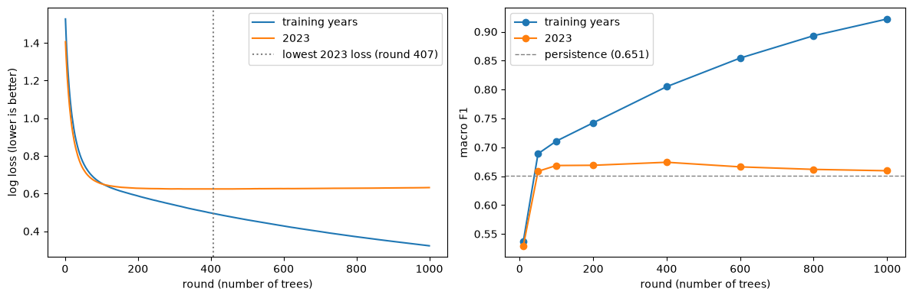
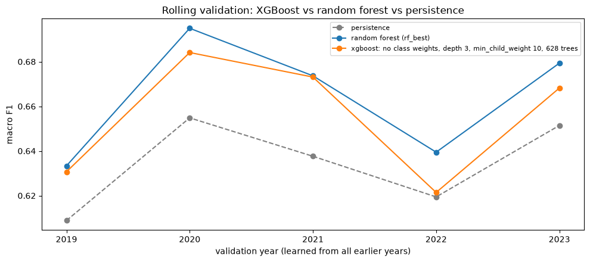

<!-- Exported from experiments/xgb_train.ipynb: every cell run top to bottom; generated, do not edit by hand -->

# XGBoost: Train and Compare

The random forest votes over 200 independent trees. **Boosting** builds trees **sequentially, each one fitted to the mistakes left by the trees before it.** Each correction is scaled down by the `learning_rate`, so no single tree moves the forecast too far.

| | Random forest | XGBoost (boosting) |
|---|---|---|
| Trees are built | Independently, all at once | One after another |
| Each tree | Deep, learns everything it can | Shallow (3–7 questions), fixes the remaining mistakes |
| Final forecast | Vote of all trees | Sum of all small corrections |
| More trees | Never overfits, only costs time | **Eventually overfits**: it starts correcting noise |

Because of the last row, XGBoost needs **early stopping**: add trees while the score on unseen days improves, stop when it does not.

**The bar** (set in `dt_train.ipynb`, section 9): a model only counts as better if it beats persistence **on average over the five years 2019–2023 and in most of them**. The random forest is the first model to pass it (`rf_train.ipynb`); XGBoost has to match or beat the forest.

Decisions so far: [`docs/model_decisions.md`](../docs/model_decisions.md). Run `lr_train_baseline.ipynb`, `dt_train.ipynb` and `rf_train.ipynb` first: this notebook loads their saved models to compare with them.

## 1. Setup

XGBoost requires the categories as integers 0–5. `CategoryXGB` in `utility.py` wraps it, encoding the names before training and decoding them on prediction, so XGBoost fits in a `Pipeline` and in `rolling_validation` like every other model.

```python
import pickle
from pathlib import Path

import numpy as np
import pandas as pd
import matplotlib.pyplot as plt

from sklearn.ensemble import RandomForestClassifier
from sklearn.feature_extraction import DictVectorizer
from sklearn.metrics import confusion_matrix, f1_score
from sklearn.pipeline import Pipeline

import sys
sys.path.insert(0, '../scripts')                 # utility.py lives in scripts/
from utility import (AQI_CATEGORIES, prepare_dataset, split_train_val_test, add_lr_features,
                     forecast_scorecard, class_scores_table, rolling_validation, rolling_summary,
                     CategoryXGB)

DATA_PATH = '../data/processed/aqi_weather_2015_2025.csv'
MODEL_DIR = Path('models')
TARGET = 'tomorrow_status'
TREND = ['aqi_roll7_mean', 'aqi_roll7_std', 'aqi_diff1', 'aqi_dev7']
pd.set_option('display.max_columns', 30)
```

## 2. The same days as every other model

```python
df = prepare_dataset(DATA_PATH)
before = len(df)
df = df[df[TREND].notna().all(axis=1)]                   # the same 195 rows every model drops
df_train, df_val, df_test = split_train_val_test(df)

print(f'Dropped {before - len(df)} rows with empty trend features')
print('train:', len(df_train), '| validation:', len(df_val), '| test:', len(df_test))
```

**Output:**

```
Dropped 195 rows with empty trend features
train: 33543 | validation: 5104 | test: 9985
```

## 3. Features: the same raw columns as the trees

The decision tree's and the forest's raw features, no transforms.

Early stopping needs the 2023 days already vectorised during training, so `DictVectorizer` is fitted once here, outside a pipeline. The final model (section 8) puts it back into a pipeline, so it still accepts the dictionaries the web service sends.

```python
TREE_NUMERIC = (['aqi_today'] + TREND +
                ['temp_mean', 'temp_max', 'temp_min', 'temp_range', 'humidity_mean', 'dew_point_mean',
                 'precip_sum', 'pressure_mean', 'cloud_cover_mean', 'wind_speed_mean', 'wind_speed_max',
                 'wind_u_mean', 'wind_v_mean', 'month'])
TREE_BINARY = [c for c in df.columns if c.startswith('has_')] + ['aqi_imputed']
TREE_CATEGORICAL = ['city']
FEATURES = TREE_NUMERIC + TREE_BINARY + TREE_CATEGORICAL

def to_records(part):
    return part[FEATURES].to_dict(orient='records')

X_train, X_val = to_records(df_train), to_records(df_val)
y_train = df_train[TARGET].astype(str).to_numpy()
y_val = df_val[TARGET].astype(str).to_numpy()

dv = DictVectorizer(sparse=False).fit(X_train)
X_train_num, X_val_num = dv.transform(X_train), dv.transform(X_val)   # numbers only, for early stopping

assert df_train[FEATURES].notna().all().all() and df_val[FEATURES].notna().all().all(), 'missing values in the features'
print(f'{len(FEATURES)} features -> {X_train_num.shape[1]} columns after one-hot encoding the city')
```

**Output:**

```
27 features -> 40 columns after one-hot encoding the city
```

## 4. The settings of XGBoost

| Setting | Meaning | Effect |
|---|---|---|
| `n_estimators` | Number of boosting rounds (trees) | Too few: underfits. Too many: fits noise. Chosen by early stopping |
| `learning_rate` | Share of each correction that is kept | Smaller → more rounds needed, usually slightly better. Fixed at 0.05 here |
| `max_depth` | Maximum tree depth | Boosting uses **shallow** trees (3–7): each fixes only part of the mistakes |
| `min_child_weight` | Roughly, minimum evidence per leaf | Boosting counterpart of `min_samples_leaf`: higher → fewer leaves fitted to odd days |
| `subsample`, `colsample_bytree` | Share of days and of features each tree sees (0.8 = 80%) | The forest's two ideas, used to decorrelate the trees |
| `balanced` | Weight every day by its category (wrapper option) | Equivalent to `class_weight='balanced'` |

```python
LEARNING_RATE = 0.05

def make_xgb(n_estimators, max_depth, min_child_weight, balanced=False):
    return Pipeline([
        ('dv', DictVectorizer(sparse=False)),             # city -> one-hot; numbers pass through
        ('xgb', CategoryXGB(n_estimators=n_estimators, learning_rate=LEARNING_RATE, max_depth=max_depth,
                            min_child_weight=min_child_weight, subsample=0.8, colsample_bytree=0.8,
                            balanced=balanced)),
    ])

def macro_f1(y_true, y_pred):
    return f1_score(y_true, y_pred, labels=AQI_CATEGORIES, average='macro')
```

## 5. Learning curve without early stopping

One model (trees of depth 5) trained for 1,000 rounds **without** stopping. After every round XGBoost records the **log loss** (its training objective; lower is better) on the training years and on 2023.

```python
curve_model = CategoryXGB(n_estimators=1000, learning_rate=LEARNING_RATE, max_depth=5, min_child_weight=1,
                          subsample=0.8, colsample_bytree=0.8)
curve_model.fit(X_train_num, y_train, eval_set=[(X_train_num, y_train), (X_val_num, y_val)])

history = curve_model.booster_.evals_result()
loss = pd.DataFrame({'training years': history['validation_0']['mlogloss'],
                     '2023': history['validation_1']['mlogloss']})
loss.index = loss.index + 1                               # round 1, 2, ...
best_round = loss['2023'].idxmin()

ROUNDS = [10, 50, 100, 200, 400, 600, 800, 1000]          # macro F1 if we had stopped after n rounds
f1_by_round = pd.DataFrame({
    n: {'training years': macro_f1(y_train, curve_model.classes_[curve_model.booster_.predict_proba(X_train_num, iteration_range=(0, n)).argmax(axis=1)]),
        '2023': macro_f1(y_val, curve_model.classes_[curve_model.booster_.predict_proba(X_val_num, iteration_range=(0, n)).argmax(axis=1)])}
    for n in ROUNDS})

fig, axes = plt.subplots(1, 2, figsize=(12, 4))
loss.plot(ax=axes[0])
axes[0].axvline(best_round, color='grey', linestyle=':', label=f'lowest 2023 loss (round {best_round})')
axes[0].set_xlabel('round (number of trees)')
axes[0].set_ylabel('log loss (lower is better)')
axes[0].legend()
f1_by_round.T.plot(ax=axes[1], marker='o')
axes[1].axhline(0.651, color='grey', linestyle='--', linewidth=1, label='persistence (0.651)')
axes[1].set_xlabel('round (number of trees)')
axes[1].set_ylabel('macro F1')
axes[1].legend()
plt.tight_layout()
plt.show()
print(f'Lowest 2023 log loss at round {best_round}')
f1_by_round.round(3)
```



**Output:**

```
Lowest 2023 log loss at round 407
```

**Output:**

<div>

<table border="1" class="dataframe">
  <thead>
    <tr style="text-align: right;">
      <th></th>
      <th>10</th>
      <th>50</th>
      <th>100</th>
      <th>200</th>
      <th>400</th>
      <th>600</th>
      <th>800</th>
      <th>1000</th>
    </tr>
  </thead>
  <tbody>
    <tr>
      <th>training years</th>
      <td>0.537</td>
      <td>0.689</td>
      <td>0.711</td>
      <td>0.742</td>
      <td>0.805</td>
      <td>0.854</td>
      <td>0.893</td>
      <td>0.922</td>
    </tr>
    <tr>
      <th>2023</th>
      <td>0.529</td>
      <td>0.658</td>
      <td>0.668</td>
      <td>0.669</td>
      <td>0.674</td>
      <td>0.666</td>
      <td>0.662</td>
      <td>0.659</td>
    </tr>
  </tbody>
</table>
</div>

**Findings:**
- **The training score keeps climbing** (0.537 after 10 rounds, 0.922 after 1,000): with enough rounds XGBoost fits the training years ever more closely, like the unconstrained tree.
- **The 2023 score rises, peaks, then falls:** 0.668 after 100 rounds, best around **400 rounds** (0.674; the lowest 2023 log loss is at round 407), down to 0.659 after 1,000. The later trees fit noise in the training years.
- **Unlike the forest, too many rounds overfit**, so the number of rounds must be chosen. Early stopping does this in the next section.

## 6. Tuning on 2023, with early stopping

3 depths × 2 `min_child_weight` × 2 weightings = 12 models. Each may grow up to 1,500 trees, but **stops when the 2023 log loss has not improved for 50 rounds** and keeps the best round (`best_n_trees`). About 3 minutes.

Early stopping uses 2023 to pick the number of trees, as 2023 picked the tree depth before. The five-year check in section 7 keeps that number fixed rather than re-tuning it on each year.

```python
DEPTHS = [3, 5, 7]
CHILD_WEIGHTS = [1, 10]
WEIGHTS = {'no class weights': False, 'balanced': True}

rows = []
for weight_name, balanced in WEIGHTS.items():
    for depth in DEPTHS:
        for child_weight in CHILD_WEIGHTS:
            m = CategoryXGB(n_estimators=1500, learning_rate=LEARNING_RATE, max_depth=depth,
                            min_child_weight=child_weight, subsample=0.8, colsample_bytree=0.8, balanced=balanced)
            m.fit(X_train_num, y_train, eval_set=[(X_val_num, y_val)], early_stopping_rounds=50)
            pred_va = m.predict(X_val_num)
            rows.append({
                'weights': weight_name, 'max_depth': depth, 'min_child_weight': child_weight,
                'best_n_trees': m.best_n_trees_,
                'train_macro_f1': macro_f1(y_train, m.predict(X_train_num)),
                'val_macro_f1': macro_f1(y_val, pred_va),
                'said_severe': (pred_va == 'Severe').sum(),
            })

tuning = pd.DataFrame(rows)
tuning['gap'] = tuning['train_macro_f1'] - tuning['val_macro_f1']
print(len(tuning), 'models trained | real Severe days in 2023:', (y_val == 'Severe').sum())
tuning.sort_values('val_macro_f1', ascending=False).round(3)
```

**Output:**

```
12 models trained | real Severe days in 2023: 51
```

**Output:**

<div>

<table border="1" class="dataframe">
  <thead>
    <tr style="text-align: right;">
      <th></th>
      <th>weights</th>
      <th>max_depth</th>
      <th>min_child_weight</th>
      <th>best_n_trees</th>
      <th>train_macro_f1</th>
      <th>val_macro_f1</th>
      <th>said_severe</th>
      <th>gap</th>
    </tr>
  </thead>
  <tbody>
    <tr>
      <th>5</th>
      <td>no class weights</td>
      <td>7</td>
      <td>10</td>
      <td>228</td>
      <td>0.794</td>
      <td>0.678</td>
      <td>44</td>
      <td>0.116</td>
    </tr>
    <tr>
      <th>2</th>
      <td>no class weights</td>
      <td>5</td>
      <td>1</td>
      <td>407</td>
      <td>0.806</td>
      <td>0.675</td>
      <td>41</td>
      <td>0.132</td>
    </tr>
    <tr>
      <th>1</th>
      <td>no class weights</td>
      <td>3</td>
      <td>10</td>
      <td>628</td>
      <td>0.733</td>
      <td>0.668</td>
      <td>42</td>
      <td>0.064</td>
    </tr>
    <tr>
      <th>3</th>
      <td>no class weights</td>
      <td>5</td>
      <td>10</td>
      <td>424</td>
      <td>0.788</td>
      <td>0.667</td>
      <td>40</td>
      <td>0.121</td>
    </tr>
    <tr>
      <th>4</th>
      <td>no class weights</td>
      <td>7</td>
      <td>1</td>
      <td>239</td>
      <td>0.853</td>
      <td>0.667</td>
      <td>42</td>
      <td>0.186</td>
    </tr>
    <tr>
      <th>0</th>
      <td>no class weights</td>
      <td>3</td>
      <td>1</td>
      <td>627</td>
      <td>0.737</td>
      <td>0.665</td>
      <td>46</td>
      <td>0.072</td>
    </tr>
    <tr>
      <th>11</th>
      <td>balanced</td>
      <td>7</td>
      <td>10</td>
      <td>693</td>
      <td>0.918</td>
      <td>0.663</td>
      <td>67</td>
      <td>0.255</td>
    </tr>
    <tr>
      <th>10</th>
      <td>balanced</td>
      <td>7</td>
      <td>1</td>
      <td>584</td>
      <td>0.956</td>
      <td>0.655</td>
      <td>66</td>
      <td>0.301</td>
    </tr>
    <tr>
      <th>8</th>
      <td>balanced</td>
      <td>5</td>
      <td>1</td>
      <td>1134</td>
      <td>0.923</td>
      <td>0.653</td>
      <td>72</td>
      <td>0.270</td>
    </tr>
    <tr>
      <th>9</th>
      <td>balanced</td>
      <td>5</td>
      <td>10</td>
      <td>1127</td>
      <td>0.888</td>
      <td>0.652</td>
      <td>73</td>
      <td>0.236</td>
    </tr>
    <tr>
      <th>6</th>
      <td>balanced</td>
      <td>3</td>
      <td>1</td>
      <td>1439</td>
      <td>0.789</td>
      <td>0.650</td>
      <td>81</td>
      <td>0.139</td>
    </tr>
    <tr>
      <th>7</th>
      <td>balanced</td>
      <td>3</td>
      <td>10</td>
      <td>1500</td>
      <td>0.784</td>
      <td>0.649</td>
      <td>83</td>
      <td>0.136</td>
    </tr>
  </tbody>
</table>
</div>

**Findings:**
- **Without class weights, every setting beats persistence on 2023** (0.665 to 0.678).
- **Balanced weights hurt again on 2023** (0.649 to 0.663). They predict "Severe" 66 to 83 times for 51 real Severe days, the same over-forecasting as logistic regression, and need far more rounds (584 up to the 1,500 limit) before the 2023 loss stops improving.
- **Deeper trees need fewer rounds:** about 630 at depth 3, about 230 at depth 7, since each deeper tree corrects more at once.
- **The top three are within 0.010,** about the size of year-to-year noise, so five years choose.

## 7. Let five years choose

Shortlist: the **3 best settings of each weighting** on 2023, each with its own early-stopped number of trees, run through rolling validation (2019 to 2023) with the saved **random forest** and **decision tree** as reference. Same selection rule as the forest: among the XGBoost models that pass the bar and are within 0.002 of the best five-year average, prefer more years ahead of persistence, then the smaller training gap. About 5 minutes.

```python
with open(MODEL_DIR / 'rf_best.bin', 'rb') as f:        # saved by rf_train.ipynb, section 10
    rf_bundle = pickle.load(f)
with open(MODEL_DIR / 'dt_best.bin', 'rb') as f:        # saved by dt_train.ipynb, section 10
    dt_bundle = pickle.load(f)
with open(MODEL_DIR / 'lr_best.bin', 'rb') as f:        # saved by lr_train_baseline.ipynb
    lr_bundle = pickle.load(f)

SHORTLIST = (tuning.sort_values('val_macro_f1', ascending=False)
                   .groupby('weights', sort=False).head(3)
                   .copy())
SHORTLIST['name'] = SHORTLIST.apply(
    lambda r: f"xgboost: {r['weights']}, depth {r['max_depth']}, min_child_weight {r['min_child_weight']}, "
              f"{r['best_n_trees']} trees", axis=1)

def xgb_maker(row):                                      # a function that returns a fresh, unfitted model
    return lambda: make_xgb(int(row['best_n_trees']), int(row['max_depth']), int(row['min_child_weight']),
                            WEIGHTS[row['weights']])

def make_rf():                                           # the chosen random forest, same settings as rf_best.bin
    return Pipeline([('dv', DictVectorizer(sparse=False)),
                     ('forest', RandomForestClassifier(**rf_bundle['params'], n_jobs=-1, random_state=1))])

def tree_xy(train, val):
    return to_records(train), to_records(val)

CANDIDATES = {row['name']: xgb_maker(row) for _, row in SHORTLIST.iterrows()}
CANDIDATES['random forest (rf_best)'] = make_rf

df_dev = pd.concat([df_train, df_val])                   # 2015-2023 only; the test years stay locked
rolling = pd.concat({name: rolling_validation(df_dev, make, tree_xy) for name, make in CANDIDATES.items()},
                    names=['model']).reset_index(level=0)
SHORTLIST[['name', 'val_macro_f1', 'said_severe']].round(3)
```

**Output:**

<div>

<table border="1" class="dataframe">
  <thead>
    <tr style="text-align: right;">
      <th></th>
      <th>name</th>
      <th>val_macro_f1</th>
      <th>said_severe</th>
    </tr>
  </thead>
  <tbody>
    <tr>
      <th>5</th>
      <td>xgboost: no class weights, depth 7, min_child_...</td>
      <td>0.678</td>
      <td>44</td>
    </tr>
    <tr>
      <th>2</th>
      <td>xgboost: no class weights, depth 5, min_child_...</td>
      <td>0.675</td>
      <td>41</td>
    </tr>
    <tr>
      <th>1</th>
      <td>xgboost: no class weights, depth 3, min_child_...</td>
      <td>0.668</td>
      <td>42</td>
    </tr>
    <tr>
      <th>11</th>
      <td>xgboost: balanced, depth 7, min_child_weight 1...</td>
      <td>0.663</td>
      <td>67</td>
    </tr>
    <tr>
      <th>10</th>
      <td>xgboost: balanced, depth 7, min_child_weight 1...</td>
      <td>0.655</td>
      <td>66</td>
    </tr>
    <tr>
      <th>8</th>
      <td>xgboost: balanced, depth 5, min_child_weight 1...</td>
      <td>0.653</td>
      <td>72</td>
    </tr>
  </tbody>
</table>
</div>

**Macro F1 per year** (persistence first, for reference):

```python
by_year = rolling.pivot_table(index='model', columns='val_year', values='macro_f1')
persistence_row = rolling.groupby('val_year')['persistence_macro_f1'].first().rename('persistence')
by_year = pd.concat([by_year, persistence_row.to_frame().T]).reindex(['persistence'] + list(CANDIDATES))
by_year.round(3)
```

**Output:**

<div>

<table border="1" class="dataframe">
  <thead>
    <tr style="text-align: right;">
      <th>val_year</th>
      <th>2019</th>
      <th>2020</th>
      <th>2021</th>
      <th>2022</th>
      <th>2023</th>
    </tr>
  </thead>
  <tbody>
    <tr>
      <th>persistence</th>
      <td>0.609</td>
      <td>0.655</td>
      <td>0.638</td>
      <td>0.619</td>
      <td>0.651</td>
    </tr>
    <tr>
      <th>xgboost: no class weights, depth 7, min_child_weight 10, 228 trees</th>
      <td>0.624</td>
      <td>0.694</td>
      <td>0.677</td>
      <td>0.609</td>
      <td>0.678</td>
    </tr>
    <tr>
      <th>xgboost: no class weights, depth 5, min_child_weight 1, 407 trees</th>
      <td>0.627</td>
      <td>0.688</td>
      <td>0.663</td>
      <td>0.602</td>
      <td>0.675</td>
    </tr>
    <tr>
      <th>xgboost: no class weights, depth 3, min_child_weight 10, 628 trees</th>
      <td>0.631</td>
      <td>0.684</td>
      <td>0.673</td>
      <td>0.621</td>
      <td>0.668</td>
    </tr>
    <tr>
      <th>xgboost: balanced, depth 7, min_child_weight 10, 693 trees</th>
      <td>0.635</td>
      <td>0.688</td>
      <td>0.658</td>
      <td>0.625</td>
      <td>0.663</td>
    </tr>
    <tr>
      <th>xgboost: balanced, depth 7, min_child_weight 1, 584 trees</th>
      <td>0.629</td>
      <td>0.676</td>
      <td>0.663</td>
      <td>0.607</td>
      <td>0.655</td>
    </tr>
    <tr>
      <th>xgboost: balanced, depth 5, min_child_weight 1, 1134 trees</th>
      <td>0.628</td>
      <td>0.678</td>
      <td>0.654</td>
      <td>0.624</td>
      <td>0.653</td>
    </tr>
    <tr>
      <th>random forest (rf_best)</th>
      <td>0.633</td>
      <td>0.695</td>
      <td>0.674</td>
      <td>0.639</td>
      <td>0.679</td>
    </tr>
  </tbody>
</table>
</div>

**Summary over the five years:**

```python
five_years = rolling_summary(rolling)
five_years.round(3)
```

**Output:**

<div>

<table border="1" class="dataframe">
  <thead>
    <tr style="text-align: right;">
      <th></th>
      <th>mean_macro_f1</th>
      <th>spread</th>
      <th>mean_vs_persistence</th>
      <th>years_won</th>
      <th>years</th>
      <th>mean_macro_auc</th>
      <th>mean_train_gap</th>
      <th>passes_bar</th>
    </tr>
    <tr>
      <th>model</th>
      <th></th>
      <th></th>
      <th></th>
      <th></th>
      <th></th>
      <th></th>
      <th></th>
      <th></th>
    </tr>
  </thead>
  <tbody>
    <tr>
      <th>xgboost: no class weights, depth 7, min_child_weight 10, 228 trees</th>
      <td>0.656</td>
      <td>0.037</td>
      <td>0.022</td>
      <td>4</td>
      <td>5</td>
      <td>0.942</td>
      <td>0.152</td>
      <td>True</td>
    </tr>
    <tr>
      <th>xgboost: no class weights, depth 5, min_child_weight 1, 407 trees</th>
      <td>0.651</td>
      <td>0.036</td>
      <td>0.017</td>
      <td>4</td>
      <td>5</td>
      <td>0.942</td>
      <td>0.185</td>
      <td>True</td>
    </tr>
    <tr>
      <th>xgboost: no class weights, depth 3, min_child_weight 10, 628 trees</th>
      <td>0.655</td>
      <td>0.028</td>
      <td>0.021</td>
      <td>5</td>
      <td>5</td>
      <td>0.942</td>
      <td>0.086</td>
      <td>True</td>
    </tr>
    <tr>
      <th>xgboost: balanced, depth 7, min_child_weight 10, 693 trees</th>
      <td>0.654</td>
      <td>0.025</td>
      <td>0.019</td>
      <td>5</td>
      <td>5</td>
      <td>0.938</td>
      <td>0.281</td>
      <td>True</td>
    </tr>
    <tr>
      <th>xgboost: balanced, depth 7, min_child_weight 1, 584 trees</th>
      <td>0.646</td>
      <td>0.028</td>
      <td>0.011</td>
      <td>4</td>
      <td>5</td>
      <td>0.938</td>
      <td>0.330</td>
      <td>True</td>
    </tr>
    <tr>
      <th>xgboost: balanced, depth 5, min_child_weight 1, 1134 trees</th>
      <td>0.647</td>
      <td>0.022</td>
      <td>0.013</td>
      <td>5</td>
      <td>5</td>
      <td>0.937</td>
      <td>0.304</td>
      <td>True</td>
    </tr>
    <tr>
      <th>random forest (rf_best)</th>
      <td>0.664</td>
      <td>0.027</td>
      <td>0.030</td>
      <td>5</td>
      <td>5</td>
      <td>0.940</td>
      <td>0.230</td>
      <td>True</td>
    </tr>
  </tbody>
</table>
</div>

```python
passing = five_years[five_years.index.str.startswith('xgboost') & five_years['passes_bar']]
assert len(passing), 'no XGBoost model passes the bar'
close = passing[passing['mean_macro_f1'] >= passing['mean_macro_f1'].max() - 0.002]    # within 0.002 = a tie
chosen_name = close.sort_values(['years_won', 'mean_train_gap'], ascending=[False, True]).index[0]
chosen = SHORTLIST.set_index('name').loc[chosen_name]
forest_mean = five_years.loc['random forest (rf_best)', 'mean_macro_f1']

print(f"Chosen: {chosen.name}")
print(f"  five-year mean {five_years.loc[chosen.name, 'mean_macro_f1']:.3f} "
      f"(random forest {forest_mean:.3f}, persistence {by_year.loc['persistence'].mean():.3f}), "
      f"ahead of persistence in {five_years.loc[chosen.name, 'years_won']} of {five_years.loc[chosen.name, 'years']} years")
```

**Output:**

```
Chosen: xgboost: no class weights, depth 3, min_child_weight 10, 628 trees
  five-year mean 0.655 (random forest 0.664, persistence 0.634), ahead of persistence in 5 of 5 years
```

```python
fig, ax = plt.subplots(figsize=(10, 4.5))
for name in ['persistence', 'random forest (rf_best)', chosen.name]:
    style = dict(color='grey', linestyle='--') if name == 'persistence' else {}
    ax.plot(by_year.columns, by_year.loc[name], marker='o', label=name, **style)
ax.set_xticks(list(by_year.columns))
ax.set_xlabel('validation year (learned from all earlier years)')
ax.set_ylabel('macro F1')
ax.set_title('Rolling validation: XGBoost vs random forest vs persistence')
ax.legend(fontsize=8)
plt.tight_layout()
plt.show()
```



**Findings:**
- **XGBoost passes the bar too.** All 6 shortlisted settings beat persistence on the five-year average (+0.011 to +0.022) and in at least 4 of the 5 years.
- **Chosen XGBoost** (no class weights, depth 3, `min_child_weight` 10, 628 trees): **0.655** against persistence's 0.634, **ahead in all 5 years**. The depth-7 setting averaged 0.001 higher (a tie) but lost 2022 and has a larger training gap, so the rule picked depth 3.
- **XGBoost does not beat the random forest.** The forest averages **0.664** and is ahead of the chosen XGBoost in all five years (in 2019 and 2021 only by 0.002 or less). The largest difference is again **2022** (0.639 against 0.621).
- **2022 is still the hardest year.** Unweighted XGBoost only ties or loses there (0.602 to 0.621 against persistence's 0.619); the balanced settings are only slightly ahead (+0.005). Only the forest is clearly ahead in 2022 (+0.020).
- **Balanced weights again look different over five years than on 2023.** On 2023 they lost clearly (0.663 against 0.678); over five years the best balanced setting is close (0.654 against 0.656) and steadier (spread 0.025). One year is not enough to judge a setting.

## 8. Compare on 2023: all five forecasts

The chosen XGBoost is retrained on 2015–2022 (inside a pipeline, with its fixed number of trees) and scored on 2023 with the same scorecard as every other model.

```python
booster = make_xgb(int(chosen['best_n_trees']), int(chosen['max_depth']), int(chosen['min_child_weight']),
                   WEIGHTS[chosen['weights']]).fit(X_train, y_train)
pred_xgb = booster.predict(X_val)

df_val_lr = add_lr_features(df_val, pd.Series(lr_bundle['city_pressure']))   # the LR needs its own transforms
lr_features = sum(lr_bundle['features'].values(), [])

PREDICTIONS = {
    'persistence': df_val['status_today'].astype(str).to_numpy(),
    'logistic regression': lr_bundle['model'].predict(df_val_lr[lr_features].to_dict(orient='records')),
    'decision tree': dt_bundle['model'].predict(X_val),
    'random forest': rf_bundle['model'].predict(X_val),
    'xgboost': pred_xgb,
}
scorecard = forecast_scorecard(y_val, PREDICTIONS, y_today=df_val['status_today'])
scorecard
```

**Output:**

<div>

<table border="1" class="dataframe">
  <thead>
    <tr style="text-align: right;">
      <th></th>
      <th>persistence</th>
      <th>logistic regression</th>
      <th>decision tree</th>
      <th>random forest</th>
      <th>xgboost</th>
    </tr>
  </thead>
  <tbody>
    <tr>
      <th>macro F1</th>
      <td>0.651</td>
      <td>0.647</td>
      <td>0.658</td>
      <td>0.679</td>
      <td>0.668</td>
    </tr>
    <tr>
      <th>accuracy</th>
      <td>0.71</td>
      <td>0.729</td>
      <td>0.723</td>
      <td>0.734</td>
      <td>0.735</td>
    </tr>
    <tr>
      <th>Severe caught</th>
      <td>27</td>
      <td>20</td>
      <td>25</td>
      <td>31</td>
      <td>24</td>
    </tr>
    <tr>
      <th>Severe missed</th>
      <td>24</td>
      <td>31</td>
      <td>26</td>
      <td>20</td>
      <td>27</td>
    </tr>
    <tr>
      <th>Severe false alarms</th>
      <td>25</td>
      <td>11</td>
      <td>19</td>
      <td>35</td>
      <td>18</td>
    </tr>
    <tr>
      <th>Dangerous recall</th>
      <td>0.749</td>
      <td>0.807</td>
      <td>0.768</td>
      <td>0.84</td>
      <td>0.809</td>
    </tr>
    <tr>
      <th>Dangerous precision</th>
      <td>0.753</td>
      <td>0.761</td>
      <td>0.74</td>
      <td>0.76</td>
      <td>0.767</td>
    </tr>
    <tr>
      <th>change days right</th>
      <td>0.0</td>
      <td>0.353</td>
      <td>0.278</td>
      <td>0.268</td>
      <td>0.28</td>
    </tr>
    <tr>
      <th>unchanged days right</th>
      <td>1.0</td>
      <td>0.883</td>
      <td>0.904</td>
      <td>0.924</td>
      <td>0.921</td>
    </tr>
  </tbody>
</table>
</div>

**Precision, recall and F1 for every category:**

```python
class_scores_table(y_val, PREDICTIONS).round(2)
```

**Output:**

<div>

<table border="1" class="dataframe">
  <thead>
    <tr>
      <th></th>
      <th colspan="3" halign="left">persistence</th>
      <th colspan="3" halign="left">logistic regression</th>
      <th colspan="3" halign="left">decision tree</th>
      <th colspan="3" halign="left">random forest</th>
      <th colspan="3" halign="left">xgboost</th>
    </tr>
    <tr>
      <th></th>
      <th>precision</th>
      <th>recall</th>
      <th>F1</th>
      <th>precision</th>
      <th>recall</th>
      <th>F1</th>
      <th>precision</th>
      <th>recall</th>
      <th>F1</th>
      <th>precision</th>
      <th>recall</th>
      <th>F1</th>
      <th>precision</th>
      <th>recall</th>
      <th>F1</th>
    </tr>
  </thead>
  <tbody>
    <tr>
      <th>Good</th>
      <td>0.62</td>
      <td>0.62</td>
      <td>0.62</td>
      <td>0.77</td>
      <td>0.39</td>
      <td>0.52</td>
      <td>0.74</td>
      <td>0.53</td>
      <td>0.62</td>
      <td>0.68</td>
      <td>0.65</td>
      <td>0.66</td>
      <td>0.73</td>
      <td>0.52</td>
      <td>0.61</td>
    </tr>
    <tr>
      <th>Satisfactory</th>
      <td>0.79</td>
      <td>0.79</td>
      <td>0.79</td>
      <td>0.78</td>
      <td>0.82</td>
      <td>0.80</td>
      <td>0.78</td>
      <td>0.82</td>
      <td>0.80</td>
      <td>0.81</td>
      <td>0.79</td>
      <td>0.80</td>
      <td>0.80</td>
      <td>0.81</td>
      <td>0.81</td>
    </tr>
    <tr>
      <th>Moderate</th>
      <td>0.72</td>
      <td>0.72</td>
      <td>0.72</td>
      <td>0.74</td>
      <td>0.75</td>
      <td>0.74</td>
      <td>0.74</td>
      <td>0.72</td>
      <td>0.73</td>
      <td>0.76</td>
      <td>0.72</td>
      <td>0.74</td>
      <td>0.74</td>
      <td>0.75</td>
      <td>0.74</td>
    </tr>
    <tr>
      <th>Poor</th>
      <td>0.58</td>
      <td>0.59</td>
      <td>0.59</td>
      <td>0.62</td>
      <td>0.60</td>
      <td>0.61</td>
      <td>0.59</td>
      <td>0.60</td>
      <td>0.59</td>
      <td>0.59</td>
      <td>0.67</td>
      <td>0.63</td>
      <td>0.61</td>
      <td>0.62</td>
      <td>0.61</td>
    </tr>
    <tr>
      <th>Very Poor</th>
      <td>0.67</td>
      <td>0.67</td>
      <td>0.67</td>
      <td>0.68</td>
      <td>0.76</td>
      <td>0.72</td>
      <td>0.66</td>
      <td>0.70</td>
      <td>0.68</td>
      <td>0.69</td>
      <td>0.74</td>
      <td>0.71</td>
      <td>0.69</td>
      <td>0.75</td>
      <td>0.72</td>
    </tr>
    <tr>
      <th>Severe</th>
      <td>0.52</td>
      <td>0.53</td>
      <td>0.52</td>
      <td>0.65</td>
      <td>0.39</td>
      <td>0.49</td>
      <td>0.57</td>
      <td>0.49</td>
      <td>0.53</td>
      <td>0.47</td>
      <td>0.61</td>
      <td>0.53</td>
      <td>0.57</td>
      <td>0.47</td>
      <td>0.52</td>
    </tr>
  </tbody>
</table>
</div>

**Confusion matrix of XGBoost** (rows: what really happened, columns: what XGBoost forecast):

```python
pd.DataFrame(confusion_matrix(y_val, pred_xgb, labels=AQI_CATEGORIES),
             index=pd.Index(AQI_CATEGORIES, name='actual'),
             columns=pd.Index(AQI_CATEGORIES, name='predicted'))
```

**Output:**

<div>

<table border="1" class="dataframe">
  <thead>
    <tr style="text-align: right;">
      <th>predicted</th>
      <th>Good</th>
      <th>Satisfactory</th>
      <th>Moderate</th>
      <th>Poor</th>
      <th>Very Poor</th>
      <th>Severe</th>
    </tr>
    <tr>
      <th>actual</th>
      <th></th>
      <th></th>
      <th></th>
      <th></th>
      <th></th>
      <th></th>
    </tr>
  </thead>
  <tbody>
    <tr>
      <th>Good</th>
      <td>153</td>
      <td>138</td>
      <td>2</td>
      <td>0</td>
      <td>0</td>
      <td>0</td>
    </tr>
    <tr>
      <th>Satisfactory</th>
      <td>54</td>
      <td>1449</td>
      <td>280</td>
      <td>2</td>
      <td>0</td>
      <td>0</td>
    </tr>
    <tr>
      <th>Moderate</th>
      <td>2</td>
      <td>222</td>
      <td>1371</td>
      <td>232</td>
      <td>2</td>
      <td>0</td>
    </tr>
    <tr>
      <th>Poor</th>
      <td>0</td>
      <td>3</td>
      <td>195</td>
      <td>479</td>
      <td>97</td>
      <td>4</td>
    </tr>
    <tr>
      <th>Very Poor</th>
      <td>0</td>
      <td>0</td>
      <td>4</td>
      <td>73</td>
      <td>277</td>
      <td>14</td>
    </tr>
    <tr>
      <th>Severe</th>
      <td>0</td>
      <td>1</td>
      <td>0</td>
      <td>2</td>
      <td>24</td>
      <td>24</td>
    </tr>
  </tbody>
</table>
</div>

**Findings:**

| 2023 | Persistence | Logistic regression | Decision tree | Random forest | XGBoost |
|---|---|---|---|---|---|
| Macro F1 | 0.651 | 0.647 | 0.658 | **0.679** | 0.668 |
| Accuracy | 0.710 | 0.729 | 0.723 | 0.734 | **0.735** |
| Severe caught / missed / false alarms | 27 / 24 / 25 | 20 / 31 / **11** | 25 / 26 / 19 | **31 / 20** / 35 | 24 / 27 / 18 |
| Dangerous recall / precision | 0.749 / 0.753 | 0.807 / 0.761 | 0.768 / 0.740 | **0.840** / 0.760 | 0.809 / **0.767** |
| Change days right | 0% | **35.3%** | 27.8% | 26.8% | 28.0% |
| Unchanged days right | **100%** | 88.3% | 90.4% | 92.4% | 92.1% |

- **XGBoost is second on 2023:** macro F1 0.668, ahead of persistence (+0.017), logistic regression and the tree, behind the forest (0.679); accuracy 73.5%, tied with the forest.
- **Conservative on Severe:** 18 false alarms, half the forest's 35, but only 24 of the 51 Severe days caught (forest 31): the trade-off between no weights (XGBoost) and balanced weights (forest).
- **Most precise Dangerous alert so far:** warns on 81% of Very Poor and Severe days at 77% precision; the forest warns on more (84%) at almost the same precision (76%).
- **Both trade-offs can be moved** by the planned **Severe threshold** step (how sure a model must be before it says "Severe"), so the five-year macro F1 is the fairer ranking, and there the forest leads.

## 9. Feature importance

XGBoost's feature importance (each feature's share of the total improvement) next to the forest's:

```python
importance = pd.DataFrame({
    'xgboost': pd.Series(booster['xgb'].booster_.feature_importances_, index=booster['dv'].feature_names_),
    'random forest': pd.Series(rf_bundle['model']['forest'].feature_importances_,
                               index=rf_bundle['model']['dv'].feature_names_),
})
importance.sort_values('xgboost', ascending=False).head(12).round(3)
```

**Output:**

<div>

<table border="1" class="dataframe">
  <thead>
    <tr style="text-align: right;">
      <th></th>
      <th>xgboost</th>
      <th>random forest</th>
    </tr>
  </thead>
  <tbody>
    <tr>
      <th>aqi_today</th>
      <td>0.372</td>
      <td>0.372</td>
    </tr>
    <tr>
      <th>aqi_roll7_mean</th>
      <td>0.117</td>
      <td>0.165</td>
    </tr>
    <tr>
      <th>precip_sum</th>
      <td>0.038</td>
      <td>0.020</td>
    </tr>
    <tr>
      <th>temp_range</th>
      <td>0.028</td>
      <td>0.053</td>
    </tr>
    <tr>
      <th>wind_speed_max</th>
      <td>0.024</td>
      <td>0.035</td>
    </tr>
    <tr>
      <th>temp_min</th>
      <td>0.024</td>
      <td>0.021</td>
    </tr>
    <tr>
      <th>city=Kolkata</th>
      <td>0.021</td>
      <td>0.001</td>
    </tr>
    <tr>
      <th>has_co</th>
      <td>0.019</td>
      <td>0.001</td>
    </tr>
    <tr>
      <th>aqi_dev7</th>
      <td>0.018</td>
      <td>0.031</td>
    </tr>
    <tr>
      <th>pressure_mean</th>
      <td>0.016</td>
      <td>0.026</td>
    </tr>
    <tr>
      <th>cloud_cover_mean</th>
      <td>0.016</td>
      <td>0.026</td>
    </tr>
    <tr>
      <th>dew_point_mean</th>
      <td>0.016</td>
      <td>0.030</td>
    </tr>
  </tbody>
</table>
</div>

**Findings:**
- **`aqi_today` again does the most work** (37%), followed by the **weekly average** (12%) and **rain** (`precip_sum`, 4%), which washes pollution out of the air.
- **The two columns are not measured the same way.** XGBoost reports by default the *average* improvement per split on a feature ("gain"), so a rarely used, high-impact feature scores high: `city=Kolkata` and `has_co` appear in the top 12 although they matter on few days. The forest reports the total improvement. Compare the order, not the exact numbers.

## 10. Save the model

```python
MODEL_PATH = MODEL_DIR / 'xgb_best.bin'
MODEL_DIR.mkdir(parents=True, exist_ok=True)
bundle = {
    'model': booster,                                      # DictVectorizer + CategoryXGB (from utility.py)
    'params': {'n_estimators': int(chosen['best_n_trees']), 'learning_rate': LEARNING_RATE,
               'max_depth': int(chosen['max_depth']), 'min_child_weight': int(chosen['min_child_weight']),
               'subsample': 0.8, 'colsample_bytree': 0.8, 'balanced': WEIGHTS[chosen['weights']]},
    'features': {'numeric': TREE_NUMERIC, 'binary': TREE_BINARY, 'categorical': TREE_CATEGORICAL},
    'categories': AQI_CATEGORIES,
    'cities': sorted(df_train['city'].unique()),           # the service must reject any other city
    'validation': scorecard['xgboost'].to_dict(),
    'five_years': five_years.loc[chosen.name].to_dict(),
    'tuning': tuning.round(4).to_dict(orient='records'),
}
with open(MODEL_PATH, 'wb') as f:
    pickle.dump(bundle, f)
with open(MODEL_PATH, 'rb') as f:
    assert (pickle.load(f)['model'].predict(X_val) == pred_xgb).all()
print(f'Saved and verified: {MODEL_PATH.resolve()} ({MODEL_PATH.stat().st_size / 1e6:.1f} MB)')
```

**Output:**

```
Saved and verified: /Users/sshobhitggupta/Documents/datatalk_ml_zoomchamp/midterm_project/aqi_forcasting/experiments/models/xgb_best.bin (4.2 MB)
```

## Discussion

1. **XGBoost passes the bar.** Over 2019–2023 it averages **0.655** against persistence's **0.634**, ahead in **all five years**.
2. **It does not beat the random forest.** The forest averages **0.664** and is ahead of XGBoost in all five years; on 2023 it scores 0.679 against 0.668.
3. **Boosting overfits with too many rounds.** The 2023 score fell after about 400 rounds while the training score kept rising. Early stopping chose the number of rounds; the forest did not need it.
4. **Different Severe trade-offs:** XGBoost raises half as many false alarms (18 against 35) but catches fewer Severe days (24 against 31). The Severe threshold step can move either model along that trade-off.
5. **XGBoost is lighter:** a 4 MB model file against the forest's 114 MB.

**Where all models stand (rolling validation 2019–2023, macro F1):**

| Model | Five-year average | vs persistence | Years ahead | Passes the bar |
|---|---|---|---|---|
| Persistence (tomorrow = today) | 0.634 | — | — | — |
| Logistic regression | 0.613 | −0.021 | 1 of 5 | No |
| Decision tree | 0.631 | −0.003 | 3 of 5 | No |
| XGBoost | 0.655 | +0.021 | 5 of 5 | **Yes** |
| **Random forest** | **0.664** | **+0.030** | **5 of 5** | **Yes** |

**The random forest is the leading model.** Next steps:
1. **Severe threshold** on the forest's probability for Severe, to choose the balance between Severe days caught and false alarms.
2. **Final check:** retrain on 2015–2023 and score the locked test years 2024–2025 **once**.
3. `train.py` and `predict.py`, then the web service.
